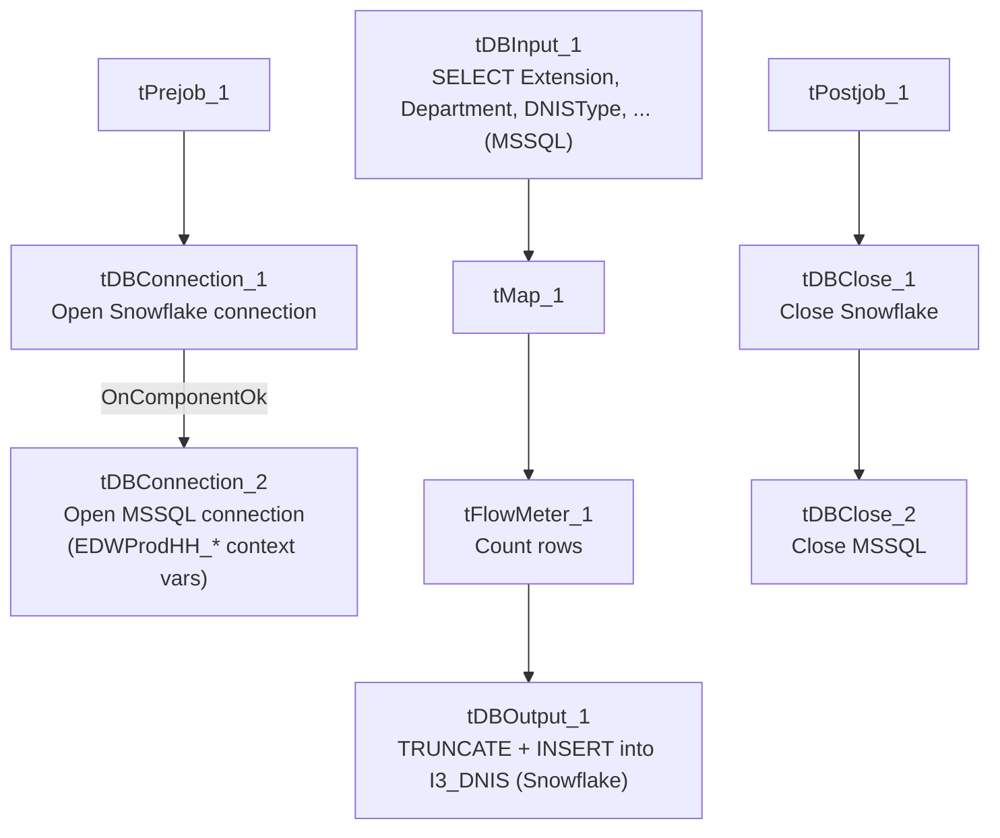

# Talend Job: DNIS_Load

## Overview

Loads DNIS (Dialed Number Identification Service) routing reference data — phone extension, department, DNIS type, area code, exchange, toll-free flag, and subgroup — from an MSSQL source (via the `EDWProdHH`-labeled connection) into the Snowflake `I3_DNIS` table, truncating and fully reloading the table on every run. This job has a near-identical sibling, `DNIS_Org_Load` (documented separately), which reads the same shape of source data but loads a different target table (`I3_DNIS_ORG`) using `UPSERT` instead of truncate-and-insert — see that job's doc for the specific differences.

## Detail table

| Field | Value |
|---|---|
| Job name | DNIS_Load |
| Version | 0.1 |
| Project | EDW2SF |
| Author | jmach@harriscollect.com |
| Created | 2022-01-25T13:27:37.100-0800 |
| Last Modified | 2025-09-24T11:00:00.211-0700 |

## Step-by-step data flow

**Setup subjob:** `tPrejob_1` → `tDBConnection_1` opens the Snowflake connection → on success, `tDBConnection_2` opens the MSSQL connection using `context.EDWProdHH_*` variables (password and Active Directory auth redacted).

**Main subjob:**

1. `tDBInput_1` runs a fixed `SELECT` (using the shared MSSQL connection) pulling `Extension`, `Department`, `DNISType`, `Areacode`, `Exchange`, `TollFree`, `SUBGROUP` — the `FROM` clause is truncated in this metadata.
2. `tMap_1` passes the 7 columns through unchanged (uppercased column names).
3. `tFlowMeter_1` counts rows passing through (labeled "MyLabel", not renamed for this job).
4. `tDBOutput_1` writes the rows into Snowflake table `I3_DNIS` with `outputAction=INSERT` and **`tableAction=TRUNCATE`** — the table is cleared and fully reloaded every run.

Separately, `tStatCatcher_1` and `tFlowMeterCatcher_1` (standard Talend internal statistics/flow-meter catchers) feed two `tLogRow` components that print job statistics to the log — these run automatically and aren't part of the business data path.

**Teardown subjob:** `tPostjob_1` → `tDBClose_1` (close Snowflake) → `tDBClose_2` (close MSSQL).

## Settings tables

### Source: `tDBInput_1` (`tMSSqlInput`)

| Setting | Value | What it means |
|---|---|---|
| Connection | Shared `tDBConnection_2` (EDWProdHH context vars) | Reuses the job's single MSSQL connection. |
| Query | `SELECT CAST([Extension] AS varchar(10)) AS Extension, [Department], [DNISType], CAST([Areacode] AS varchar(10)) AS Areacode, CAST([Exchange] AS varchar(10)) AS Exchange, [TollFree], [SUBGROUP] FROM [dbo]....` (truncated) | Table name is cut off in this metadata — unable to determine from metadata which specific source table this reads. |

### Target: `tDBOutput_1` (`tSnowflakeOutput`)

| Setting | Value | What it means |
|---|---|---|
| Table | `I3_DNIS` | Destination table for DNIS routing reference data. |
| Output action | `INSERT` | Appends rows after the table is cleared. |
| Table action | `TRUNCATE` | Table is fully cleared immediately before load — a true "truncate and reload" every run, unlike jobs that truncate a separate staging table and merge into a warehouse table. |

## Dependencies & configuration

- **Triggers/depends on other jobs:** none — no `tRunJob` links found.
- **Context variables used:** `EDWProdHH_Server`, `EDWProdHH_Port`, `EDWProdHH_Schema`, `EDWProdHH_Database`, `EDWProdHH_Login` (MSSQL connection).
- No hardcoded developer-workstation paths found in this job.

## Glossary

| Component type | Plain-English meaning |
|---|---|
| `tMSSqlConnection` / `tMSSqlInput` / `tMSSqlClose` | Open a Microsoft SQL Server connection, run a query against it, and close it. |
| `tSnowflakeConnection` / `tSnowflakeOutput` / `tSnowflakeClose` | Open a Snowflake connection, write rows to a table (with table-level truncate/create options), and close the connection. |
| `tMap` | Maps/transforms columns from one schema to another. |
| `tFlowMeter` | Counts rows passing a point in the flow for logging/monitoring. |
| `tStatCatcher` / `tFlowMeterCatcher` / `tLogRow` | Talend's built-in job-statistics and flow-meter capture components, which print execution stats to the log; not part of the business data flow. |

## Issues observed

- **The source query's `FROM` clause is truncated in this metadata**, so the exact source table (only `[dbo]....`) can't be confirmed — verify directly in Talend Studio if the specific MSSQL table name matters for an audit or migration.
- **This job truncates and fully reloads `I3_DNIS` on every run with no result-count logging, `tWarn`, or `tDie`** — a failed or partial load (e.g. a mid-run MSSQL error after truncate) could leave `I3_DNIS` empty or partially populated with no job-specific alert; only a generic Talend execution error would surface. No other issues distinct from the project-wide patterns in `05_operational_runbook.md` were found in this job's own metadata.
- **Sibling comparison:** `DNIS_Org_Load` reads the same shape of source columns but loads a different table (`I3_DNIS_ORG`) via `UPSERT` with no truncate step — see that job's own doc for the specific difference; whether the two jobs' source queries pull from the same or different underlying MSSQL tables/views is unable to determine from either job's (truncated) query text.
