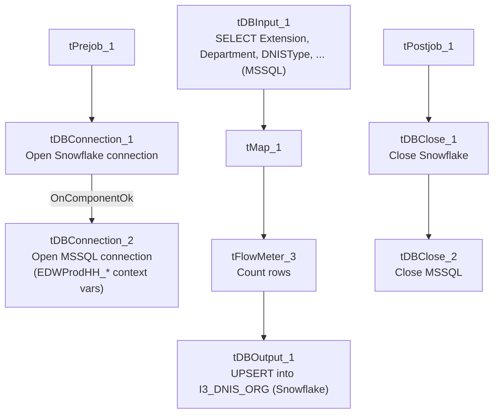

# Talend Job: DNIS_Org_Load

## Overview

Loads the same shape of DNIS (Dialed Number Identification Service) routing reference data as its sibling job `DNIS_Load` — extension, department, DNIS type, area code, exchange, toll-free flag, subgroup — from an MSSQL source (via the `EDWProdHH`-labeled connection) into Snowflake, but here the target is `I3_DNIS_ORG` and the write is an `UPSERT` rather than a truncate-and-reload. This job is otherwise structurally identical to `DNIS_Load` (documented separately) — same source column shape, same connection setup, same lack of business-specific error handling.

## Detail table

| Field | Value |
|---|---|
| Job name | DNIS_Org_Load |
| Version | 0.1 |
| Project | EDW2SF |
| Author | jmach@harriscollect.com |
| Created | 2022-01-25T14:04:20.428-0800 (about 37 minutes after `DNIS_Load`) |
| Last Modified | 2025-09-24T11:00:20.527-0700 |

## Step-by-step data flow

**Setup subjob:** `tPrejob_1` → `tDBConnection_1` opens the Snowflake connection → on success, `tDBConnection_2` opens the MSSQL connection using `context.EDWProdHH_*` variables (password and Active Directory auth redacted).

**Main subjob:**

1. `tDBInput_1` runs a fixed `SELECT` (using the shared MSSQL connection) pulling `Extension`, `Department`, `DNISType`, `Areacode`, `Exchange`, `TollFree`, `SUBGROUP` — the `FROM` clause is truncated in this metadata, and its visible text is byte-for-byte the same as `DNIS_Load`'s query up to the truncation point.
2. `tMap_1` passes the 7 columns through unchanged (uppercased column names).
3. `tFlowMeter_3` counts rows passing through (labeled "MyLabel", not renamed for this job).
4. `tDBOutput_1` **upserts** the rows into Snowflake table `I3_DNIS_ORG` (`UPSERT`, `tableAction=NONE`) — no truncate step, unlike `DNIS_Load`.

Separately, `tStatCatcher_1` and `tFlowMeterCatcher_1` feed two `tLogRow` components that print job statistics to the log — not part of the business data path.

**Teardown subjob:** `tPostjob_1` → `tDBClose_1` (close Snowflake) → `tDBClose_2` (close MSSQL).

## Settings tables

### Source: `tDBInput_1` (`tMSSqlInput`)

| Setting | Value | What it means |
|---|---|---|
| Connection | Shared `tDBConnection_2` (EDWProdHH context vars) | Reuses the job's single MSSQL connection. |
| Query | `SELECT CAST([Extension] AS varchar(10)) AS Extension, [Department], [DNISType], CAST([Areacode] AS varchar(10)) AS [Areacode], CAST([Exchange] AS varchar(10)) AS [Exchange], [TollFree], [SUBGROUP] FROM [d...` (truncated) | Visible text matches `DNIS_Load`'s query up to the truncation point (aside from minor bracket-quoting differences on the `AS` aliases); the actual source table/view name and any `WHERE` clause are not visible in either job's metadata. |

### Target: `tDBOutput_1` (`tSnowflakeOutput`)

| Setting | Value | What it means |
|---|---|---|
| Table | `I3_DNIS_ORG` | A different target table than `DNIS_Load`'s `I3_DNIS`. |
| Output action | `UPSERT` | Updates matching rows and inserts new ones — no separate truncate/staging step. |
| Table action | `NONE` | Table is not created/altered by this job. |

## Dependencies & configuration

- **Triggers/depends on other jobs:** none — no `tRunJob` links found.
- **Context variables used:** `EDWProdHH_Server`, `EDWProdHH_Port`, `EDWProdHH_Schema`, `EDWProdHH_Database`, `EDWProdHH_Login` (MSSQL connection).
- No hardcoded developer-workstation paths found in this job.

## Glossary

| Component type | Plain-English meaning |
|---|---|
| `tMSSqlConnection` / `tMSSqlInput` / `tMSSqlClose` | Open a Microsoft SQL Server connection, run a query against it, and close it. |
| `tSnowflakeConnection` / `tSnowflakeOutput` / `tSnowflakeClose` | Open a Snowflake connection, upsert rows into a table, and close the connection. |
| `tMap` | Maps/transforms columns from one schema to another. |
| `tFlowMeter` | Counts rows passing a point in the flow for logging/monitoring. |
| `tStatCatcher` / `tFlowMeterCatcher` / `tLogRow` | Talend's built-in job-statistics and flow-meter capture components, which print execution stats to the log; not part of the business data flow. |

## Issues observed

- **Sibling comparison with `DNIS_Load`:** the two jobs were built 37 minutes apart on the same day and share an identical source-query shape (same 7 columns, same visible query text up to truncation), but load different target tables with different strategies — `DNIS_Load` truncates and fully reloads `I3_DNIS`, while this job upserts into `I3_DNIS_ORG` with no truncate. Whether `I3_DNIS` and `I3_DNIS_ORG` are meant to hold the same data at different grains (e.g. one row per extension vs. one row per organizational unit), or whether this job is a variant built for a different consumer, is unable to determine from metadata — the "_Org" suffix suggests an organizational/department-level view of the same DNIS data, but that is inferred from naming, not confirmed by the (truncated) query text.
- **The source query's `FROM` clause is truncated in this metadata**, so it can't be confirmed whether this job reads the exact same source table as `DNIS_Load` or a different one — verify directly in Talend Studio.
- **No result-count logging, `tWarn`, or `tDie`** — a failed or partial upsert would only surface as a generic Talend execution error. No other issues distinct from the project-wide patterns in `05_operational_runbook.md` were found in this job's own metadata.
