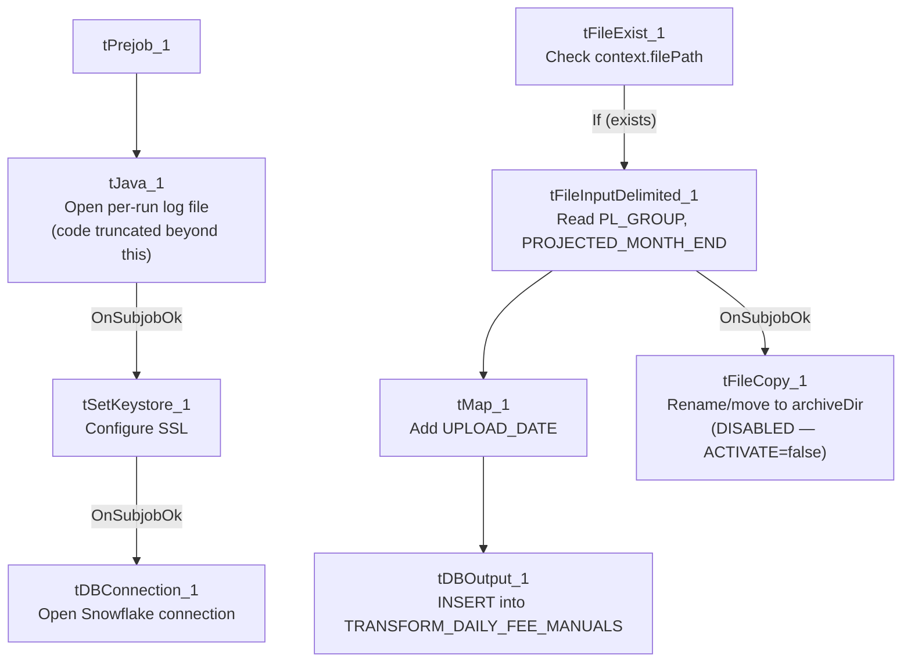

# Talend Job: Daily_Fee_Projection_Load

## Overview

Loads a manually-prepared fee-projection CSV (grouping code and projected month-end value, per `PL_GROUP`) into the Snowflake `TRANSFORM_DAILY_FEE_MANUALS` table, stamping each row with an `UPLOAD_DATE`. The job only proceeds if the expected input file is present (`tFileExist_1` gates the read), and is wired to archive/rename the source file afterward — though that archive step is configured but **disabled** in this job, so the file is not actually moved (see Issues observed).

## Detail table

| Field | Value |
|---|---|
| Job name | Daily_Fee_Projection_Load |
| Version | 0.1 |
| Project | EDW2SF |
| Author | jmach@harriscollect.com |
| Created | 2026-01-12T14:40:17.733-0800 |
| Last Modified | 2026-01-30T09:40:45.878-0800 |

## Step-by-step data flow

**Setup subjob:** `tPrejob_1` → `tJava_1` opens a per-run log file at `context.logDir + jobName + "_" + <timestamp> + ".log"` (the captured code is truncated after that point — see Issues observed for what else it may do) → on success, `tSetKeystore_1` configures SSL trust/keystore from `context.keystorePath` (all passwords redacted) → on success, `tDBConnection_1` opens the Snowflake connection. **No `tPostjob`/`tDBClose` component exists in this job** — see Issues observed.

**Main subjob:**

1. `tFileExist_1` checks whether `context.filePath` exists.
2. **If it does** (`RUN_IF`), `tFileInputDelimited_1` reads it (comma-delimited, header row present, `DIE_ON_ERROR=false`) with columns `PL_GROUP`, `PROJECTED_MONTH_END`.
3. `tMap_1` adds an `UPLOAD_DATE` column, producing a 3-column output.
4. `tDBOutput_1` inserts the rows into Snowflake table `TRANSFORM_DAILY_FEE_MANUALS` (`INSERT`, `tableAction=NONE`).
5. On `tFileInputDelimited_1`'s subjob success, `tFileCopy_1` is wired to copy/rename the source file to `context.archiveDir + "manual-fees-" + <CCYYMMDD> + ".csv"` and remove the original (`REMOVE_FILE=true`) — **but `ACTIVATE=false` on this component means it does not actually run**; see Issues observed.

If `tFileExist_1` finds no file, the job simply does nothing further — no warning or error is raised for a missing input file.

## Settings tables

### Source: `tFileInputDelimited_1`

| Setting | Value | What it means |
|---|---|---|
| FILENAME | `context.filePath` | A single expected file path, not a directory iteration — this job processes one specific file per run. |
| FIELDSEPARATOR / HEADER | `,` / 1 header row | Comma-delimited with header. |
| DIE_ON_ERROR | `false` | Malformed rows don't fail the job; no reject flow is wired either (rejected rows are silently dropped). |

### Target: `tDBOutput_1` (`tSnowflakeOutput`)

| Setting | Value | What it means |
|---|---|---|
| Table | `TRANSFORM_DAILY_FEE_MANUALS` | Destination table for the fee-projection rows. |
| Output action | `INSERT` | Appends rows; no truncate step in this job. |
| Table action | `NONE` | Table is not created/altered by this job. |

### Archive step (disabled): `tFileCopy_1`

| Setting | Value | What it means |
|---|---|---|
| ACTIVATE | `false` | **This component is disabled** — despite being wired into the flow, it does not execute at runtime. |
| FILENAME | `context.filePath` | The file that would be moved, if enabled. |
| DESTINATION / DESTINATION_RENAME | `context.archiveDir` / `"manual-fees-" + <CCYYMMDD> + ".csv"` | Intended target name for the archived file. |
| REMOVE_FILE | `true` | Intended to delete the original after copying (i.e., a move, not a copy) — moot while disabled. |
| FAILON | `false` | Even if enabled, a failure here would not fail the job. |

## Dependencies & configuration

- **Triggers/depends on other jobs:** none — no `tRunJob` links found.
- **Context variables used:** `logDir`, `keystorePath`, `filePath`, `archiveDir`, `sourceDir` (referenced per the extracted context list, though not visibly used in any captured parameter — likely used in the truncated portion of `tJava_1`'s code).
- **3 hardcoded paths**: `tSetKeystore_1.SSL_TRUSTSERVER_TRUSTSTORE` (`C:/clientTrustStore.trustStore`), `tFileInputDelimited_1.TEMP_DIR`, and `tFileCopy_1.SOURCE_DERECTORY` (both `C:/Talend-Studio-20211109_1610-V8.0.1/workspace`) — same portability risk documented project-wide in `05_operational_runbook.md`.

## Glossary

| Component type | Plain-English meaning |
|---|---|
| `tFileExist` | Checks whether a specific file exists on disk before proceeding. |
| `tFileInputDelimited` | Reads a delimited (CSV-style) text file according to a schema. |
| `tMap` | Maps/transforms columns from one schema to another. |
| `tSnowflakeOutput` | Writes rows to a Snowflake table. |
| `tFileCopy` | Copies (and optionally renames/moves) a file to a destination directory. |
| `tSetKeystore` | Configures SSL trust/keystore settings used by the subsequent Snowflake connection. |

## Issues observed

- **The file-archive step (`tFileCopy_1`) is wired into the job but disabled (`ACTIVATE=false`).** The design clearly intends to rename the processed file to `manual-fees-<date>.csv` and remove it from the source location after a successful load, but as configured this never happens — the source file is left in place after every run. If this job is re-run (or the scheduler doesn't clear the source file), the same manually-dropped fee file could be re-loaded and re-inserted on a subsequent run, since there's no truncate/dedup step on the target table either. Verify with the team whether disabling this step was intentional (e.g., archival handled by a separate manual process) or an oversight.
- **`tJava_1`'s captured code is truncated after the log-file-opening logic** (ending in `"Path s..."`), so this job's setup step may do more than just open a log file — unable to determine the rest of its logic from this metadata; verify directly in Talend Studio, especially since `context.sourceDir` is referenced in the job's context-variable list but not visibly used elsewhere.
- **No `tPostjob`/`tDBClose` component exists in this job** — the Snowflake connection opened by `tDBConnection_1` is never explicitly closed within the job itself, consistent with a pattern already seen in other jobs in this batch (e.g. `Debtor_Deleted_Load`).
- **No target-table truncate/dedup logic and no `tDie`/`tWarn`** — combined with the disabled archive step above, there is a real risk of the same fee-projection file being loaded more than once with no automated safeguard against it.
