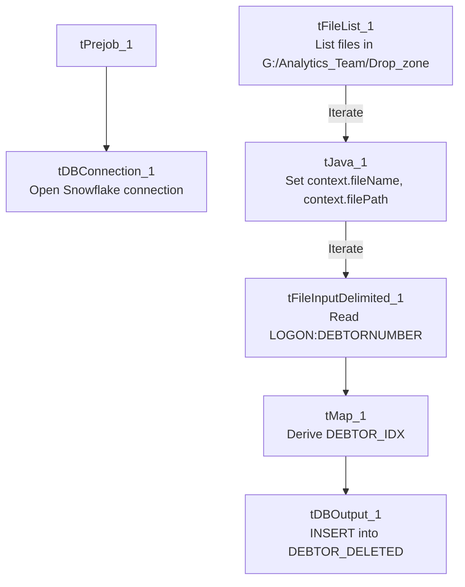

# Talend Job: Debtor_Deleted_Load

## Overview

Loads a feed of deleted-debtor records (logon and debtor number, colon-delimited) from a shared network drop-zone folder into the Snowflake `DEBTOR_DELETED` table, iterating over every file found and deriving a `DEBTOR_IDX` for each row. Unlike most other jobs in this project, its source directory is a hand-managed network share (`G:/Analytics_Team/Drop_zone`) rather than a `context.sourceDir`-style operational path, suggesting this feed is manually dropped by an analyst rather than produced by an automated upstream extract.

## Detail table

| Field | Value |
|---|---|
| Job name | Debtor_Deleted_Load |
| Version | 0.1 |
| Project | EDW2SF |
| Author | jmach@harriscollect.com |
| Created | 2023-11-27T14:04:54.006-0800 |
| Last Modified | 2025-09-24T11:00:39.227-0700 |

## Step-by-step data flow

**Setup subjob:** `tPrejob_1` → `tDBConnection_1` opens the Snowflake connection. **No `tPostjob`/`tDBClose` component exists in this job** — see Issues observed.

**Main subjob:**

1. `tFileList_1` lists files in `"G:/Analytics_Team/Drop_zone"`.
2. For each file, `tJava_1` sets `context.fileName` and `context.filePath` from the current file.
3. `tFileInputDelimited_1` reads it (**colon-delimited**, header row present, `DIE_ON_ERROR=false`) with columns `LOGON`, `DEBTORNUMBER`.
4. `tMap_1` derives a `DEBTOR_IDX` column, producing a 3-column output.
5. `tDBOutput_1` inserts the rows into Snowflake table `DEBTOR_DELETED` (`INSERT`, `tableAction=CREATE_IF_NOT_EXISTS`).

## Settings tables

### Source: `tFileList_1` / `tFileInputDelimited_1`

| Setting | Value | What it means |
|---|---|---|
| DIRECTORY | `"G:/Analytics_Team/Drop_zone"` | A hardcoded network-share path, styled as a manually-managed analyst drop folder rather than an automated `context.sourceDir`-driven extract location. |
| FIELDSEPARATOR / HEADER | `:` (colon) / 1 header row | Unusual delimiter choice — colon rather than comma or tab. |
| DIE_ON_ERROR | `false` | Malformed rows don't fail the job; no reject flow is wired (rejected rows are silently dropped). |

### Target: `tDBOutput_1` (`tSnowflakeOutput`)

| Setting | Value | What it means |
|---|---|---|
| Table | `DEBTOR_DELETED` | Destination table for deleted-debtor records. |
| Output action | `INSERT` | Appends rows; no truncate step in this job, so re-processing the same file(s) would duplicate rows. |
| Table action | `CREATE_IF_NOT_EXISTS` | Creates the table on first run if it doesn't already exist. |

## Dependencies & configuration

- **Triggers/depends on other jobs:** none — no `tRunJob` links found.
- **Context variables used:** `fileName`, `filePath` (both set internally by `tJava_1`).
- **1 hardcoded developer-workstation path**: `tFileInputDelimited_1.TEMP_DIR` (`C:/Talend-Studio-20211109_1610-V8.0.1/workspace`) — same portability risk documented project-wide in `05_operational_runbook.md`. The source directory itself (`G:/Analytics_Team/Drop_zone`) is also a hardcoded literal, though on a mapped network drive rather than the local workspace path pattern the extraction specifically flags.

## Glossary

| Component type | Plain-English meaning |
|---|---|
| `tFileList` | Lists files in a directory for the job to iterate over one at a time. |
| `tFileInputDelimited` | Reads a delimited text file (colon-separated, in this job) according to a schema. |
| `tMap` | Maps/transforms columns from one schema to another. |
| `tSnowflakeOutput` | Writes rows to a Snowflake table. |

## Issues observed

- **This job has no `tPostjob`/`tDBClose` component** — the Snowflake connection opened by `tDBConnection_1` is never explicitly closed within the job itself, the same pattern already seen in `Daily_Fee_Projection_Load` and the two 2023 one-off jobs in this batch.
- **No truncate, dedup, or file-archive/move step exists after a successful load.** `tFileList_1` iterates every file currently in the drop-zone directory on every run with no mechanism shown to prevent re-processing a file already loaded on a prior run — if a file isn't manually removed from `G:/Analytics_Team/Drop_zone` after being picked up, it would be re-read and its rows re-inserted (duplicated) on the next run. Verify with the team whether file cleanup happens through some out-of-band process not visible in this metadata.
- **The source directory is a hand-managed network share (`G:/Analytics_Team/Drop_zone`)**, not a `context.sourceDir`-style operational path used elsewhere in this project — this strongly suggests the deleted-debtor feed is a manually curated file drop by an analyst team rather than an automated upstream system extract, which is worth confirming operationally (who is responsible for dropping the file, and on what cadence).
- **The colon (`:`) field separator is unusual** compared to the comma/tab delimiters used by most other file-based jobs in this project — not itself a problem, but worth knowing if anyone needs to hand-edit or validate a source file for this job.
