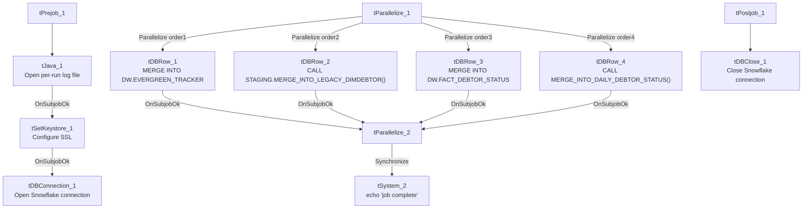

# Talend Job: Debtor_Derived_Load

## Overview

This is a pure SQL-orchestration job with no file or table inputs of its own: it runs four independent Snowflake merge/stored-procedure operations in parallel against data already staged by other jobs, deriving downstream tracking and fact tables — an "Evergreen desk" transfer tracker, a legacy debtor-dimension merge, a debtor-status fact table, and a daily debtor-status rollup. It then logs a simple completion message once all four finish. This job is a useful source of concrete site-code mappings (see Settings tables) not otherwise spelled out in the project's shared documentation.

## Detail table

| Field | Value |
|---|---|
| Job name | Debtor_Derived_Load |
| Version | 0.1 |
| Project | EDW2SF |
| Author | jmach@harriscollect.com |
| Created | 2022-12-01T10:01:32.480-0800 |
| Last Modified | 2025-11-19T07:48:17.214-0800 |

## Step-by-step data flow

**Setup subjob:** `tPrejob_1` → `tJava_1` opens a per-run log file at `context.logDir + jobName + "_" + <timestamp> + ".log"` → on success, `tSetKeystore_1` configures SSL trust/keystore from `context.keystorePath` (all passwords redacted) → on success, `tDBConnection_1` opens the Snowflake connection.

**Main subjob** — `tParallelize_1` starts four independent Snowflake operations concurrently, with no data or dependency links between them:

1. `tDBRow_1` merges `STAGING.LEGACY_DIMDEBTOR` rows tagged with the "Evergreen" desk (`DESK='EVG'`, `OLD_DSK_NAME='EVG'`, or a client code ending in `'EV'`) into `DW.EVERGREEN_TRACKER`, inserting new (never-seen) `DEBTOR_IDX` values only — no update branch.
2. `tDBRow_2` calls the stored procedure `STAGING.MERGE_INTO_LEGACY_DIMDEBTOR()`.
3. `tDBRow_3` merges `STAGING.DEBTOR_STATUS_CURRENT` into `DW.FACT_DEBTOR_STATUS`, deriving a numeric `DIMLOGON` from the site-code prefix of `DEBTOR_IDX` via a hardcoded `CASE` mapping (see Settings tables), inserting a new fact row only when the exact combination of `DEBTOR_IDX`/`CLIENT`/`STATUS`/`STATUS_DATE` isn't already present (an append-only status-history pattern).
4. `tDBRow_4` calls the stored procedure `MERGE_INTO_DAILY_DEBTOR_STATUS()`.

None of the four capture or log their result codes (see Issues observed). Once all four report `OnSubjobOk`, `tParallelize_2` synchronizes and triggers `tSystem_2`, which runs a shell command (`echo 'job <jobName> complete.'`) purely for log output.

## Settings tables

### Evergreen tracker: `tDBRow_1`

| Setting | Value | What it means |
|---|---|---|
| Query | `MERGE INTO DW.EVERGREEN_TRACKER TGT USING (SELECT DEBTOR_IDX, CLIENT, DESK AS CURR_DESK, OLD_DSK_NAME AS PREV_DESK, OLD_DSK_DT AS DESK_CHANGE_DT FROM STAGING.LEGACY_DIMDEBTOR WHERE (DESK='EVG' OR OLD_DSK_NAME='EVG' OR RIGHT(TRIM(CLIENT),2)='EV') AND LENGTH(TRIM(DEBTOR_IDX))>10 AND COALESCE(CHARINDEX('-',DEBTOR_IDX),0) > 0) SRC ON TGT.DEBTOR_IDX = SRC.DEBTOR_IDX WHEN NOT MATCHED THEN INSERT (...)` | Tracks debtors ever assigned to (or transferred from) an "Evergreen" desk/client, inserting each `DEBTOR_IDX` only once (no update on re-match), splitting `LOGON`/`DEBTOR` out of the `DEBTOR_IDX` composite key via string functions. |

### Legacy dimension merge: `tDBRow_2`

| Setting | Value | What it means |
|---|---|---|
| Query | `CALL STAGING.MERGE_INTO_LEGACY_DIMDEBTOR();` | Calls a stored procedure (not shown in this metadata) that presumably merges newly staged legacy debtor-dimension rows. |

### Debtor-status fact merge: `tDBRow_3`

| Setting | Value | What it means |
|---|---|---|
| Query | `MERGE INTO DW.FACT_DEBTOR_STATUS AS TGT USING (SELECT ..., CASE LEFT(DEBTOR_IDX,CHARINDEX('-',DEBTOR_IDX)-1) WHEN 'CHI' THEN 400 WHEN 'CO' THEN 200 WHEN 'DC' THEN 600 WHEN 'HH' THEN 100 WHEN 'PRE' THEN 300 WHEN 'TOL' THEN 700 ELSE 0 END AS DIMLOGON, ... FROM STAGING.DEBTOR_STATUS_CURRENT) AS SRC ON (DEBTOR_IDX, CLIENT, STATUS, STATUS_DATE match) WHEN NOT MATCHED THEN INSERT (...)` | Appends a new fact row only for combinations of `DEBTOR_IDX`/`CLIENT`/`STATUS`/`STATUS_DATE` not already present — an append-only status-history table, not an upsert. **This query's hardcoded `CASE` statement is a concrete site-code-to-`DIMLOGON` mapping**: `CHI=400`, `CO=200`, `DC=600`, `HH=100`, `PRE=300`, `TOL=700` (else `0`) — useful ground truth for the site-code glossary entry in `01_system_architecture.md`, which does not otherwise define the numeric codes. |

### Daily status rollup: `tDBRow_4`

| Setting | Value | What it means |
|---|---|---|
| Query | `CALL MERGE_INTO_DAILY_DEBTOR_STATUS();` | Calls a stored procedure (not shown in this metadata; note the **absence of a schema prefix**, unlike the other three operations which reference `DW.`/`STAGING.` explicitly). |

## Dependencies & configuration

- **Triggers/depends on other jobs:** none — no `tRunJob` links found. This job reads from `STAGING.LEGACY_DIMDEBTOR` and `STAGING.DEBTOR_STATUS_CURRENT`, which are presumably populated by other jobs not identified in this job's own metadata (likely staging jobs for `Debtor_Status_Load`/`Debtor_Status_Load_MSSQL` or similar) — verify the actual producer job(s) with the team.
- **Context variables used:** `keystorePath`, `logDir`.
- **2 hardcoded paths**: `tSetKeystore_1.SSL_TRUSTSERVER_TRUSTSTORE` (`C:/clientTrustStore.trustStore`) and `tSystem_2.DIRECTORY` (`C:/Talend-Studio-20211109_1610-V8.0.1/workspace`) — same portability risk documented project-wide in `05_operational_runbook.md`.

## Glossary

| Component type | Plain-English meaning |
|---|---|
| `tSnowflakeRow` | Runs an arbitrary SQL statement or stored-procedure call against Snowflake. |
| `tParallelize` | Runs its downstream branches at the same time rather than one after another; a second `tParallelize` here is used purely to synchronize/wait for all four branches before proceeding. |
| `tSystem` | Runs an OS-level shell command — here, just an `echo` statement for a completion log line. |
| `tSetKeystore` | Configures SSL trust/keystore settings used by the subsequent Snowflake connection. |

## Issues observed

- **None of the four SQL operations capture or log their result/error status.** `tDBRow_2` and `tDBRow_4`'s stored procedures return result columns (`RESULT`, `DDSRESULT`), but no `tJavaRow` or similar component captures them into a context variable, and none of the four branches has a `tWarn`/`tDie` reacting to success or failure — unlike this project's other merge-heavy jobs (`ADP_Payroll_Load`, `CO_Master_Load`), a failure in any of these four operations would only surface as a generic Talend execution error, with no job-specific diagnostic.
- **The four merge/procedure calls run fully in parallel with no visible dependency ordering**, even though they read from what appear to be related staging tables (`STAGING.LEGACY_DIMDEBTOR`, `STAGING.DEBTOR_STATUS_CURRENT`). Unable to determine from this metadata whether that's safe (e.g., each reads a fully-independent staging table with no cross-dependency) or whether there's an implicit ordering requirement not enforced by the job itself — verify with the team, particularly whether `tDBRow_2`'s `MERGE_INTO_LEGACY_DIMDEBTOR()` needs to complete before `tDBRow_1`'s read of `STAGING.LEGACY_DIMDEBTOR`.
- **`tDBRow_4`'s procedure call has no schema prefix** (`MERGE_INTO_DAILY_DEBTOR_STATUS()`), unlike the other three operations, which explicitly reference `DW.` or `STAGING.` — this relies on the Snowflake session's default schema being correct at call time; worth confirming that's reliable across environments.
- **The `tSystem_2` completion step is a plain `echo` shell command with no actual operational effect** (no email, no semaphore file, no external signal) — it only writes to the job's own console/log output, so it provides no externally visible completion signal for downstream monitoring.
