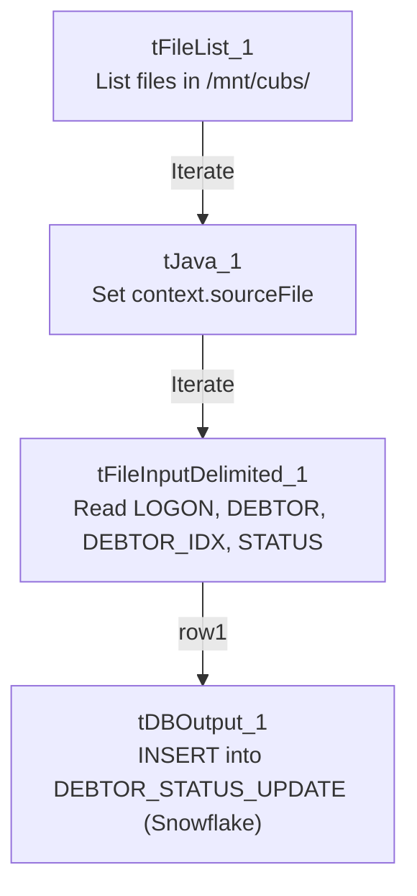

# Talend Job: Debtor_Status_Load

## Overview

Loads debtor status-change records (logon, debtor number, `DEBTOR_IDX`, status) from tab-delimited files found in a shared source directory into the Snowflake `DEBTOR_STATUS_UPDATE` table. This job has a near-identical sibling, `Debtor_Status_Load_MSSQL` (documented separately), which reads the exact same source files and schema but writes to an MSSQL table of the same name instead of Snowflake — the two appear to be parallel loaders feeding the same logical data to two different downstream systems.

## Detail table

| Field | Value |
|---|---|
| Job name | Debtor_Status_Load |
| Version | 0.1 |
| Project | EDW2SF |
| Author | jmach@harriscollect.com |
| Created | 2023-05-22T12:47:40.005-0700 |
| Last Modified | 2025-09-24T11:08:10.516-0700 |

## Step-by-step data flow

This job has no `tPrejob`/`tPostjob` or explicit database connection component in its own metadata — see Issues observed.

1. `tFileList_1` lists files in the hardcoded directory `/mnt/cubs/`.
2. For each file, `tJava_1` sets `context.sourceFile` to the current file path.
3. `tFileInputDelimited_1` reads it (tab-delimited, header row present, `DIE_ON_ERROR=false`) using a repository schema labeled "debtor_status", with columns `LOGON`, `DEBTOR`, `DEBTOR_IDX`, `STATUS`.
4. `tDBOutput_1` inserts the rows into Snowflake table `DEBTOR_STATUS_UPDATE` (`INSERT`, `tableAction=CREATE_IF_NOT_EXISTS`).

## Settings tables

### Source: `tFileList_1` / `tFileInputDelimited_1`

| Setting | Value | What it means |
|---|---|---|
| DIRECTORY | `"/mnt/cubs/"` | Hardcoded literal path (not a `context.*` variable). |
| SCHEMA | Repository schema "debtor_status" | Standardized 4-column layout shared with the MSSQL sibling job. |
| FIELDSEPARATOR / HEADER | `\t` / 1 header row | Tab-delimited with header. |
| DIE_ON_ERROR | `false` | Malformed rows don't fail the job; no reject flow is wired (rejected rows silently dropped). |

### Target: `tDBOutput_1` (`tSnowflakeOutput`)

| Setting | Value | What it means |
|---|---|---|
| Table | `DEBTOR_STATUS_UPDATE` | Destination table in Snowflake. |
| Output action | `INSERT` | Appends rows; no truncate step. |
| Table action | `CREATE_IF_NOT_EXISTS` | Creates the table on first run if it doesn't already exist. |

## Dependencies & configuration

- **Triggers/depends on other jobs:** none — no `tRunJob` links found. Likely feeds `Debtor_Derived_Load`'s `STAGING.DEBTOR_STATUS_CURRENT`-driven merge into `DW.FACT_DEBTOR_STATUS`, though that relationship is not expressed via `tRunJob` in either job's metadata — verify with the team.
- **Context variables used:** `sourceFile` (set internally by `tJava_1`).
- **1 hardcoded developer-workstation path**: `tFileInputDelimited_1.TEMP_DIR` (`C:/Talend-Studio-20211109_1610-V8.0.1/workspace`) — same portability risk documented project-wide in `05_operational_runbook.md`. The source directory `/mnt/cubs/` is also a hardcoded literal, not a `context.*` variable.

## Glossary

| Component type | Plain-English meaning |
|---|---|
| `tFileList` | Lists files in a directory for the job to iterate over one at a time. |
| `tFileInputDelimited` | Reads a delimited (tab-separated) text file according to a schema. |
| `tSnowflakeOutput` | Writes rows to a Snowflake table. |

## Issues observed

- **This job has no `tPrejob`/`tPostjob`, and no `tDBConnection`/`tDBClose` component anywhere in its metadata** — the same pattern already seen in several other jobs in this batch (`DEBTOR_UPDATES_20230807`, `Debtor_Deleted_Load`). How `tDBOutput_1` actually connects to Snowflake is unable to determine from this metadata; verify directly in Talend Studio.
- **No truncate or dedup logic** — re-processing a file already loaded (if not removed from `/mnt/cubs/` between runs) would insert duplicate status records with no automated safeguard.
- **Sibling comparison with `Debtor_Status_Load_MSSQL`:** both jobs were built the same day (about 1h40m apart), read the identical source directory and schema, but this job targets Snowflake while the sibling targets MSSQL (`EDWProdHH`-labeled connection) — see that job's doc for the specific configuration differences (notably, batch/commit sizing and `DIE_ON_ERROR` settings that exist on the MSSQL output but have no equivalent visible on this job's Snowflake output).
