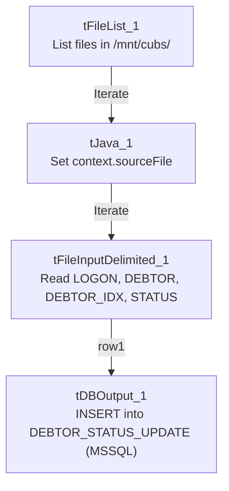

# Talend Job: Debtor_Status_Load_MSSQL

## Overview

Loads the same debtor status-change records (logon, debtor number, `DEBTOR_IDX`, status) from the same tab-delimited source files as its sibling job `Debtor_Status_Load`, but writes them into an MSSQL table (`DEBTOR_STATUS_UPDATE`, via the `EDWProdHH`-labeled connection) instead of Snowflake. Built about 1 hour 40 minutes after the Snowflake version on the same day, this is very likely a parallel loader feeding the same status data to a second consuming system (an operational MSSQL database) alongside the warehouse.

## Detail table

| Field | Value |
|---|---|
| Job name | Debtor_Status_Load_MSSQL |
| Version | 0.1 |
| Project | EDW2SF |
| Author | jmach@harriscollect.com |
| Created | 2023-05-22T14:26:03.203-0700 |
| Last Modified | 2025-08-28T08:57:21.076-0700 |

## Step-by-step data flow

This job has no `tPrejob`/`tPostjob` or explicit database connection component in its own metadata — see Issues observed.

1. `tFileList_1` lists files in the hardcoded directory `/mnt/cubs/` (identical to `Debtor_Status_Load`).
2. For each file, `tJava_1` sets `context.sourceFile` to the current file path.
3. `tFileInputDelimited_1` reads it (tab-delimited, header row present, `DIE_ON_ERROR=false`) with columns `LOGON`, `DEBTOR`, `DEBTOR_IDX`, `STATUS` — same shape as the sibling job, though this component has no repository-schema reference captured (inline schema instead).
4. `tDBOutput_1` (`tMSSqlOutput`) inserts the rows into MSSQL table `DEBTOR_STATUS_UPDATE` using `context.EDWProdHH_*` connection variables (`INSERT`, `TABLE_ACTION=NONE`, `DIE_ON_ERROR=false`, batched in groups of 10,000).

## Settings tables

### Source: `tFileList_1` / `tFileInputDelimited_1`

| Setting | Value | What it means |
|---|---|---|
| DIRECTORY | `"/mnt/cubs/"` | Identical source directory to `Debtor_Status_Load`. |
| FIELDSEPARATOR / HEADER | `\t` / 1 header row | Tab-delimited with header — same layout as the sibling job. |
| DIE_ON_ERROR | `false` | Malformed rows don't fail the job; no reject flow is wired. |

### Target: `tDBOutput_1` (`tMSSqlOutput`)

| Setting | Value | What it means |
|---|---|---|
| Connection | `context.EDWProdHH_Server`/`Port`/`Schema`/`Database`/`Login` (password redacted) | A dedicated (not shared) MSSQL connection opened inline on this component (`USE_EXISTING_CONNECTION=false`), rather than a separate `tDBConnection` in the job. |
| Table | `DEBTOR_STATUS_UPDATE` | Same table name as the Snowflake sibling's target, but a different physical database/system. |
| Data action / Table action | `INSERT` / `NONE` | Appends rows; table must already exist (no create-if-not-exists here, unlike the Snowflake sibling). |
| DIE_ON_ERROR | `false` | A row-level or connection error does not fail the job outright. |
| COMMIT_EVERY / BATCH_SIZE | `10000` / `10000` | Batches inserts in groups of 10,000 rows for performance — a setting with no equivalent visible on the Snowflake sibling's output component. |

## Dependencies & configuration

- **Triggers/depends on other jobs:** none — no `tRunJob` links found.
- **Context variables used:** `EDWProdHH_Server`, `EDWProdHH_Port`, `EDWProdHH_Schema`, `EDWProdHH_Database`, `EDWProdHH_Login` (MSSQL connection), `sourceFile` (set internally by `tJava_1`).
- **1 hardcoded developer-workstation path**: `tFileInputDelimited_1.TEMP_DIR` (`C:/Talend-Studio-20211109_1610-V8.0.1/workspace`) — same portability risk documented project-wide in `05_operational_runbook.md`. The source directory `/mnt/cubs/` is also a hardcoded literal.

## Glossary

| Component type | Plain-English meaning |
|---|---|
| `tFileList` | Lists files in a directory for the job to iterate over one at a time. |
| `tFileInputDelimited` | Reads a delimited (tab-separated) text file according to a schema. |
| `tMSSqlOutput` | Writes rows to a Microsoft SQL Server table, using its own inline connection settings. |

## Issues observed

- **This job has no `tPrejob`/`tPostjob`, and no `tDBConnection`/`tDBClose` component anywhere in its metadata** — the connection is instead opened inline on `tDBOutput_1` itself (`USE_EXISTING_CONNECTION=false`). This means the MSSQL connection is opened and (implicitly) closed around this single component rather than managed at the job level — a less consistent pattern than most other MSSQL-writing jobs in this project.
- **No truncate or dedup logic**, and `TABLE_ACTION=NONE` (the table must already exist) — re-processing a file already loaded would insert duplicate status records into the MSSQL table with no automated safeguard, same risk as the Snowflake sibling.
- **Sibling comparison with `Debtor_Status_Load`:** both jobs read the exact same source directory and (visually) the same 4-column schema, but this job's `tFileInputDelimited_1` has no repository-schema reference captured (the Snowflake sibling explicitly uses a repository schema labeled "debtor_status"), and this job's target uses `TABLE_ACTION=NONE` rather than `CREATE_IF_NOT_EXISTS`. Whether these two jobs are both scheduled to run against the same source files (each independently consuming/leaving the files, potentially causing a race if one deletes what the other expects to read) is unable to determine from either job's metadata — verify the scheduling relationship and file-handling behavior with the team, since neither job shows a file-archive/delete step after reading.
