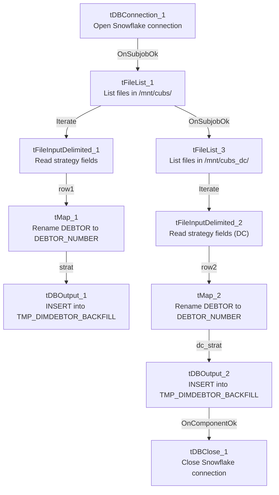

# Talend Job: Debtor_Strat_Backfill

## Overview

Loads historical debtor collection-strategy records (strategy test numbers, first/second actions, strategy events, "side-strategy" scheduling fields) from tab-delimited files found in two separate source directories — a general drop location and a DC-specific one — into a shared Snowflake staging table, `TMP_DIMDEBTOR_BACKFILL`. The `TMP_` prefix and lack of any downstream merge step in this job's own metadata indicate this is a backfill/staging job whose output is presumably consumed by a separate merge process not shown here.

## Detail table

| Field | Value |
|---|---|
| Job name | Debtor_Strat_Backfill |
| Version | 0.1 |
| Project | EDW2SF |
| Author | jmach@harriscollect.com |
| Created | 2023-01-18T10:25:14.366-0800 |
| Last Modified | 2025-09-24T11:06:32.580-0700 |

## Step-by-step data flow

This job has no `tPrejob`/`tPostjob` component, but does include an explicit Snowflake connection open/close pair — see Issues observed for the mix of patterns.

1. `tDBConnection_1` opens the Snowflake connection; on success, `tFileList_1` lists files in `/mnt/cubs/`.
2. For each file, `tFileInputDelimited_1` reads it (tab-delimited, header row present, repository schema labeled "metadata") with 14 business columns (`LOGON`, `DEBTOR`, `DEBTOR_IDX`, `STRAT_TEST_NUMBER`, `STRAT_1ST_ACTION`, `STRAT_EVENT`, `STRAT_2ND_ACTION`, `STRAT_NEXT_STRAT_DATE`, `STRAT_NEXT_STRAT_TEST`, `SIDESTRAT_DATE`, `SIDESTRAT_START_TIME`, `SIDESTRAT_NAME`, `SIDESTRAT_TEST_NUMBER`, `SIDESTRAT_ACTION`).
3. `tMap_1` renames `DEBTOR` to `DEBTOR_NUMBER` and passes the rest through unchanged.
4. `tDBOutput_1` inserts the rows into Snowflake table `TMP_DIMDEBTOR_BACKFILL` (`INSERT`, `tableAction=NONE`).
5. On `tFileList_1`'s subjob success, `tFileList_3` lists files in a **second, DC-specific directory**, `/mnt/cubs_dc/`.
6. For each file found there, `tFileInputDelimited_2` reads it with the identical schema, `tMap_2` performs the same rename, and `tDBOutput_2` inserts into the **same target table**, `TMP_DIMDEBTOR_BACKFILL`.
7. Once `tDBOutput_2` completes, `tDBClose_1` closes the Snowflake connection.

## Settings tables

### Sources: `tFileList_1`/`tFileInputDelimited_1` and `tFileList_3`/`tFileInputDelimited_2`

| Setting | Value | What it means |
|---|---|---|
| DIRECTORY | `"/mnt/cubs/"` and `"/mnt/cubs_dc/"` | Two hardcoded literal directories — a general source and a DC-site-specific one — both feeding the same target table. |
| SCHEMA | Repository schema "metadata" (both) | A generically-named schema label for a strategy-specific column set — see Issues observed. |
| FIELDSEPARATOR / HEADER | `\t` / 1 header row | Tab-delimited with header, identical between both sources. |
| DIE_ON_ERROR | `false` (both) | Malformed rows don't fail the job; no reject flow is wired on either input. |

### Target: `tDBOutput_1` / `tDBOutput_2` (`tSnowflakeOutput`)

| Setting | Value | What it means |
|---|---|---|
| Table | `TMP_DIMDEBTOR_BACKFILL` (both) | Both source directories load into the same staging table — its `TMP_` prefix indicates this is intermediate/scratch data for a further merge step not present in this job. |
| Output action | `INSERT` (both) | Appends rows; no truncate step in this job. |
| Table action | `NONE` (both) | Table is not created/altered by this job — it must already exist. |

## Dependencies & configuration

- **Triggers/depends on other jobs:** none — no `tRunJob` links found. Whatever job merges `TMP_DIMDEBTOR_BACKFILL` into a permanent warehouse table is not identified in this job's own metadata — verify with the team.
- **Context variables used:** none — this job uses no `context.*` variables at all; both source directories and the Snowflake connection details appear to be hardcoded or configured directly on the component.
- **2 hardcoded developer-workstation paths**: `tFileInputDelimited_1.TEMP_DIR` and `tFileInputDelimited_2.TEMP_DIR` (both `C:/Talend-Studio-20211109_1610-V8.0.1/workspace`) — same portability risk documented project-wide in `05_operational_runbook.md`. The source directories `/mnt/cubs/` and `/mnt/cubs_dc/` are also hardcoded literals.

## Glossary

| Component type | Plain-English meaning |
|---|---|
| `tFileList` | Lists files in a directory for the job to iterate over one at a time. |
| `tFileInputDelimited` | Reads a delimited (tab-separated) text file according to a schema. |
| `tMap` | Maps/transforms columns from one schema to another. |
| `tSnowflakeConnection` / `tSnowflakeOutput` / `tSnowflakeClose` | Open a Snowflake connection, write rows to a table, and close the connection. |

## Issues observed

- **No `tPrejob`/`tPostjob` component exists**, though this job does explicitly open (`tDBConnection_1`) and close (`tDBClose_1`) its Snowflake connection — a partial version of the pattern used by most other jobs in this project (which wrap connection management in `tPrejob`/`tPostjob` subjobs). This inconsistency (connection managed, but not inside a prejob/postjob) is a minor structural deviation worth noting if this job is ever used as a template for a new one.
- **Both the general and DC-specific source loads write into the same staging table with no distinguishing site/source column added by either `tMap`** — once loaded, `TMP_DIMDEBTOR_BACKFILL` doesn't retain which of the two source directories a given row came from (unless `LOGON` itself encodes the site, which is plausible but not confirmed by this metadata). If the downstream merge process needs to treat DC rows differently, it would have to infer that from `LOGON` rather than an explicit source flag.
- **No truncate step before either load** — since `TMP_DIMDEBTOR_BACKFILL` is only appended to (`INSERT`, no truncate), and the job's own metadata shows no cleanup of previously-loaded files from `/mnt/cubs/`/`/mnt/cubs_dc/`, re-running this job against files that were already processed (if not removed) would insert duplicate rows into the temp table.
- **The repository schema label ("metadata") is generic** rather than something like "debtor_strat", despite the schema itself being specific to strategy/side-strategy fields — a minor naming inconsistency, though not something that affects job behavior.
