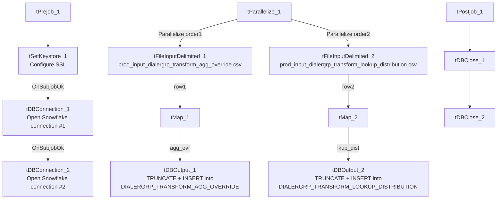

# Talend Job: Dialer_Grp_Transform_Inputs_Load

## Overview

Loads two manually-maintained business-rule configuration files — a dialer-group aggregation override table and a dialer-group-to-target-distribution lookup table — from `context.sourceDir` into two Snowflake reference tables, truncating and fully replacing each on every run. These appear to be configuration inputs consumed by other "dialer group transform" logic elsewhere in the project (not shown in this job's own metadata) that assigns debtors to dialer campaign groups.

## Detail table

| Field | Value |
|---|---|
| Job name | Dialer_Grp_Transform_Inputs_Load |
| Version | 0.1 |
| Project | EDW2SF |
| Author | jmach@harriscollect.com |
| Created | 2022-08-05T10:10:34.420-0700 |
| Last Modified | 2025-11-04T11:08:13.369-0800 |

## Step-by-step data flow

**Setup subjob:** `tPrejob_1` → `tSetKeystore_1` configures SSL trust/keystore from `context.keystorePath` (all passwords redacted) → on success, `tDBConnection_1` opens a Snowflake connection → on success, `tDBConnection_2` opens a **second, separate** Snowflake connection — see Issues observed.

**Main subjob** — `tParallelize_1` starts two independent branches:

1. **Aggregation-override branch:** `tFileInputDelimited_1` reads `context.sourceDir + "prod_input_dialergrp_transform_agg_override.csv"` (comma-delimited CSV, header row present, `US-ASCII` encoding, `DIE_ON_ERROR=true`, repository schema "dialer_grp_agg_input") with 9 columns: `PL_GROUP`, `GRP1_MIN`/`MAX` through `GRP4_MIN`/`MAX`. `tMap_1` passes them through unchanged, and `tDBOutput_1` writes them into Snowflake table `DIALERGRP_TRANSFORM_AGG_OVERRIDE` (`INSERT`, `tableAction=TRUNCATE`).
2. **Lookup-distribution branch:** `tFileInputDelimited_2` reads `context.sourceDir + "prod_input_dialergrp_transform_lookup_distribution.csv"` (comma-delimited CSV, header row present, `UTF-8` encoding, `DIE_ON_ERROR=true`, repository schema "dialergrp_xform_lkup_dist") with 2 columns: `DIALERGRP`, `TARGET_DISTRIBUTION`. `tMap_2` passes them through unchanged, and `tDBOutput_2` writes them into Snowflake table `DIALERGRP_TRANSFORM_LOOKUP_DISTRIBUTION` (`INSERT`, `tableAction=TRUNCATE`).

Both input components have a matching repository reject schema configured, but since `DIE_ON_ERROR=true` on both, a malformed row fails the job outright rather than routing to a reject flow.

**Teardown subjob:** `tPostjob_1` → `tDBClose_1` → `tDBClose_2` (closing both Snowflake connections in sequence).

## Settings tables

### Source 1: `tFileInputDelimited_1`

| Setting | Value | What it means |
|---|---|---|
| FILENAME | `context.sourceDir + "prod_input_dialergrp_transform_agg_override.csv"` | A fixed, single expected filename per run. |
| ENCODING | `US-ASCII` | Notably different from the sibling input's `UTF-8` — see Issues observed. |
| DIE_ON_ERROR | `true` | A malformed row fails the job outright. |

### Source 2: `tFileInputDelimited_2`

| Setting | Value | What it means |
|---|---|---|
| FILENAME | `context.sourceDir + "prod_input_dialergrp_transform_lookup_distribution.csv"` | A fixed, single expected filename per run. |
| ENCODING | `UTF-8` | Different from the sibling input's `US-ASCII`. |
| DIE_ON_ERROR | `true` | A malformed row fails the job outright. |

### Targets: `tDBOutput_1` / `tDBOutput_2` (`tSnowflakeOutput`)

| Setting | Value | What it means |
|---|---|---|
| Table | `DIALERGRP_TRANSFORM_AGG_OVERRIDE` / `DIALERGRP_TRANSFORM_LOOKUP_DISTRIBUTION` | Two separate reference/configuration tables, each rebuilt from its own source CSV. |
| Output action | `INSERT` (both) | Appends rows after truncation. |
| Table action | `TRUNCATE` (both) | Each table is fully cleared and reloaded every run — appropriate for small, manually-maintained configuration tables. |

## Dependencies & configuration

- **Triggers/depends on other jobs:** none — no `tRunJob` links found. The two tables this job populates are almost certainly read by other "Dialer_Grp_Transform"-named jobs elsewhere in the project, though that consuming relationship isn't visible in this job's own metadata.
- **Context variables used:** `keystorePath`, `sourceDir`.
- **3 hardcoded paths**: `tFileInputDelimited_1.TEMP_DIR`, `tFileInputDelimited_2.TEMP_DIR` (both `C:/Talend-Studio-20211109_1610-V8.0.1/workspace`), and `tSetKeystore_1.SSL_TRUSTSERVER_TRUSTSTORE` (`C:/clientTrustStore.trustStore`) — same portability risk documented project-wide in `05_operational_runbook.md`.

## Glossary

| Component type | Plain-English meaning |
|---|---|
| `tFileInputDelimited` | Reads a delimited (CSV-style) text file according to a schema. |
| `tMap` | Maps/transforms columns from one schema to another. |
| `tSnowflakeConnection` / `tSnowflakeOutput` / `tSnowflakeClose` | Open a Snowflake connection, write rows to a table (with truncate/insert options), and close the connection. |
| `tParallelize` | Runs its downstream branches at the same time rather than one after another — here, the two independent config-file loads run concurrently. |
| `tSetKeystore` | Configures SSL trust/keystore settings used by the subsequent Snowflake connections. |

## Issues observed

- **Two separate Snowflake connections are opened (`tDBConnection_1` and `tDBConnection_2`) rather than one shared connection reused by both output components** — most other jobs in this project (e.g. `DC_E_Media_Load`, `Debtor_Strat_Backfill`) use a single connection per database. Unable to determine from this metadata why two are needed here (possibly one per parallel branch to avoid a threading conflict on a single connection object, which is a legitimate Talend consideration for components running inside a `tParallelize`), but it's a minor inconsistency worth knowing if consolidating connections is ever considered.
- **The two source files use different encodings** (`US-ASCII` for the aggregation-override file, `UTF-8` for the lookup-distribution file) — not necessarily a problem if that reflects how each file is actually produced, but worth confirming with whoever maintains these manually-edited CSVs, since accidentally saving either file in the wrong encoding could cause `DIE_ON_ERROR=true` to fail the job on special characters.
- **Both target tables are fully truncated and reloaded from single, fixed-name source files** with no fallback if the file is missing or empty — unlike `Daily_Fee_Projection_Load`, there is no `tFileExist` gate here, so a missing source file would presumably cause `tFileInputDelimited`'s read to fail (and, per `DIE_ON_ERROR=true`, fail the job) rather than silently skip the load. No other issues distinct from the project-wide patterns in `05_operational_runbook.md` were found in this job's own metadata.
