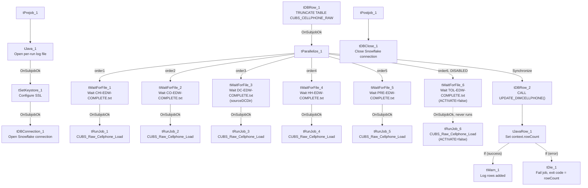

# Talend Job: DimCellphone_Load

## Overview

This is an orchestrator job for the `DimCellphone` dimension: it truncates the shared `CUBS_CELLPHONE_RAW` staging table, then waits for each site's daily CUBS extract to land (via per-site `CHI/CO/DC/HH/PRE-EDW-COMPLETE.txt` semaphore files) before triggering the same child job, `CUBS_Raw_Cellphone_Load`, once per site. Once all site branches finish, it calls a stored procedure to merge the accumulated raw cellphone data into the `DimCellphone` dimension and reports the row count via a warning or fails the job on error. **A sixth site branch, for TOL, exists in the design but is disabled** — see Issues observed.

## Detail table

| Field | Value |
|---|---|
| Job name | DimCellphone_Load |
| Version | 0.1 |
| Project | EDW2SF |
| Author | jmach@harriscollect.com |
| Created | 2023-03-23T19:46:39.921-0700 |
| Last Modified | 2026-08-07T11:42:31.383-0700 |

## Step-by-step data flow

**Setup subjob:** `tPrejob_1` → `tJava_1` opens a per-run log file → on success, `tSetKeystore_1` configures SSL trust/keystore from `context.keystorePath` (all passwords redacted) → on success, `tDBConnection_1` opens the Snowflake connection.

**Main subjob:**

1. `tDBRow_1` runs `TRUNCATE TABLE CUBS_CELLPHONE_RAW;`.
2. On success, `tParallelize_1` starts **6 branches**, one per site, each polling `context.sourceDir` (or `context.sourceDCDir` for DC) every 30 seconds for up to 720 iterations for that site's completion marker, then — once found — triggering the same child job via `tRunJob`:
   - `tWaitForFile_1` → `CHI-EDW-COMPLETE.txt` → `tRunJob_1` → **CUBS_Raw_Cellphone_Load**
   - `tWaitForFile_2` → `CO-EDW-COMPLETE.txt` → `tRunJob_2` → **CUBS_Raw_Cellphone_Load**
   - `tWaitForFile_3` → `DC-EDW-COMPLETE.txt` (in `context.sourceDCDir`, not `sourceDir`) → `tRunJob_3` → **CUBS_Raw_Cellphone_Load**
   - `tWaitForFile_4` → `HH-EDW-COMPLETE.txt` → `tRunJob_4` → **CUBS_Raw_Cellphone_Load**
   - `tWaitForFile_5` → `PRE-EDW-COMPLETE.txt` → `tRunJob_5` → **CUBS_Raw_Cellphone_Load**
   - `tWaitForFile_6` → `TOL-EDW-COMPLETE.txt` → `tRunJob_6` → **CUBS_Raw_Cellphone_Load** — **both components have `ACTIVATE=false`, so this branch never runs.**

   All 6 `tRunJob` calls invoke the exact same child job (`CUBS_Raw_Cellphone_Load`) with `TRANSMIT_ORIGINAL_CONTEXT=true` but `TRANSMIT_WHOLE_CONTEXT=false` and no dynamic context switch — how the child job distinguishes which site it's processing on each of the 5 active calls is not visible in this job's own metadata; see Issues observed.
3. Once `tParallelize_1` synchronizes (waits for all branches, active or not), `tDBRow_2` calls `CALL UPDATE_DIMCELLPHONE()`.
4. `tJavaRow_1` captures the procedure's `RETVALUE` into `context.rowCount`.
5. The flow branches on two ordered `RUN_IF` conditions (conditions themselves not captured, but component wiring/messages make the intent clear):
   - **Success:** `tWarn_1` logs `"<rowCount> rows added to DimCellphone"` (severity 42) — a warning, not a failure.
   - **Failure:** `tDie_1` fails the job with message `"<rowCount>: an error occurred during UPDATE or INSERT"` and exit code = `context.rowCount`.

**Teardown subjob:** `tPostjob_1` → `tDBClose_1` closes the Snowflake connection.

## Settings tables

### Gates: `tWaitForFile_1` through `tWaitForFile_6`

| Setting | Value | What it means |
|---|---|---|
| WAIT / MAX_ITERATIONS | 30 (seconds) / 720 (all 6) | Polls every 30 seconds for up to 720 tries (6 hours max) per site. |
| DIRECTORY | `context.sourceDir` (CHI, CO, HH, PRE, TOL) / `context.sourceDCDir` (DC only) | DC uses a distinct context variable for its source directory — consistent with `context.sourceDCDir` also appearing in `DimCellphone_Load`'s sibling orchestrators elsewhere in this project. |
| FILEMASK | `"<SITE>-EDW-COMPLETE.txt"` | Site-specific semaphore filename, same pattern as `Semaphore_Check` and `CO_Master_Load`. |
| ACTIVATE | `true` (5 of 6) / **`false` for `tWaitForFile_6` (TOL)** | The TOL branch is disabled — see Issues observed. |

### Orchestration: `tRunJob_1` through `tRunJob_6`

| Setting | Value | What it means |
|---|---|---|
| PROCESS | `CUBS_Raw_Cellphone_Load` (all 6) | Every branch calls the identical child job — no per-site job variant. |
| DIE_ON_CHILD_ERROR | `true` (all 6) | If the child job fails, `DimCellphone_Load` fails too. |
| TRANSMIT_ORIGINAL_CONTEXT / TRANSMIT_WHOLE_CONTEXT | `true` / `false` (all 6) | The child receives the parent's original context values but not necessarily every variable — how site-specific behavior is achieved inside `CUBS_Raw_Cellphone_Load` isn't visible here. |
| ACTIVATE | `true` (5 of 6) / **`false` for `tRunJob_6` (TOL)** | The TOL call is disabled — see Issues observed. |

### Merge step: `tDBRow_2`

| Setting | Value | What it means |
|---|---|---|
| Query | `CALL UPDATE_DIMCELLPHONE()` | Merges accumulated `CUBS_CELLPHONE_RAW` data (populated by however many of the 6 `CUBS_Raw_Cellphone_Load` calls actually ran) into the `DimCellphone` dimension. Its `RETVALUE` drives the success/failure branch. |

## Dependencies & configuration

- **This job calls `CUBS_Raw_Cellphone_Load` via `tRunJob` up to 6 times** (5 active: CHI, CO, DC, HH, PRE; 1 disabled: TOL) — matches the 6-call count in `06_dependency_matrix.md`, though that count does not distinguish the disabled TOL call from the 5 active ones.
- **Context variables used:** `keystorePath`, `logDir`, `sourceDir`, `sourceDCDir`, `rowCount` (set internally from the merge procedure's return value).
- **1 hardcoded path**: `tSetKeystore_1.SSL_TRUSTSERVER_TRUSTSTORE` (`C:/clientTrustStore.trustStore`) — same pattern documented project-wide in `05_operational_runbook.md`.

## Glossary

| Component type | Plain-English meaning |
|---|---|
| `tWaitForFile` | Polls a directory for a specific file to appear, for up to a configured number of attempts, before letting the job continue — used here as an active per-site gate. |
| `tRunJob` | Runs another Talend job as a sub-process, optionally waiting for it to finish before continuing. |
| `tParallelize` | Runs its downstream branches at the same time rather than one after another; here also used with a `Synchronize` connector to wait for all 6 branches (active or not) before proceeding. |
| `tSnowflakeRow` | Runs an arbitrary SQL statement or stored-procedure call against Snowflake. |
| `tJavaRow` | Runs custom Java code once per input row — here used to unpack a stored procedure's return value into a context variable. |
| `tWarn` / `tDie` | Logs a warning without failing the job, or ends the job with a specific failure message and exit code. |

## Issues observed

- **The TOL branch (`tWaitForFile_6`/`tRunJob_6`) is present in the job design but disabled (`ACTIVATE=false` on both components).** This means `DimCellphone_Load` never waits for TOL's semaphore file and never triggers `CUBS_Raw_Cellphone_Load` for TOL — if TOL cellphone data is supposed to be included in the `DimCellphone` dimension, it is not being loaded by this job as currently configured. This is consistent with the project-wide observation in `05_operational_runbook.md` that only `CO` has a fully-fledged `_Master_Load` orchestrator and other sites' pipeline coverage is inconsistent — verify with the team whether TOL cellphone data is loaded some other way, or whether this is a gap.
- **All 6 (5 active) `tRunJob` calls invoke the exact same child job with no visible per-site context override** (`USE_DYNAMIC_CONTEXT=false`, `TRANSMIT_WHOLE_CONTEXT=false`). How `CUBS_Raw_Cellphone_Load` knows which site's data to process on each of the 5 active calls is not visible in this job's own metadata — per `06_dependency_matrix.md`, confirming exactly what differs per call requires opening each `tRunJob` component's context settings individually in Talend Studio, which this extraction did not capture.
- **A failed `UPDATE_DIMCELLPHONE()` merge does fail the job** (via `tDie_1`), which is a stronger safety net than `CO_Master_Load`'s warning-only `FACTTRANS` merge failure — worth noting as a positive contrast when comparing error-handling maturity across this project's orchestrator jobs.
- **If `DimCellphone_Load` fails, its own error won't say which of the (up to 5 active) site branches actually broke** — same diagnostic limitation documented for `CO_Master_Load` in `05_operational_runbook.md`.
