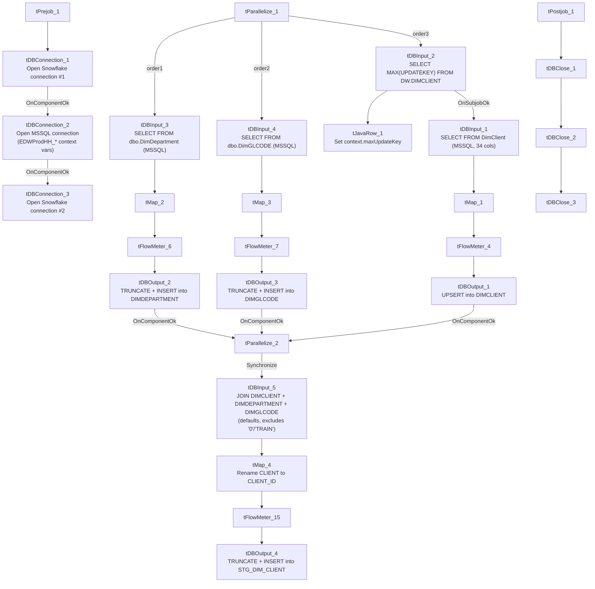

# Talend Job: DimClient_Load

## Overview

Loads three related client-hierarchy dimension tables from the `EDWProdHH` MSSQL source into Snowflake — `DIMCLIENT` (client master, upserted), `DIMDEPARTMENT`, and `DIMGLCODE` (both fully truncated and reloaded reference tables) — running all three in parallel, then combines them into a single denormalized staging table, `STG_DIM_CLIENT`, joining client-to-department-to-GL-code with default "Unassigned" fallbacks and explicitly excluding the `'0'` and `'TRAIN'` test/placeholder client codes.

## Detail table

| Field | Value |
|---|---|
| Job name | DimClient_Load |
| Version | 0.1 |
| Project | EDW2SF |
| Author | jmach@harriscollect.com |
| Created | 2022-01-04T15:07:06.234-0800 |
| Last Modified | 2022-05-24T09:48:29.496-0700 |

## Step-by-step data flow

**Setup subjob:** `tPrejob_1` → `tDBConnection_1` opens a Snowflake connection → on success, `tDBConnection_2` opens the MSSQL connection using `context.EDWProdHH_*` variables (password and Active Directory auth redacted) → on success, `tDBConnection_3` opens a **second, separate** Snowflake connection.

**Main subjob** — `tParallelize_1` starts three independent branches, all of which must finish (`tParallelize_2`, `WAIT_FOR=All`) before the final staging step runs:

1. **DimClient branch:** `tDBInput_2` (Snowflake) runs `SELECT CAST(COALESCE(MAX(UPDATEKEY),0) AS VARCHAR(10)) AS MAX_UPDATE_KEY FROM DW.DIMCLIENT;`, capturing the result into `context.maxUpdateKey` via `tJavaRow_1`. On success, `tDBInput_1` (MSSQL) reads the `DimClient` table (34 columns — client codes, name/address fields, desk, series, multiple grouping codes, `DIALER_GRP`, `UPDATEKEY`, etc.; query text truncated, so any `WHERE` filter using `context.maxUpdateKey` is not visible). `tMap_1` passes columns through (uppercased); `tFlowMeter_4` counts rows; `tDBOutput_1` **upserts** into Snowflake `DIMCLIENT` (`UPSERT`, `tableAction=NONE`).
2. **DimDepartment branch:** `tDBInput_3` (MSSQL) runs a fixed `SELECT DimDepartment, DepartmentName, Description, Logon, DimGLCode FROM dbo.DimDepartment`; `tMap_2` passes columns through; `tFlowMeter_6` counts rows; `tDBOutput_2` inserts into Snowflake `DIMDEPARTMENT` (`INSERT`, `tableAction=TRUNCATE` — full reload).
3. **DimGLCode branch:** `tDBInput_4` (MSSQL) runs `SELECT CAST(DimGLCode AS numeric(38,0)) AS DimGLCode, Description FROM dbo.DimGLCODE`; `tMap_3` passes columns through; `tFlowMeter_7` counts rows; `tDBOutput_3` inserts into Snowflake `DIMGLCODE` (`INSERT`, `tableAction=TRUNCATE` — full reload).

Once all three branches signal `tParallelize_2`, it synchronizes and triggers the final staging step:

4. `tDBInput_5` (Snowflake) runs a join of the just-reloaded `DW.DIMCLIENT`, `DW.DIMDEPARTMENT`, and `DW.DIMGLCODE`, defaulting missing department/GL associations to `'Unassigned'` (department ID 11, GL code 4), and **excluding client codes `'0'` and `'TRAIN'`**. `tMap_4` renames `CLIENT` to `CLIENT_ID`; `tFlowMeter_15` counts rows; `tDBOutput_4` inserts into Snowflake `STG_DIM_CLIENT` (`INSERT`, `tableAction=TRUNCATE`).

**Teardown subjob:** `tPostjob_1` → `tDBClose_1` → `tDBClose_2` → `tDBClose_3` (closing both Snowflake connections and the MSSQL connection).

## Settings tables

### Source: `tDBInput_1` (`tMSSqlInput`, DimClient)

| Setting | Value | What it means |
|---|---|---|
| Table | `DimClient` | Source client-master table, 34 columns (client codes, address, desk/series, multiple grouping fields, `DIALER_GRP`/`DLR_GRP`, `UPDATEKEY`). |
| Query | Truncated in this metadata after the column list | No `WHERE` clause is visible — same "unable to confirm incremental filter" pattern seen in other max-key jobs in this project (e.g. `i3_CallDetail_40_Load`, `DC_E_Media_Load`). |

### Target: `tDBOutput_1` (Snowflake `DIMCLIENT`)

| Setting | Value | What it means |
|---|---|---|
| Output action / Table action | `UPSERT` / `NONE` | Updates matching rows and inserts new ones directly into the standing `DIMCLIENT` table — no staging/merge step needed. |

### DimDepartment / DimGLCode sources and targets

| Setting | Value | What it means |
|---|---|---|
| `tDBInput_3` query | `SELECT DimDepartment, DepartmentName, Description, Logon, DimGLCode FROM dbo.DimDepartment` | Small reference table — department code, name, and its associated GL code. |
| `tDBInput_4` query | `SELECT CAST(DimGLCode AS numeric(38,0)) AS DimGLCode, Description FROM dbo.DimGLCODE` | Small reference table — GL code and description. |
| `tDBOutput_2` / `tDBOutput_3` | `INSERT` / `TRUNCATE` (both) | Both are small enough to fully reload every run rather than upsert. |

### Staging join: `tDBInput_5` (Snowflake)

| Setting | Value | What it means |
|---|---|---|
| Query | `SELECT 'CUBS' AS SOURCE_SYSTEM, C.LOGON, C.CLIENT, ..., COALESCE(C.DIMDEPARTMENT,11) AS DEPARTMENT_ID, COALESCE(D.DEPARTMENTNAME,'Unassigned') AS DEPARTMENT_NAME, COALESCE(D.DESCRIPTION,'Unassigned') AS DEPARTMENT_DESC, COALESCE(G.DIMGLCODE,4) AS GL_CODE, COALESCE(G.DESCRIPTION,'Unassigned') AS GL_DESC, ... FROM DW.DIMCLIENT C LEFT JOIN DW.DIMDEPARTMENT D ON ... LEFT JOIN DW.DIMGLCODE G ON ... WHERE C.CLIENT NOT IN ('0','TRAIN');` | Joins the three just-reloaded dimensions with `LEFT JOIN`s and explicit fallback defaults (department 11/"Unassigned", GL code 4/"Unassigned") for clients with no department/GL mapping. **Explicitly excludes client codes `'0'` and `'TRAIN'`** — a hardcoded business rule filtering out placeholder/test client records from this staging view. |

### Target: `tDBOutput_4` (Snowflake `STG_DIM_CLIENT`)

| Setting | Value | What it means |
|---|---|---|
| Output action / Table action | `INSERT` / `TRUNCATE` | Full reload of the denormalized staging table every run. |

## Dependencies & configuration

- **Triggers/depends on other jobs:** none — no `tRunJob` links found.
- **Context variables used:** `EDWProdHH_Server`, `EDWProdHH_Port`, `EDWProdHH_Schema`, `EDWProdHH_Database`, `EDWProdHH_Login` (MSSQL connection), `maxUpdateKey` (computed internally from the Snowflake max-key query, though its use in filtering the source query is unconfirmed — see Issues observed).
- No hardcoded developer-workstation paths found in this job.

## Glossary

| Component type | Plain-English meaning |
|---|---|
| `tMSSqlConnection` / `tMSSqlInput` / `tMSSqlClose` | Open a Microsoft SQL Server connection, run a query against it, and close it. |
| `tSnowflakeConnection` / `tSnowflakeInput` / `tSnowflakeOutput` / `tSnowflakeClose` | Open a Snowflake connection, read/write rows, and close the connection. |
| `tMap` | Maps/transforms columns from one schema to another. |
| `tFlowMeter` | Counts rows passing a point in the flow for logging/monitoring. |
| `tJavaRow` | Runs custom Java code once per input row — here used to unpack a query result into a context variable. |
| `tParallelize` | Runs its downstream branches at the same time; a second instance here (`tParallelize_2`) is used purely to synchronize all three branches before the final staging step. |

## Issues observed

- **The incremental-load logic for `DIMCLIENT` may not actually be applied.** As with `i3_CallDetail_40_Load` and `DC_E_Media_Load`, this job computes `context.maxUpdateKey` before reading the MSSQL source, but the `tDBInput_1.QUERY` text is truncated after the column list with no visible `WHERE` clause. Because the write is an `UPSERT`, an unfiltered full-table pull wouldn't create duplicates, but it would mean unnecessary full-table reprocessing every run if the filter isn't actually applied — unable to confirm from this metadata; verify directly in Talend Studio.
- **Two separate Snowflake connections are opened** (`tDBConnection_1` and `tDBConnection_3`) rather than one shared connection — the same pattern already flagged in `Dialer_Grp_Transform_Inputs_Load`, likely to avoid a threading conflict across the job's three parallel branches, but worth confirming intent.
- **The `STG_DIM_CLIENT` staging query's exclusion of `CLIENT NOT IN ('0','TRAIN')` is a hardcoded business rule embedded directly in SQL text**, not a configurable list — if a new placeholder/test client code is ever introduced, it would need a manual edit to this query to be excluded from downstream reporting consumers of `STG_DIM_CLIENT`.
- **No error/row-count logging specific to this job's business outcome** (no `tWarn`/`tDie`/`tSendMail`) — a load failure in any of the three parallel branches, or in the final staging step, would only surface as a generic Talend execution error, with no job-specific message to distinguish which branch failed.
