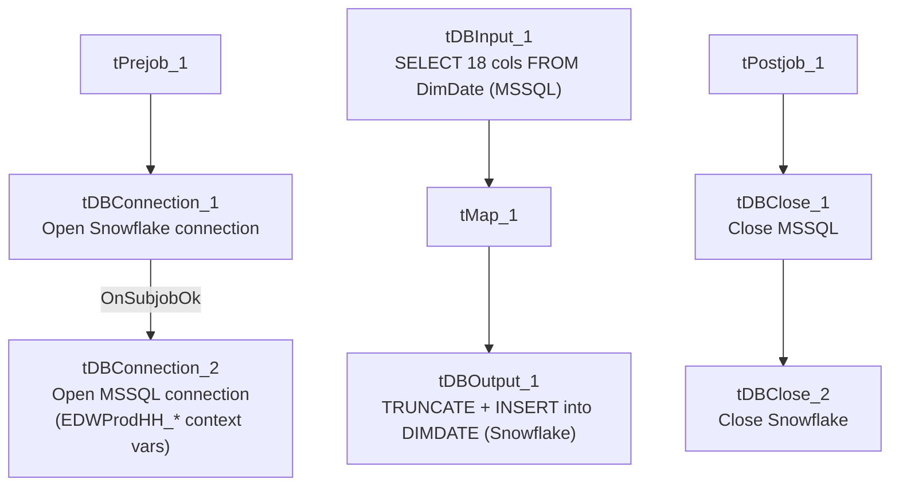

# Talend Job: DimDate_Load

## Overview

Loads the standard date-dimension table (calendar attributes: day/week/month/quarter/year breakdowns, day-of-week, holiday text, etc.) from the `EDWProdHH` MSSQL source's `DimDate` table into the Snowflake `DIMDATE` table, fully truncating and reloading it every run. This is a simple, self-contained reference-table load with no incremental logic — appropriate for a slowly-changing calendar dimension.

## Detail table

| Field | Value |
|---|---|
| Job name | DimDate_Load |
| Version | 0.1 |
| Project | EDW2SF |
| Author | jmach@harriscollect.com |
| Created | 2021-12-31T10:52:46.108-0800 |
| Last Modified | 2025-09-24T11:00:51.244-0700 |

## Step-by-step data flow

**Setup subjob:** `tPrejob_1` → `tDBConnection_1` opens a Snowflake connection → on success, `tDBConnection_2` opens the MSSQL connection using `context.EDWProdHH_*` variables (password and Active Directory auth redacted).

**Main subjob:**

1. `tDBInput_1` runs a fixed `SELECT` against MSSQL table `DimDate`, pulling 18 calendar-attribute columns (`DATESK`, `DATE`, `DAY`, `DAYSUFFIX`, `DAYOFWEEK`, `DOWINMONTH`, `DAYOFYEAR`, `WEEKOFYEAR`, `WEEKOFMONTH`, `FIRSTDAYOFWEEK`, `MONTH`, `MONTHNAME`, `QUARTER`, `QUARTERNAME`, `YEAR`, `STANDARDDATE`, `HOLIDAYTEXT`, `DAYSINWEEK`) — query text truncated after `DOWInMonth`, but the schema shows the full 18-column result.
2. `tMap_1` passes all 18 columns through unchanged.
3. `tDBOutput_1` inserts the rows into Snowflake table `DIMDATE` (`INSERT`, `tableAction=TRUNCATE` — a full reload every run). **The target table's own schema includes 4 additional columns** (`BUSINESSDAY`, `HOLIDAY`, `BUS_DAY_OF_MONTH`, `BUS_DAY_OF_YEAR`) that are not present in the source query or the map's output — see Issues observed.

**Teardown subjob:** `tPostjob_1` → `tDBClose_1` (close MSSQL) → `tDBClose_2` (close Snowflake).

## Settings tables

### Source: `tDBInput_1` (`tMSSqlInput`)

| Setting | Value | What it means |
|---|---|---|
| Table | `DimDate` | Standard calendar-dimension source table. |
| Query | `SELECT CAST([DateSK] AS numeric(38,0)) AS DATESK, CONVERT(date,[Date],23) AS [DATE], CAST([Day] AS numeric(38,0)) AS [DAY], [DaySuffix] AS DAYSUFFIX, [DayOfWeek] AS [DAYOFWEEK], CAST([DOWInMonth] AS numeric(38,0)...` (truncated) | Standard calendar breakdown fields; the visible portion shows type-casting to numeric/date but no filtering — this is expected to be a full-table pull, not incremental, which is appropriate for a static/slowly-changing date dimension. |

### Target: `tDBOutput_1` (`tSnowflakeOutput`)

| Setting | Value | What it means |
|---|---|---|
| Table | `DIMDATE` | Destination calendar-dimension table. |
| Output action | `INSERT` | Appends rows after truncation. |
| Table action | `TRUNCATE` | Table is fully cleared and reloaded every run. |
| Extra target columns | `BUSINESSDAY`, `HOLIDAY`, `BUS_DAY_OF_MONTH`, `BUS_DAY_OF_YEAR` | Present in the target table's schema but not sourced or mapped by this job — see Issues observed. |

## Dependencies & configuration

- **Triggers/depends on other jobs:** none — no `tRunJob` links found.
- **Context variables used:** `EDWProdHH_Server`, `EDWProdHH_Port`, `EDWProdHH_Schema`, `EDWProdHH_Database`, `EDWProdHH_Login` (MSSQL connection).
- No hardcoded developer-workstation paths found in this job.

## Glossary

| Component type | Plain-English meaning |
|---|---|
| `tMSSqlConnection` / `tMSSqlInput` / `tMSSqlClose` | Open a Microsoft SQL Server connection, run a query against it, and close it. |
| `tSnowflakeConnection` / `tSnowflakeOutput` / `tSnowflakeClose` | Open a Snowflake connection, write rows to a table (with truncate/insert options), and close the connection. |
| `tMap` | Maps/transforms columns from one schema to another. |

## Issues observed

- **The Snowflake `DIMDATE` table's own schema includes 4 columns this job never populates**: `BUSINESSDAY`, `HOLIDAY`, `BUS_DAY_OF_MONTH`, `BUS_DAY_OF_YEAR`. None of these appear in the source MSSQL query or in `tMap_1`'s mapped output. Because the load action is `TRUNCATE` + `INSERT` (not a partial column update), these 4 columns would be left at their column-default (likely `NULL`) on every single run unless Talend's insert behavior implicitly carries forward previous values — which a `TRUNCATE` explicitly rules out. Unable to determine from this metadata whether these columns are: (a) genuinely unused/vestigial in the target table, (b) populated by a separate downstream process after this job runs, or (c) a sign this job's mapping was never updated after the target table was extended with business-day/holiday-flag columns. Verify directly in Talend Studio and with the team, since any report relying on `BUSINESSDAY`/`HOLIDAY` flags being populated could be silently working with `NULL`s.
- **No error/row-count logging specific to this job's business outcome** (no `tWarn`/`tDie`/`tSendMail`) — a load failure would only surface as a generic Talend execution error. Beyond the column-mismatch finding above, no other issues distinct from the project-wide patterns in `05_operational_runbook.md` were found in this job's own metadata.
