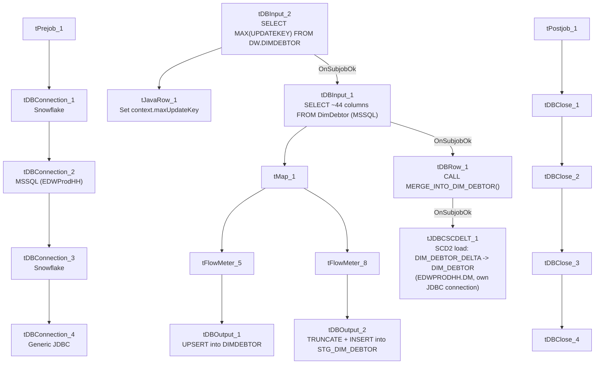

# Talend Job: DimDebtor_Load

## Overview

Loads the debtor dimension from the "EDWProdHH" MSSQL `DimDebtor` table into Snowflake, populating three destinations: a full-width `DIMDEBTOR` table (upserted), a narrower `STG_DIM_DEBTOR` staging table (truncated and reloaded every run), and a slowly-changing-dimension (SCD Type 2) `DIM_DEBTOR` table built from a `DIM_DEBTOR_DELTA` source via a dedicated JDBC/SCD component. The job also computes the current max `UPDATEKEY` already in Snowflake before pulling from MSSQL, suggesting an intended incremental design (see Issues observed for whether that's actually applied).

## Detail table

| Field | Value |
|---|---|
| Job name | DimDebtor_Load |
| Version | 0.1 |
| Project | EDW2SF |
| Author | jmach@harriscollect.com |
| Created | 2022-01-11T09:49:39.139-0800 |
| Last Modified | 2022-02-28T11:03:08.530-0800 |

## Step-by-step data flow

**Setup subjob:** `tPrejob_1` → `tDBConnection_1` (Snowflake) → `tDBConnection_2` (MSSQL, "EDWProdHH" context variables) → `tDBConnection_3` (a second Snowflake connection) → `tDBConnection_4` (a generic JDBC connection, used only by the SCD component below).

**Main subjob:**

1. `tDBInput_2` runs `SELECT CAST(COALESCE(MAX(UPDATEKEY),0) AS VARCHAR(10)) AS MAX_UPDATEKEY FROM DW.DIMDEBTOR;` against Snowflake.
2. `tJavaRow_1` captures that value into `context.maxUpdateKey`.
3. On success, `tDBInput_1` runs a `SELECT` (query text truncated in this metadata) against the MSSQL `DimDebtor` table, pulling ~44 columns (debtor number, logon, client, balances, activity dates, promise-to-pay fields, etc.). The visible portion does not show a `WHERE` clause referencing `context.maxUpdateKey` — see Issues observed.
4. `tMap_1` maps the source row to a combined output schema (adds `SOURCE_SYSTEM`, renames/derives `DEBTOR_NUMBER`, `DEBTOR_IDX`, `PACKET_ID`, `PRIMARY_DEBTOR_NUM`, `DEBTOR_ZIP`, `DEBTOR_STATE`, `BATCH`, `STATUS`) and fans out to two flows.
5. **Flow A:** `tFlowMeter_5` counts rows → `tDBOutput_1` upserts into Snowflake `DIMDEBTOR` (all ~44 columns, `outputAction=UPSERT`, `tableAction=NONE`).
6. **Flow B:** `tFlowMeter_8` counts rows → `tDBOutput_2` inserts into Snowflake `STG_DIM_DEBTOR` (narrower column set plus standard reject columns, `outputAction=INSERT`, `tableAction=TRUNCATE` — cleared and reloaded every run).
7. On `tDBInput_1`'s subjob success, `tDBRow_1` runs `CALL MERGE_INTO_DIM_DEBTOR();` against Snowflake.
8. On that subjob's success, `tJDBCSCDELT_1` (a Talend SCD Type 2 component) reads from `DIM_DEBTOR_DELTA` and writes to `DIM_DEBTOR` in the `EDWPRODHH` database / `DM` schema, using its own JDBC connection (`tDBConnection_4`) — see Settings table for its hardcoded connection URL and surrogate-key setup.

**Teardown subjob:** `tPostjob_1` → `tDBClose_1` (Snowflake) → `tDBClose_2` (MSSQL) → `tDBClose_3` (second Snowflake) → `tDBClose_4` (JDBC).

## Settings tables

### Source: `tDBInput_1` (`tMSSqlInput`)

| Setting | Value | What it means |
|---|---|---|
| Connection | Shared `tDBConnection_2` | MSSQL "EDWProdHH" connection. |
| Table | `DimDebtor` | Source debtor table. |
| Query | `SELECT [DebtorNumber],[LOGON],CAST([DimLogon]...),...` (truncated at ~column 9 in this metadata) | Full column list and any `WHERE` clause are not visible — see Issues observed. |

### Target A: `tDBOutput_1` (`tSnowflakeOutput`)

| Setting | Value | What it means |
|---|---|---|
| Table | `DIMDEBTOR` | Full dimension table. |
| Output action | `UPSERT` | Updates existing rows / inserts new ones by key — safer against duplication than a plain `INSERT` even if the incremental filter isn't applied upstream. |
| Table action | `NONE` | Table structure untouched. |

### Target B: `tDBOutput_2` (`tSnowflakeOutput`)

| Setting | Value | What it means |
|---|---|---|
| Table | `STG_DIM_DEBTOR` | Narrower staging table (11 business columns + reject columns). |
| Output action / Table action | `INSERT` / `TRUNCATE` | Classic truncate-and-reload staging pattern feeding the merge/SCD steps below. |

### Merge + SCD: `tDBRow_1` / `tJDBCSCDELT_1`

| Setting | Value | What it means |
|---|---|---|
| Query (`tDBRow_1`) | `CALL MERGE_INTO_DIM_DEBTOR();` | Merges staged rows into a Snowflake target (not shown in this metadata) before the SCD step runs. |
| `tJDBCSCDELT_1` connection URL | `"jdbc:snowflake://xca26579.us-east-1.snowflakecomputing.com?db=EDWPRODHH&schema=DM"` | A **hardcoded Snowflake account/host and database/schema**, distinct from the job's other (context-driven) Snowflake connections — see Issues observed. |
| `tJDBCSCDELT_1` user | `"TALEND"` (hardcoded, not a context variable) | Password is `***REDACTED***`. |
| Source / target table | `DIM_DEBTOR_DELTA` → `DIM_DEBTOR` | Reads a delta/change table and writes the SCD2 dimension. |
| Surrogate key | `DEBTOR_KEY`, generated via `DB_SEQUENCE` `SEQ_DEBTOR` | New surrogate key per SCD version. |
| SCD tracking columns | `EFF_DT` (job start time), `EXP_DT` (fixed `2199-12-31` for open records), `IS_CURRENT`, `VERSION` | Standard Type-2 history columns. |

## Dependencies & configuration

- **Triggers/depends on other jobs:** none — no `tRunJob` links found.
- **Context variables used:** `EDWProdHH_Database`, `EDWProdHH_Login`, `EDWProdHH_Port`, `EDWProdHH_Schema`, `EDWProdHH_Server`, `maxUpdateKey` (computed internally).
- No hardcoded developer-workstation paths found in this job's file-based components (it has none) — but see Issues observed regarding the hardcoded JDBC connection details in `tJDBCSCDELT_1`/`tDBConnection_4`.

## Glossary

| Component type | Plain-English meaning |
|---|---|
| `tMSSqlInput` / `tMSSqlConnection` / `tMSSqlClose` | Query a Microsoft SQL Server source / open and close that connection. |
| `tSnowflakeInput` / `tSnowflakeOutput` / `tSnowflakeConnection` / `tSnowflakeClose` / `tSnowflakeRow` | Query, write to, connect to, close, or run arbitrary SQL against Snowflake. |
| `tMap` | Maps/transforms columns from one schema to another. |
| `tFlowMeter` | Counts rows passing a point in the flow for logging/monitoring. |
| `tJavaRow` | Runs custom Java code once per input row — here used to unpack a single query result into a context variable. |
| `JDBCConnection` / `JDBCClose` | A generic (non-Snowflake-labeled) JDBC connection/close pair — here pointed at the same Snowflake account via a raw JDBC URL, used only by the SCD component. |
| `tJDBCSCDELT` | Talend's Slowly Changing Dimension (Type 2 "ELT" variant) component: builds a versioned dimension table with effective/expiration dates and a current-row flag from a delta/change source. |

## Issues observed

- **The incremental-load logic may not actually be applied.** The job computes `context.maxUpdateKey` from Snowflake before reading the MSSQL source (the same pattern used in `i3_CallDetail_40_Load`), but the `tDBInput_1.QUERY` text captured in this metadata is truncated after the ninth column and does not show a `WHERE` clause referencing `context.maxUpdateKey`. Unable to determine from this metadata whether the query is actually filtered — however, unlike a pure `INSERT`-only job, `tDBOutput_1`'s `UPSERT` action would at least avoid duplicating rows in `DIMDEBTOR` even on a full re-read; `STG_DIM_DEBTOR` is truncated every run regardless, so it's unaffected either way. Verify the actual `WHERE` clause directly in Talend Studio.
- **`tJDBCSCDELT_1` connects to Snowflake through a separate, hardcoded JDBC URL** (`jdbc:snowflake://xca26579.us-east-1.snowflakecomputing.com?db=EDWPRODHH&schema=DM`) with a hardcoded username (`"TALEND"`), rather than reusing the job's context-driven `tDBConnection_1`/`tDBConnection_3` Snowflake connections or a `context.*` variable. If the Snowflake account, host, or database name ever changes, this component would need to be updated by hand and could easily be missed since it doesn't follow the rest of the job's connection pattern.
- **Two separate Snowflake connections are opened in this job** (`tDBConnection_1`/`tDBConnection_3`) in addition to the JDBC one used by the SCD step — unable to determine from metadata why a single shared connection wasn't reused for all three; this triples the number of Snowflake sessions/logins per run compared to a single-connection design.
