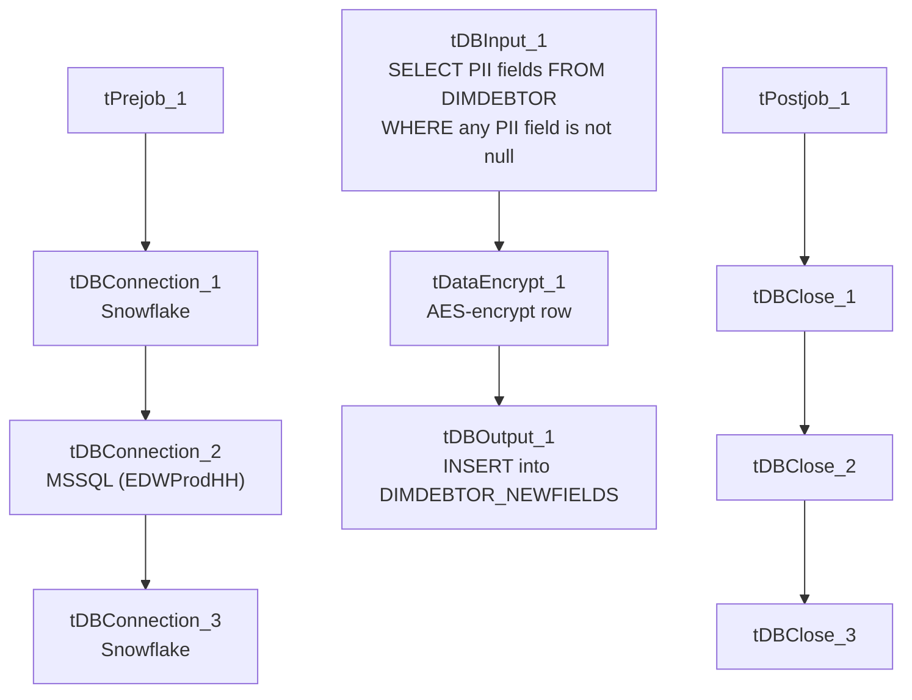

# Talend Job: DimDebtor_NewFields_Load

## Overview

Pulls a small set of sensitive personal fields (name, address, city, phone, date of birth, SSN) for debtors with any non-null contact/PII data from the "EDWProdHH" MSSQL `DIMDEBTOR` table, encrypts the row with AES before it ever reaches Snowflake, and appends it to a dedicated `DIMDEBTOR_NEWFIELDS` table. This is a narrower, PII-focused companion to `DimDebtor_Load` rather than a full dimension refresh.

## Detail table

| Field | Value |
|---|---|
| Job name | DimDebtor_NewFields_Load |
| Version | 0.1 |
| Project | EDW2SF |
| Author | jmach@harriscollect.com |
| Created | 2022-04-29T14:39:47.160-0700 |
| Last Modified | 2025-09-24T11:07:33.476-0700 |

## Step-by-step data flow

**Setup subjob:** `tPrejob_1` → `tDBConnection_1` (Snowflake) → `tDBConnection_2` (MSSQL, "EDWProdHH" context variables) → `tDBConnection_3` (a second Snowflake connection, opened but not shown as feeding any component directly in this metadata).

**Main subjob:**

1. `tDBInput_1` runs a `SELECT` against MSSQL `DIMDEBTOR`: `DEBTOR_IDX, NAME1, NAME2, ADD1, ADD2, CITY, PHONE, TRY_CAST(DOB AS DATE) AS DOB, SSN`, filtered `WHERE (NAME1 IS NOT NULL OR NAME2 IS NOT NULL OR ADD1 IS NOT NULL OR ADD2 IS NOT NULL OR CITY IS NOT NULL OR PHONE IS NOT NUL...` (condition list truncated in this metadata, but clearly a "any PII field populated" filter).
2. `tDataEncrypt_1` encrypts the row using AES (secret type, key, and password all `***REDACTED***`), writing a crypto-controller file reference to `"/home/talenduser/dimdbtr.crypt"` (a Linux path, notably different from this project's usual Windows workstation paths — see Issues observed).
3. `tDBOutput_1` inserts the encrypted rows into Snowflake `DIMDEBTOR_NEWFIELDS` (`INSERT`, `tableAction=NONE` — no truncate, so this table accumulates across runs).

**Teardown subjob:** `tPostjob_1` → `tDBClose_1` (Snowflake) → `tDBClose_2` (MSSQL) → `tDBClose_3` (second Snowflake).

## Settings tables

### Source: `tDBInput_1` (`tMSSqlInput`)

| Setting | Value | What it means |
|---|---|---|
| Query | `SELECT DEBTOR_IDX, NAME1, NAME2, ADD1, ADD2, CITY, PHONE, TRY_CAST(DOB AS DATE) AS DOB, SSN FROM DIMDEBTOR WHERE (...)` | Pulls only the PII fields, filtered to rows where at least one contact/identity field is populated (full condition truncated in this metadata). |

### Transform: `tDataEncrypt_1`

| Setting | Value | What it means |
|---|---|---|
| CRYPTO_METHOD | `AES` | Symmetric encryption applied to the row before it's written anywhere. |
| SECRET_TYPE / SECRET_KEY / PASSWORD_M1 | `***REDACTED***` | Preserved as redacted — never guess the real values. |
| CRYPTO_FILE_PATH | `"/home/talenduser/dimdbtr.crypt"` | A Linux-style path for a crypto controller file — see Issues observed. |

### Target: `tDBOutput_1` (`tSnowflakeOutput`)

| Setting | Value | What it means |
|---|---|---|
| Table | `DIMDEBTOR_NEWFIELDS` | Destination for the encrypted PII rows. |
| Output action | `INSERT` | Appends rows. |
| Table action | `NONE` | No truncate before load — this table is **not** cleared each run, so it accumulates rather than reflecting a point-in-time snapshot; see Issues observed. |

## Dependencies & configuration

- **Triggers/depends on other jobs:** none — no `tRunJob` links found.
- **Context variables used:** `EDWProdHH_Database`, `EDWProdHH_Login`, `EDWProdHH_Port`, `EDWProdHH_Schema`, `EDWProdHH_Server`.
- No hardcoded developer-workstation paths were flagged by the extraction for this job (the one absolute path present, `tDataEncrypt_1.CRYPTO_FILE_PATH`, is a Linux runtime path rather than the usual `C:/Talend-Studio-...` pattern — see Issues observed).

## Glossary

| Component type | Plain-English meaning |
|---|---|
| `tMSSqlInput` / `tMSSqlConnection` / `tMSSqlClose` | Query a Microsoft SQL Server source / open and close that connection. |
| `tDataEncrypt` | Encrypts one or more columns (or the whole row) using a configured algorithm and key before it continues downstream. |
| `tSnowflakeOutput` / `tSnowflakeConnection` / `tSnowflakeClose` | Write rows to Snowflake / open and close the Snowflake connection. |

## Issues observed

- **`DIMDEBTOR_NEWFIELDS` has no `TRUNCATE` before load (`tableAction=NONE`, `outputAction=INSERT`).** Unlike the truncate-and-reload pattern used throughout most of this project's dimension loads, this table accumulates every run's output. Since the source query has no incremental filter (no `context.max*` variable referenced), re-running this job would append the same PII rows again, producing duplicates unless something downstream deduplicates — unable to determine from metadata whether that's intended or whether `DIMDEBTOR_NEWFIELDS` is meant to be a full-refresh table that's truncated by a process not captured here.
- **The crypto file path (`/home/talenduser/dimdbtr.crypt`) is a Linux path**, unlike the `C:/Talend-Studio-20211109_1610-V8.0.1/...` Windows workstation paths hardcoded throughout most of this project (see `05_operational_runbook.md`). This suggests this job (or at least this component's configuration) may run on a different, Linux-based execution host than most of the project — worth confirming with the team which runtime actually executes this job, since a mismatched path here would cause a runtime file-not-found error specific to this component.
- **A third connection (`tDBConnection_3`, Snowflake) is opened in the setup subjob but doesn't appear to feed any component** in this job's wiring — it may be vestigial from a copy-paste of another job's template, or its usage may not have been captured in this extraction. Unable to determine from metadata.
- **A PII-handling job with no visible error/reject handling**: `tDBInput_1`'s truncated `WHERE` clause and the encrypted output make it hard to audit from metadata alone whether all intended debtor PII rows are captured; per this project's data-handling expectations, confirm this job's row counts/coverage are validated elsewhere.
