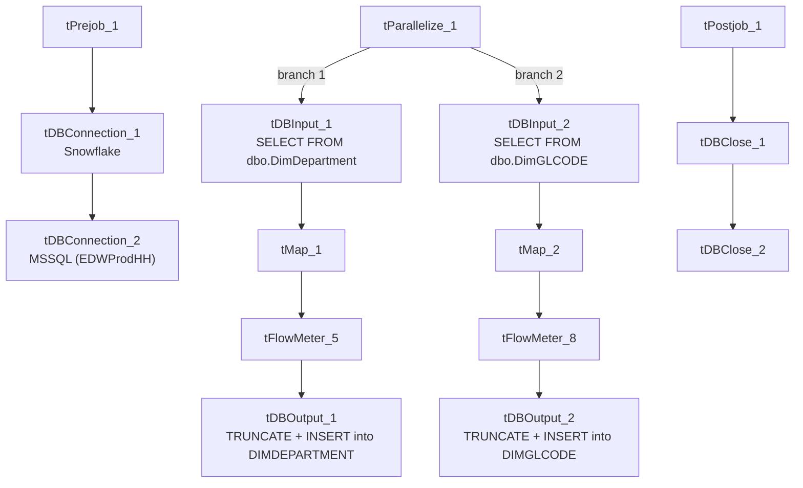

# Talend Job: DimDepartment_and_GL_Load

## Overview

Loads two small reference/lookup dimensions in parallel from the "EDWProdHH" MSSQL database into Snowflake: the collections department table (`DimDepartment`) and the general-ledger code table (`DimGLCODE`). Both are simple truncate-and-reload jobs with no merge or incremental logic — every run replaces the full contents of both Snowflake tables.

## Detail table

| Field | Value |
|---|---|
| Job name | DimDepartment_and_GL_Load |
| Version | 0.1 |
| Project | EDW2SF |
| Author | jmach@harriscollect.com |
| Created | 2022-01-04T11:06:39.580-0800 |
| Last Modified | 2025-09-24T10:59:31.961-0700 |

## Step-by-step data flow

**Setup subjob:** `tPrejob_1` → `tDBConnection_1` (Snowflake) → `tDBConnection_2` (MSSQL, "EDWProdHH" context variables).

**Main subjob** — `tParallelize_1` runs two independent branches at the same time:

1. **Department branch:** `tDBInput_1` runs `SELECT CAST(DimDepartment AS NUMERIC(38,0)) AS DimDepartment, DepartmentName, Description, Logon, CAST(DimGLCode AS NUMERIC(38,0)) AS DimGLCode FROM dbo.DimDepartment` → `tMap_1` passes the row through → `tFlowMeter_5` counts rows → `tDBOutput_1` truncates and inserts into Snowflake `DIMDEPARTMENT`.
2. **GL branch:** `tDBInput_2` runs `SELECT CAST(DimGLCode AS numeric(38,0)) AS DimGLCode, Description FROM dbo.DimGLCODE` → `tMap_2` passes the row through → `tFlowMeter_8` counts rows → `tDBOutput_2` truncates and inserts into Snowflake `DIMGLCODE`.

**Teardown subjob:** `tPostjob_1` → `tDBClose_1` (Snowflake) → `tDBClose_2` (MSSQL).

## Settings tables

### Branch 1: `tDBInput_1` / `tDBOutput_1`

| Setting | Value | What it means |
|---|---|---|
| Query | `SELECT CAST(DimDepartment AS NUMERIC(38,0)) AS DimDepartment, DepartmentName, Description, Logon, CAST(DimGLCode AS NUMERIC(38,0)) AS DimGLCode FROM dbo.DimDepartment` | Small reference table — department key, name, description, logon, and its linked GL code. |
| Target table | `DIMDEPARTMENT` | |
| Output action / Table action | `INSERT` / `TRUNCATE` | Full replace every run. |

### Branch 2: `tDBInput_2` / `tDBOutput_2`

| Setting | Value | What it means |
|---|---|---|
| Query | `SELECT CAST(DimGLCode AS numeric(38,0)) AS DimGLCode, Description FROM dbo.DimGLCODE` | GL code lookup: code and description only. |
| Target table | `DIMGLCODE` | |
| Output action / Table action | `INSERT` / `TRUNCATE` | Full replace every run. |

## Dependencies & configuration

- **Triggers/depends on other jobs:** none — no `tRunJob` links found.
- **Context variables used:** `EDWProdHH_Database`, `EDWProdHH_Login`, `EDWProdHH_Port`, `EDWProdHH_Schema`, `EDWProdHH_Server`.
- No hardcoded developer-workstation paths found in this job.

## Glossary

| Component type | Plain-English meaning |
|---|---|
| `tMSSqlInput` / `tMSSqlConnection` / `tMSSqlClose` | Query a Microsoft SQL Server source / open and close that connection. |
| `tMap` | Maps/transforms columns from one schema to another (here, effectively pass-through). |
| `tFlowMeter` | Counts rows passing a point in the flow for logging/monitoring. |
| `tSnowflakeOutput` / `tSnowflakeConnection` / `tSnowflakeClose` | Write rows to Snowflake / open and close the Snowflake connection. |
| `tParallelize` | Runs its downstream branches at the same time rather than one after another. |

## Issues observed

- **`tDBOutput_1`'s target schema names the `LOGON` column `DIMLOGON`** in its own `schema_columns` list (distinct from `tMap_1`'s output, which names it `LOGON`), while a separate `LOGON` column also exists in the same schema. This looks like a leftover/duplicate column definition from a prior schema revision rather than two genuinely different fields — unable to determine from metadata which one Talend actually populates at runtime; verify the live mapping in Talend Studio if department-logon data looks inconsistent in Snowflake.
- No other findings beyond the project-wide patterns already documented in `05_operational_runbook.md` (e.g. no incremental load, no merge step, no error handling beyond default Talend behavior) — this is a simple, low-risk reference-data refresh job.
