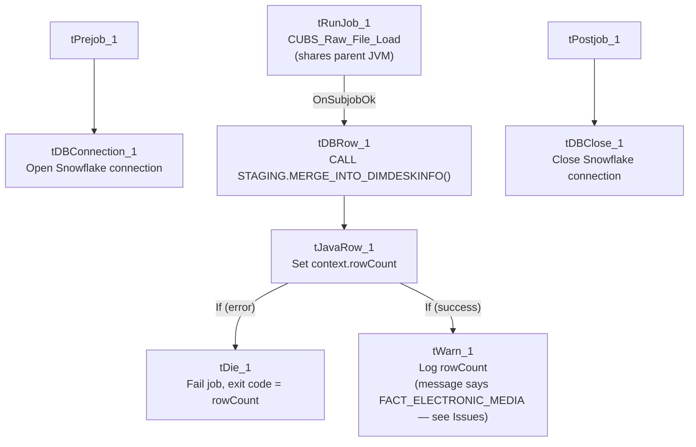

# Talend Job: DimDeskInfo_Load

## Overview

A thin orchestrator that runs the shared `CUBS_Raw_File_Load` job to land a desk-information extract file, then merges the staged data into the `DIMDESKINFO` dimension via a Snowflake stored procedure. It does not read or write any business data directly itself — everything data-related happens inside the called `CUBS_Raw_File_Load` job and the merge procedure.

## Detail table

| Field | Value |
|---|---|
| Job name | DimDeskInfo_Load |
| Version | 0.1 |
| Project | EDW2SF |
| Author | jmach@harriscollect.com |
| Created | 2022-06-17T08:56:17.920-0700 |
| Last Modified | 2022-06-17T08:58:55.025-0700 |

## Step-by-step data flow

**Setup subjob:** `tPrejob_1` → `tDBConnection_1` (Snowflake).

**Main subjob:**

1. `tRunJob_1` runs **`CUBS_Raw_File_Load`** (`USE_INDEPENDENT_PROCESS=false` — runs inside this job's own JVM rather than as a separate process; `DIE_ON_CHILD_ERROR=true`, `TRANSMIT_ORIGINAL_CONTEXT=true`).
2. On that sub-job's success, `tDBRow_1` runs `CALL STAGING.MERGE_INTO_DIMDESKINFO();` against Snowflake (`TSTATCATCHER_STATS=true`).
3. `tJavaRow_1` captures the procedure's `RETVALUE` into `context.rowCount`.
4. The flow branches on two ordered `RUN_IF` conditions off `tJavaRow_1` (the branch conditions themselves aren't captured in this metadata, but the component wiring makes the intent clear):
   - **Failure branch:** `tDie_1` fails the job with message `context.rowCount + ": an error occurred during MERGE"` and exit code = `context.rowCount`.
   - **Success/logging branch:** `tWarn_1` logs `context.rowCount + " rows added to FACT_ELECTRONIC_MEDIA"` (severity 42) — **note this message names the wrong table**, see Issues observed.

**Teardown subjob:** `tPostjob_1` → `tDBClose_1` (Snowflake).

## Settings tables

### Orchestration: `tRunJob_1`

| Setting | Value | What it means |
|---|---|---|
| PROCESS | `CUBS_Raw_File_Load` | Delegates the actual file landing/parsing to this shared job. |
| USE_INDEPENDENT_PROCESS | `false` | Runs inside `DimDeskInfo_Load`'s own JVM rather than as a separate process — same non-default pattern seen on `CO_Master_Load`'s call to `DimFiscal_CO_Load`. |
| DIE_ON_CHILD_ERROR | `true` | If `CUBS_Raw_File_Load` fails, this job fails too. |

### Merge + result handling: `tDBRow_1` / `tJavaRow_1` / `tDie_1` / `tWarn_1`

| Setting | Value | What it means |
|---|---|---|
| Query | `CALL STAGING.MERGE_INTO_DIMDESKINFO();` | Merges the file data staged by `CUBS_Raw_File_Load` into the `DIMDESKINFO` dimension. |
| `tDie_1` message | `context.rowCount + ": an error occurred during MERGE"` | Fails the job loudly with the procedure's return code as the exit code. |
| `tWarn_1` message | `context.rowCount + " rows added to FACT_ELECTRONIC_MEDIA"` | **Mislabeled** — this job merges into `DIMDESKINFO`, not `FACT_ELECTRONIC_MEDIA`. See Issues observed. |

## Dependencies & configuration

- **Triggers/depends on other jobs:** calls `CUBS_Raw_File_Load` via `tRunJob_1` (see `06_dependency_matrix.md` — this same shared job is also called by `DimEmployeeInfo_Load`, `Fact_Electronic_Media_Load`, and `PaymentPlan_Load`).
- **Context variables used:** `rowCount` (set internally from the merge procedure's return value).
- No hardcoded developer-workstation paths found in this job's own components (though `CUBS_Raw_File_Load` itself may have some — not covered by this job's own metadata).

## Glossary

| Component type | Plain-English meaning |
|---|---|
| `tRunJob` | Runs another Talend job as a sub-process (or, if configured not to use an independent process, inline in the same JVM). |
| `tSnowflakeRow` | Runs an arbitrary SQL statement or stored-procedure call against Snowflake. |
| `tJavaRow` | Runs custom Java code once per input row — here used to unpack a stored procedure's return value. |
| `tDie` / `tWarn` | `tDie` ends the job with a specific failure message and exit code; `tWarn` logs a warning without stopping the job. |

## Issues observed

- **`tWarn_1`'s success message says `"... rows added to FACT_ELECTRONIC_MEDIA"`, but this job merges into `DIMDESKINFO`.** This is a copy-paste artifact — `DimEmployeeInfo_Load` (also in this batch) has the *identical* `tWarn_1` message text, and `Fact_Electronic_Media_Load` (referenced in `05_operational_runbook.md` as a job with explicit `tDie`/`tWarn` logic) is presumably where this message text actually originated. It's a **cosmetic/log-message bug only** — the real merge call (`CALL STAGING.MERGE_INTO_DIMDESKINFO();`) is correctly targeted — but it would mislead anyone reading this job's run log about which table was actually updated.
- **`CUBS_Raw_File_Load` runs with `USE_INDEPENDENT_PROCESS=false`**, sharing this job's JVM rather than running as a separate process. Same non-default pattern flagged as worth confirming in `CO_Master_Load`'s call to `DimFiscal_CO_Load` — unable to determine intent from metadata.
- **This job's own metadata contains no file paths, table names, or business logic beyond the merge call** — the actual source file location, format, and target staging table are entirely defined inside `CUBS_Raw_File_Load`, which is outside the scope of this job's own JSON. Anyone debugging a `DimDeskInfo_Load` data issue will need to look at `CUBS_Raw_File_Load`'s own documentation.
