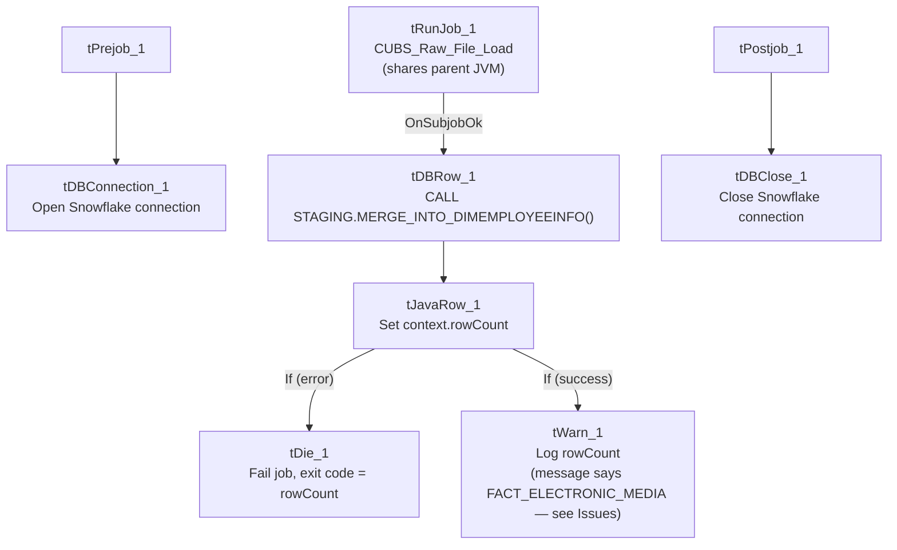

# Talend Job: DimEmployeeInfo_Load

## Overview

A thin orchestrator, structurally identical to `DimDeskInfo_Load`, that runs the shared `CUBS_Raw_File_Load` job to land an employee-information extract file, then merges the staged data into the `DIMEMPLOYEEINFO` dimension via a Snowflake stored procedure. It does not read or write any business data directly itself.

## Detail table

| Field | Value |
|---|---|
| Job name | DimEmployeeInfo_Load |
| Version | 0.1 |
| Project | EDW2SF |
| Author | jmach@harriscollect.com |
| Created | 2022-05-24T17:34:49.967-0700 |
| Last Modified | 2022-05-24T17:37:27.563-0700 |

## Step-by-step data flow

**Setup subjob:** `tPrejob_1` → `tDBConnection_1` (Snowflake).

**Main subjob:**

1. `tRunJob_1` runs **`CUBS_Raw_File_Load`** (`USE_INDEPENDENT_PROCESS=false` — runs inside this job's own JVM; `DIE_ON_CHILD_ERROR=true`, `TRANSMIT_ORIGINAL_CONTEXT=true`).
2. On that sub-job's success, `tDBRow_1` runs `CALL STAGING.MERGE_INTO_DIMEMPLOYEEINFO();` against Snowflake (`TSTATCATCHER_STATS=true`).
3. `tJavaRow_1` captures the procedure's `RETVALUE` into `context.rowCount`.
4. Branches on two `RUN_IF` conditions off `tJavaRow_1`:
   - **Failure branch:** `tDie_1` fails the job with message `context.rowCount + ": an error occurred during MERGE"` and exit code = `context.rowCount`.
   - **Success/logging branch:** `tWarn_1` logs `context.rowCount + " rows added to FACT_ELECTRONIC_MEDIA"` (severity 42) — **again names the wrong table**, see Issues observed.

**Teardown subjob:** `tPostjob_1` → `tDBClose_1` (Snowflake).

## Settings tables

### Orchestration: `tRunJob_1`

| Setting | Value | What it means |
|---|---|---|
| PROCESS | `CUBS_Raw_File_Load` | Delegates the actual file landing/parsing to this shared job. |
| USE_INDEPENDENT_PROCESS | `false` | Runs inside `DimEmployeeInfo_Load`'s own JVM rather than as a separate process. |
| DIE_ON_CHILD_ERROR | `true` | If `CUBS_Raw_File_Load` fails, this job fails too. |

### Merge + result handling: `tDBRow_1` / `tJavaRow_1` / `tDie_1` / `tWarn_1`

| Setting | Value | What it means |
|---|---|---|
| Query | `CALL STAGING.MERGE_INTO_DIMEMPLOYEEINFO();` | Merges the file data staged by `CUBS_Raw_File_Load` into the `DIMEMPLOYEEINFO` dimension. |
| `tDie_1` message | `context.rowCount + ": an error occurred during MERGE"` | Fails the job loudly with the procedure's return code as the exit code. |
| `tWarn_1` message | `context.rowCount + " rows added to FACT_ELECTRONIC_MEDIA"` | **Mislabeled** — this job merges into `DIMEMPLOYEEINFO`, not `FACT_ELECTRONIC_MEDIA`. See Issues observed. |

## Dependencies & configuration

- **Triggers/depends on other jobs:** calls `CUBS_Raw_File_Load` via `tRunJob_1` (see `06_dependency_matrix.md` — this same shared job is also called by `DimDeskInfo_Load`, `Fact_Electronic_Media_Load`, and `PaymentPlan_Load`).
- **Context variables used:** `rowCount` (set internally from the merge procedure's return value).
- No hardcoded developer-workstation paths found in this job's own components.

## Glossary

| Component type | Plain-English meaning |
|---|---|
| `tRunJob` | Runs another Talend job as a sub-process (or, if configured not to use an independent process, inline in the same JVM). |
| `tSnowflakeRow` | Runs an arbitrary SQL statement or stored-procedure call against Snowflake. |
| `tJavaRow` | Runs custom Java code once per input row — here used to unpack a stored procedure's return value. |
| `tDie` / `tWarn` | `tDie` ends the job with a specific failure message and exit code; `tWarn` logs a warning without stopping the job. |

## Issues observed

- **This job is functionally and structurally identical to `DimDeskInfo_Load`** except for the target table names (`DIMEMPLOYEEINFO` vs. `DIMDESKINFO`) — same `tRunJob` target, same component wiring, same `RUN_IF` branching, and the **same copy-paste bug**: `tWarn_1`'s success message reads `"... rows added to FACT_ELECTRONIC_MEDIA"` regardless of which dimension is actually being loaded. Since three sibling jobs (`DimDeskInfo_Load`, `DimEmployeeInfo_Load`, and presumably the template they were copied from) all carry this exact same mislabeled string, it strongly suggests all three were built from a single `Fact_Electronic_Media_Load`-derived template and the log message was never updated per job. It's a **cosmetic/log-message bug only** — the actual `CALL STAGING.MERGE_INTO_DIMEMPLOYEEINFO();` is correctly targeted.
- **`CUBS_Raw_File_Load` runs with `USE_INDEPENDENT_PROCESS=false`**, sharing this job's JVM rather than running as a separate process — same non-default pattern as its `DimDeskInfo_Load` sibling; unable to determine intent from metadata.
- As with its sibling, **this job's own metadata contains no file paths, table names, or business logic beyond the merge call** — the source file location, format, and target staging table are entirely defined inside the shared `CUBS_Raw_File_Load` job.
