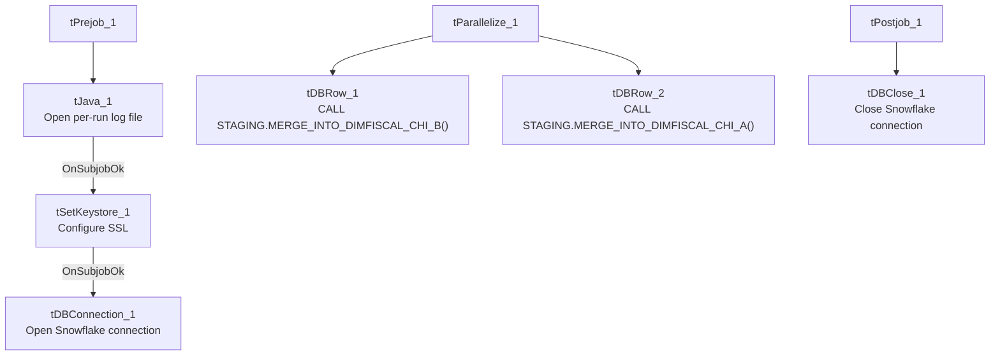

# Talend Job: DimFiscal_CHI_Load

## Overview

A merge-only orchestrator for the "CHI" site's fiscal/patient-billing dimension: it runs two Snowflake stored-procedure merges (`DIMFISCAL_CHI_A` and `DIMFISCAL_CHI_B`) in parallel to fold previously-staged CHI fiscal data into its final tables. It is part of a six-job family (`DimFiscal_<SITE>_Load` for CHI, CO, DC, HH, PRE, TOL) that share an identical template but differ in how many merge sub-tables (`_A` through `_E`) each site actually has — CHI is the **smallest** member of the family, with only two merges where CO/DC/PRE/TOL have three and HH has five (see Issues observed for the full comparison).

## Detail table

| Field | Value |
|---|---|
| Job name | DimFiscal_CHI_Load |
| Version | 0.1 |
| Project | EDW2SF |
| Author | jmach@harriscollect.com |
| Created | 2022-07-08T11:25:11.869-0700 |
| Last Modified | 2025-11-04T11:08:07.102-0800 |

## Step-by-step data flow

**Setup subjob:** `tPrejob_1` → `tJava_1` opens a per-run log file at `context.logDir + jobName + "_" + <timestamp> + ".log"` and redirects `System.out`/`System.err` to it → on subjob success, `tSetKeystore_1` configures SSL trust/keystore (truststore path hardcoded, see Settings) → on subjob success, `tDBConnection_1` opens the Snowflake connection.

**Main subjob:** `tParallelize_1` runs two branches at the same time:
1. `tDBRow_1` runs `CALL STAGING.MERGE_INTO_DIMFISCAL_CHI_B();`
2. `tDBRow_2` runs `CALL STAGING.MERGE_INTO_DIMFISCAL_CHI_A();`

Neither merge component captures a return value or branches on success/failure in this job — both simply run and the job either succeeds or fails on a raw Talend execution error.

**Teardown subjob:** `tPostjob_1` → `tDBClose_1` (Snowflake).

## Settings tables

### SSL setup: `tSetKeystore_1`

| Setting | Value | What it means |
|---|---|---|
| SSL_TRUSTSERVER_TRUSTSTORE | `"C:/clientTrustStore.trustStore"` (hardcoded) | A fixed Windows path to the SSL truststore file — see Issues observed. |
| SSL_KEYSTORE | `context.keystorePath` | Keystore path is context-driven, unlike the truststore path above. |
| SSL_TRUSTSERVER_PASSWORD / SSL_KEYSTORE_PASSWORD | `***REDACTED***` | Preserved as redacted. |

### Merges: `tDBRow_1` / `tDBRow_2`

| Setting | Value | What it means |
|---|---|---|
| Query 1 | `CALL STAGING.MERGE_INTO_DIMFISCAL_CHI_B();` | Merges the "B" fiscal sub-table for the CHI site. |
| Query 2 | `CALL STAGING.MERGE_INTO_DIMFISCAL_CHI_A();` | Merges the "A" fiscal sub-table for the CHI site. |
| Result handling | None captured | Unlike some other merge jobs in this project (e.g. `DimDeskInfo_Load`), neither `tDBRow` here has a downstream `tJavaRow`/`tWarn`/`tDie` — see Issues observed. |

## Dependencies & configuration

- **Triggers/depends on other jobs:** none — no `tRunJob` links found in this job's own metadata. (Note: `CO_Master_Load` calls the CO sibling, `DimFiscal_CO_Load`, via `tRunJob` — see `06_dependency_matrix.md` — but nothing in this project's captured orchestration calls `DimFiscal_CHI_Load` itself; how/when it's triggered is not visible in this metadata.)
- **Context variables used:** `keystorePath`, `logDir`.
- **1 hardcoded path finding:** `tSetKeystore_1.SSL_TRUSTSERVER_TRUSTSTORE = "C:/clientTrustStore.trustStore"`.

## Glossary

| Component type | Plain-English meaning |
|---|---|
| `tJava` | Runs custom Java code once — here, to redirect the job's console output to a per-run log file. |
| `tSetKeystore` | Configures the SSL trust/keystore used for secure connections made later in the job. |
| `tSnowflakeConnection` / `tSnowflakeClose` / `tSnowflakeRow` | Open/close a Snowflake connection, or run an arbitrary SQL statement/procedure call against it. |
| `tParallelize` | Runs its downstream branches at the same time rather than one after another. |

## Issues observed

- **No result-code checking on either merge call.** Unlike `CO_Master_Load`'s `FACTTRANS` merge (which captures `RETVALUE` and logs a `tWarn`) or `DimDeskInfo_Load`'s merge (which branches to `tDie`/`tWarn`), this job's two `tDBRow` merges have no downstream `tJavaRow`, `tWarn`, or `tDie`. A merge procedure that returns an error code without throwing a SQL exception would go completely unnoticed — the job would report success regardless. Verify whether `MERGE_INTO_DIMFISCAL_CHI_A/B()` are expected to throw on failure rather than return a status code.
- **Family comparison — DimFiscal_CHI_Load has only 2 merge sub-tables (A, B)**, the fewest of the six `DimFiscal_<SITE>_Load` siblings in this batch: CO/DC/TOL each have 3 (A, B, C), PRE has 3 configured but one (`_C`) is disabled (`ACTIVATE=false` — see `job_DimFiscal_PRE_Load.md`), and HH has 5 (A–E). Unable to determine from metadata whether CHI genuinely has fewer fiscal sub-categories than the other sites or whether a `_C` merge was never built out for this site — worth confirming with the team if CHI fiscal reporting seems incomplete relative to other sites.
- **The SSL truststore path is hardcoded** (`C:/clientTrustStore.trustStore`) while the keystore path uses `context.keystorePath` — an inconsistency in how the same job handles two very similar SSL settings. This hardcoded path is repeated identically across all six `DimFiscal_<SITE>_Load` siblings, so a truststore relocation would require updating all six jobs individually.
