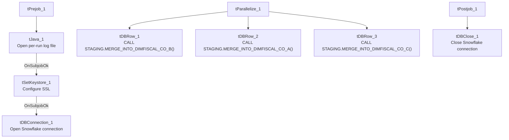

# Talend Job: DimFiscal_CO_Load

## Overview

A merge-only orchestrator for the "CO" site's fiscal/patient-billing dimension: it runs three Snowflake stored-procedure merges (`DIMFISCAL_CO_A`, `_B`, `_C`) in parallel to fold previously-staged CO fiscal data into its final tables. This is the member of the `DimFiscal_<SITE>_Load` family that is directly called by `CO_Master_Load` (see Dependencies below), making it the only sibling with a confirmed, documented trigger.

## Detail table

| Field | Value |
|---|---|
| Job name | DimFiscal_CO_Load |
| Version | 0.1 |
| Project | EDW2SF |
| Author | jmach@harriscollect.com |
| Created | 2022-07-10T19:28:58.415-0700 |
| Last Modified | 2025-11-04T11:08:10.583-0800 |

## Step-by-step data flow

**Setup subjob:** `tPrejob_1` → `tJava_1` opens a per-run log file → on subjob success, `tSetKeystore_1` configures SSL trust/keystore → on subjob success, `tDBConnection_1` opens the Snowflake connection.

**Main subjob:** `tParallelize_1` runs three branches at the same time:
1. `tDBRow_1` runs `CALL STAGING.MERGE_INTO_DIMFISCAL_CO_B();`
2. `tDBRow_2` runs `CALL STAGING.MERGE_INTO_DIMFISCAL_CO_A();`
3. `tDBRow_3` runs `CALL STAGING.MERGE_INTO_DIMFISCAL_CO_C();`

No result-code checking is wired on any of the three merges.

**Teardown subjob:** `tPostjob_1` → `tDBClose_1` (Snowflake).

## Settings tables

### SSL setup: `tSetKeystore_1`

| Setting | Value | What it means |
|---|---|---|
| SSL_TRUSTSERVER_TRUSTSTORE | `"C:/clientTrustStore.trustStore"` (hardcoded) | Same hardcoded truststore path used across all six `DimFiscal_<SITE>_Load` siblings. |
| SSL_KEYSTORE | `context.keystorePath` | Context-driven. |

### Merges: `tDBRow_1` / `tDBRow_2` / `tDBRow_3`

| Setting | Value | What it means |
|---|---|---|
| Query 1 | `CALL STAGING.MERGE_INTO_DIMFISCAL_CO_B();` | Merges the "B" fiscal sub-table for CO. |
| Query 2 | `CALL STAGING.MERGE_INTO_DIMFISCAL_CO_A();` | Merges the "A" fiscal sub-table for CO. |
| Query 3 | `CALL STAGING.MERGE_INTO_DIMFISCAL_CO_C();` | Merges the "C" fiscal sub-table for CO. |
| Result handling | None captured | No `tJavaRow`/`tWarn`/`tDie` downstream of any of the three — see Issues observed. |

## Dependencies & configuration

- **Triggers/depends on other jobs:** none itself, but **this job is called by `CO_Master_Load`** via `tRunJob_5`, as the fourth step in that orchestrator's client/debtor/reference-data chain (`CUBS_Raw_CO_Client_Load` → `CUBS_Raw_CO_Debtor_Load` → `CUBS_Raw_CO_ETL_Load` → **`DimFiscal_CO_Load`** → `CUBS_Raw_DeskInfo_Load`). Per `job_CO_Master_Load.md`, that `tRunJob` call is configured with `USE_INDEPENDENT_PROCESS=false` — the only one of `CO_Master_Load`'s 10 sub-job calls set that way, meaning this job runs inside `CO_Master_Load`'s own JVM rather than as a separate process.
- **Context variables used:** `keystorePath`, `logDir`.
- **1 hardcoded path finding:** `tSetKeystore_1.SSL_TRUSTSERVER_TRUSTSTORE = "C:/clientTrustStore.trustStore"`.

## Glossary

| Component type | Plain-English meaning |
|---|---|
| `tJava` | Runs custom Java code once — here, to redirect console output to a per-run log file. |
| `tSetKeystore` | Configures the SSL trust/keystore used for secure connections made later in the job. |
| `tSnowflakeConnection` / `tSnowflakeClose` / `tSnowflakeRow` | Open/close a Snowflake connection, or run an arbitrary SQL statement/procedure call against it. |
| `tParallelize` | Runs its downstream branches at the same time rather than one after another. |

## Issues observed

- **No result-code checking on any of the three merge calls** — same gap as its `DimFiscal_CHI_Load` sibling. A merge procedure returning a non-zero status without raising a SQL exception would go unnoticed.
- **This job runs in-process (`USE_INDEPENDENT_PROCESS=false`) when called from `CO_Master_Load`**, unlike the other 9 jobs that orchestrator calls. As flagged in `job_CO_Master_Load.md`, this may be intentional or an oversight — if this job's three parallel merges are resource-intensive, running them inside the parent orchestrator's JVM could affect `CO_Master_Load`'s own memory footprint or error isolation.
- **Family comparison — DimFiscal_CO_Load has 3 merge sub-tables (A, B, C)**, matching DC and TOL exactly, while CHI has only 2 and HH has 5; PRE nominally has 3 but one is disabled (see `job_DimFiscal_PRE_Load.md`). CO is the only sibling with a confirmed caller in this project's orchestration metadata.
- Same hardcoded truststore path issue documented across the whole `DimFiscal_<SITE>_Load` family (see `05_operational_runbook.md`'s hardcoded-path note) applies here.
