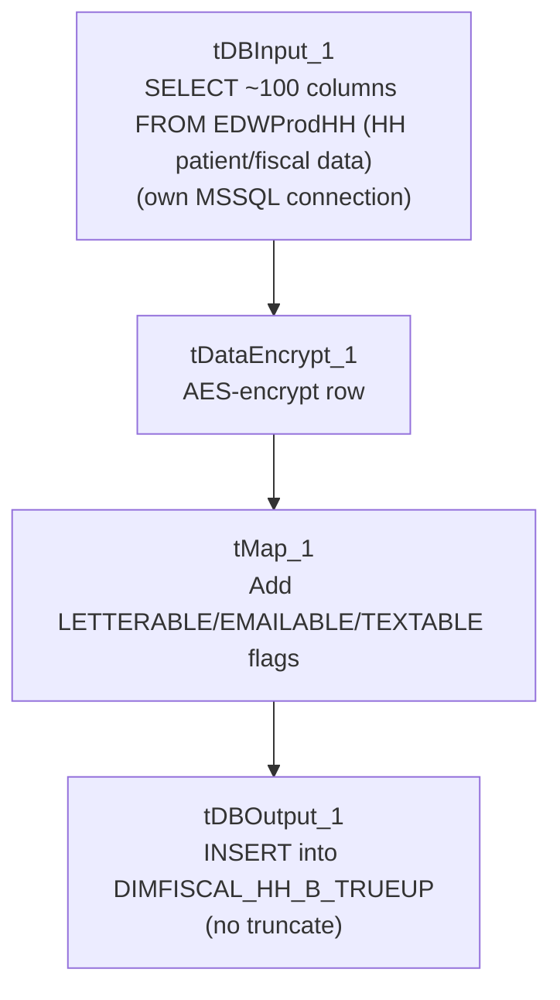

# Talend Job: DimFiscal_HH_B_TrueUp

## Overview

Unlike every other job in the `DimFiscal_*` family (which are merge-only orchestrators calling `STAGING.MERGE_INTO_DIMFISCAL_<SITE>_<LETTER>()` stored procedures), this is a standalone **data load** job: it reads a wide (~100-column) patient/insurance/collections extract for the "HH" site directly from the "EDWProdHH" MSSQL database, encrypts the row with AES, and inserts it into a dedicated `DIMFISCAL_HH_B_TRUEUP` Snowflake table. The name suggests a one-off or periodic "true-up" (reconciliation) load of the HH "B" fiscal data set, run separately from the regular `DimFiscal_HH_Load` merge cycle.

## Detail table

| Field | Value |
|---|---|
| Job name | DimFiscal_HH_B_TrueUp |
| Version | 0.1 |
| Project | EDW2SF |
| Author | jmach@harriscollect.com |
| Created | 2024-10-01T07:48:11.397-0700 |
| Last Modified | 2025-09-24T11:01:02.206-0700 |

## Step-by-step data flow

**No `tPrejob`/`tPostjob`, connection-open/close, or logging setup components are present in this job's metadata** — see Issues observed. The job's only visible flow is a single linear chain:

1. `tDBInput_1` (`USE_EXISTING_CONNECTION=false`, opens its own MSSQL connection using `context.EDWProdHH_*` variables) runs a large `SELECT` against the HH site's patient/billing source, returning ~100 columns: file date, logon (hardcoded literal `'HH'`), debtor number, patient demographics (name, DOB, SSN, address, phone), admit/discharge/diagnosis fields, insurance/employer fields (many suffixed `_F<number>`, suggesting positional form-field origins), collection-history flags (bankruptcy possibility, bad/positive trade counts, 30/60/90-day past-due buckets), and an `UpdateKey`/`PURGE_FLG` pair.
2. `tDataEncrypt_1` encrypts the row using AES (secret type, key, and password all `***REDACTED***`), writing a crypto-controller file reference to `"C:/Data/dimdbtr.crypt"` — a different hardcoded path from the similar `tDataEncrypt` step in `DimDebtor_NewFields_Load` (`/home/talenduser/dimdbtr.crypt`), even though both reference the same filename stem.
3. `tMap_1` maps the ~100 encrypted-passthrough columns to the target schema, adding three computed flag columns (`LETTERABLE`, `EMAILABLE`, `TEXTABLE`).
4. `tDBOutput_1` inserts the rows into Snowflake table `DIMFISCAL_HH_B_TRUEUP` (`INSERT`, `tableAction=NONE` — no truncate, so this table accumulates across runs; `DIE_ON_ERROR=true` on `tMap_1`, so a mapping failure fails the job outright).

## Settings tables

### Source: `tDBInput_1` (`tMSSqlInput`)

| Setting | Value | What it means |
|---|---|---|
| USE_EXISTING_CONNECTION | `false` | Opens its own dedicated MSSQL connection inline rather than sharing a `tDBConnection` component — unusual compared to the rest of this project's jobs. |
| Query (visible portion) | `SELECT dd.[Date] AS FILEDATE, 'HH' AS LOGON, DebtorNumber AS DEBTOR_NUMBER, CAST(DimLogon AS NUMERIC(38,0)) AS DimLogon, DEBTOR_IDX, PAT_NAME_F258 AS PATIENT_NAME, ADMIT_DIAG_F259 AS ADMIT_DIAGNOSIS, TRY_CAST(ADMIT_DATE_F260 AS DATE...` (truncated) | A hospital/patient-billing style extract — the `_F<number>` column suffixes throughout the schema (e.g. `GROUP_F292`, `INS_NAME_F298`) strongly suggest the source system uses numbered form fields. |
| Result columns of note | `POSS_CH7`/`POSS_CH11`/`POSS_CH13` (bankruptcy chapter flags), `BAD_TRADES`/`POS_TRADES`, `THIRTY_60_PAST`/`SIXTYONE_90_PAST`/`NINETYONE_PAST` (aging buckets), `PURGE_FLG` | Credit/collections-history fields not present in the simpler `DimFiscal_<SITE>_Load` merge jobs, reinforcing that HH's fiscal data model is the most detailed of the six sites. |

### Transform: `tDataEncrypt_1`

| Setting | Value | What it means |
|---|---|---|
| CRYPTO_METHOD | `AES` | Encrypts the row before it's written anywhere. |
| CRYPTO_FILE_PATH | `"C:/Data/dimdbtr.crypt"` | Hardcoded Windows path — see Issues observed. |
| SECRET_TYPE / SECRET_KEY / PASSWORD_M1 | `***REDACTED***` | Preserved as redacted. |

### Target: `tDBOutput_1` (`tSnowflakeOutput`)

| Setting | Value | What it means |
|---|---|---|
| Table | `DIMFISCAL_HH_B_TRUEUP` | Destination table, distinct from the `DIMFISCAL_HH_B` table merged by `DimFiscal_HH_Load`. |
| Output action / Table action | `INSERT` / `NONE` | No truncate — accumulates across runs; see Issues observed. |

## Dependencies & configuration

- **Triggers/depends on other jobs:** none — no `tRunJob` links found, and this job does not appear as a target of any other job's `tRunJob` in this project's captured orchestration.
- **Context variables used:** `EDWProdHH_Database`, `EDWProdHH_Login`, `EDWProdHH_Port`, `EDWProdHH_Schema`, `EDWProdHH_Server`.
- No hardcoded developer-workstation (`C:/Talend-Studio-...`) paths were flagged by the extraction, but see Issues observed regarding `tDataEncrypt_1`'s crypto file path.

## Glossary

| Component type | Plain-English meaning |
|---|---|
| `tMSSqlInput` | Runs a query against a Microsoft SQL Server source. |
| `tDataEncrypt` | Encrypts one or more columns (or the whole row) using a configured algorithm and key before it continues downstream. |
| `tMap` | Maps/transforms columns from one schema to another. |
| `tSnowflakeOutput` | Writes rows to a Snowflake table. |

## Issues observed

- **This job has no `tPrejob`/`tPostjob`, no explicit Snowflake connection-open/close pair, and no per-run log file setup** — a structural gap compared to every other job in this batch (and this project generally), which consistently wrap their main flow in prejob/postjob subjobs. `tDBOutput_1` (a `tSnowflakeOutput`) must be using an implicit/default connection not captured as a separate component in this metadata. Unable to determine from metadata whether this reflects the job's actual design (e.g., built quickly as a one-off "true-up" utility rather than a production-pattern job) or an extraction gap — verify directly in Talend Studio.
- **`DIMFISCAL_HH_B_TRUEUP` has no truncate before load (`tableAction=NONE`)**, and the source query has no visible incremental filter (no `context.max*` reference). Re-running this job would likely append duplicate rows unless the source query's `WHERE` clause (not fully visible in this metadata) already limits it to a specific date/batch — consistent with a "true-up" utility meant to be run deliberately for a specific reconciliation event rather than on an automated recurring schedule. Confirm with the team whether this job is scheduled or run manually.
- **The crypto file path (`C:/Data/dimdbtr.crypt`) differs from the similar `tDataEncrypt` step in `DimDebtor_NewFields_Load`** (`/home/talenduser/dimdbtr.crypt`), even though both reference the same "dimdbtr" filename stem and likely serve a related encryption purpose. This inconsistency (one Windows path, one Linux path, both hardcoded) suggests these two encryption steps were configured independently rather than sharing a common crypto-configuration source — worth confirming both point to a key/config that's still valid and consistent.
- **Naming note:** despite being grouped with the `DimFiscal_<SITE>_Load` family by name, this job's data (patient/insurance/collections detail) and structure (direct load + encrypt, no merge-procedure orchestration) make it a fundamentally different kind of job from its five `DimFiscal_<SITE>_Load` siblings — treat it as a related-but-distinct utility rather than a seventh site variant.
