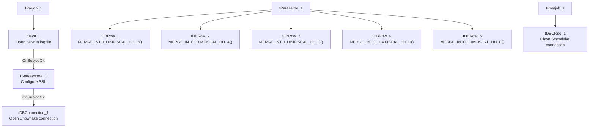

# Talend Job: DimFiscal_HH_Load

## Overview

A merge-only orchestrator for the "HH" site's fiscal/patient-billing dimension: it runs **five** Snowflake stored-procedure merges (`DIMFISCAL_HH_A` through `_E`) in parallel to fold previously-staged HH fiscal data into its final tables. This is the **largest** member of the `DimFiscal_<SITE>_Load` family — HH is the only site with an `_E` sub-table, and (per `DimScore_Load`, documented elsewhere in this project) HH's fiscal data also feeds separate scoring outputs (`FISCAL_HH_C`, `FISCAL_HH_E`) not present for other sites.

## Detail table

| Field | Value |
|---|---|
| Job name | DimFiscal_HH_Load |
| Version | 0.1 |
| Project | EDW2SF |
| Author | jmach@harriscollect.com |
| Created | 2022-07-08T11:08:14.057-0700 |
| Last Modified | 2025-11-04T11:08:13.032-0800 |

## Step-by-step data flow

**Setup subjob:** `tPrejob_1` → `tJava_1` opens a per-run log file → on subjob success, `tSetKeystore_1` configures SSL trust/keystore → on subjob success, `tDBConnection_1` opens the Snowflake connection.

**Main subjob:** `tParallelize_1` runs five branches at the same time:
1. `tDBRow_1` runs `CALL STAGING.MERGE_INTO_DIMFISCAL_HH_B();`
2. `tDBRow_2` runs `CALL STAGING.MERGE_INTO_DIMFISCAL_HH_A();`
3. `tDBRow_3` runs `CALL STAGING.MERGE_INTO_DIMFISCAL_HH_C();`
4. `tDBRow_4` runs `CALL STAGING.MERGE_INTO_DIMFISCAL_HH_D();`
5. `tDBRow_5` runs `CALL STAGING.MERGE_INTO_DIMFISCAL_HH_E();`

No result-code checking is wired on any of the five merges.

**Teardown subjob:** `tPostjob_1` → `tDBClose_1` (Snowflake).

## Settings tables

### SSL setup: `tSetKeystore_1`

| Setting | Value | What it means |
|---|---|---|
| SSL_TRUSTSERVER_TRUSTSTORE | `"C:/clientTrustStore.trustStore"` (hardcoded) | Same hardcoded truststore path used across all six `DimFiscal_<SITE>_Load` siblings. |
| SSL_KEYSTORE | `context.keystorePath` | Context-driven. |

### Merges: `tDBRow_1`–`tDBRow_5`

| Setting | Value | What it means |
|---|---|---|
| Queries | `CALL STAGING.MERGE_INTO_DIMFISCAL_HH_A();` through `_E();` | Five separate fiscal sub-tables for the HH site — more than any other site in this family. |
| Result handling | None captured | No `tJavaRow`/`tWarn`/`tDie` downstream of any of the five. |

## Dependencies & configuration

- **Triggers/depends on other jobs:** none — no `tRunJob` links found, and no orchestrator in this project's captured metadata calls `DimFiscal_HH_Load`.
- **Context variables used:** `keystorePath`, `logDir`.
- **1 hardcoded path finding:** `tSetKeystore_1.SSL_TRUSTSERVER_TRUSTSTORE = "C:/clientTrustStore.trustStore"`.
- **Related jobs:** `DimScore_Load` (also in this batch) reads directly from `dimfiscal_hh_c` (joined to `DimLogOn`) to populate an `Experian` score table, and separately reads a fiscal query it labels "Fiscal_E" into a `FISCAL_HH_E` table — both presumably downstream consumers of the `_C` and `_E` merges this job performs. `DimFiscal_HH_B_TrueUp` (also in this batch) is a separate, differently-structured job that loads fresh HH fiscal "B" source data directly from MSSQL rather than merging already-staged data — it is not part of this job's `tRunJob`/merge chain but shares the "B" naming.

## Glossary

| Component type | Plain-English meaning |
|---|---|
| `tJava` | Runs custom Java code once — here, to redirect console output to a per-run log file. |
| `tSetKeystore` | Configures the SSL trust/keystore used for secure connections made later in the job. |
| `tSnowflakeConnection` / `tSnowflakeClose` / `tSnowflakeRow` | Open/close a Snowflake connection, or run an arbitrary SQL statement/procedure call against it. |
| `tParallelize` | Runs its downstream branches at the same time rather than one after another. |

## Issues observed

- **No result-code checking on any of the five merge calls** — same gap as every other sibling in this family.
- **Family comparison — DimFiscal_HH_Load has 5 merge sub-tables (A–E)**, the most of any site: CO/DC/TOL have 3, CHI has 2, and PRE nominally has 3 but one is disabled. Unable to determine from metadata why HH's fiscal model is subdivided further than other sites — likely reflects a genuinely more complex HH billing/fiscal data model (consistent with `DimFiscal_HH_B_TrueUp`'s much larger ~100-column patient/insurance schema compared to other sites' simpler fiscal loads), but worth confirming with the team.
- **Running five parallel Snowflake procedure calls from one job** increases the number of concurrent sessions/warehouse load at run time compared to the 2–3-way parallelism of its siblings — if Snowflake warehouse sizing or concurrency limits are a concern, this job is the heaviest of the family.
- Same hardcoded truststore path issue documented across the whole `DimFiscal_<SITE>_Load` family applies here.
