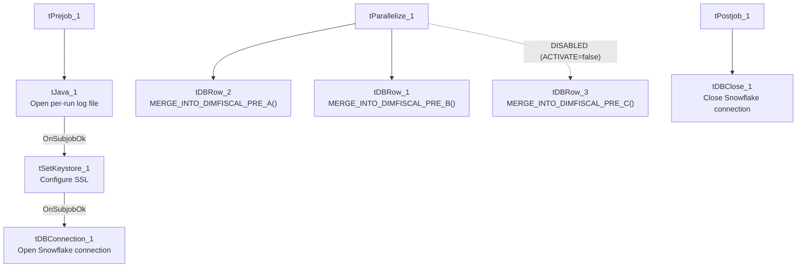

# Talend Job: DimFiscal_PRE_Load

## Overview

A merge-only orchestrator for the "PRE" site's fiscal/patient-billing dimension, structurally matching the CO/DC/TOL siblings with three merge sub-tables (`A`, `B`, `C`) — except that **the "C" merge component is disabled** (`ACTIVATE=false`) in this job's current configuration, meaning only two of the three merges (`A`, `B`) actually run. This is the one genuinely functional difference among the `DimFiscal_<SITE>_Load` family beyond site naming and sub-table count.

## Detail table

| Field | Value |
|---|---|
| Job name | DimFiscal_PRE_Load |
| Version | 0.1 |
| Project | EDW2SF |
| Author | jmach@harriscollect.com |
| Created | 2022-08-09T17:06:18.134-0700 |
| Last Modified | 2025-11-04T11:08:05.631-0800 |

## Step-by-step data flow

**Setup subjob:** `tPrejob_1` → `tJava_1` opens a per-run log file → on subjob success, `tSetKeystore_1` configures SSL trust/keystore → on subjob success, `tDBConnection_1` opens the Snowflake connection.

**Main subjob:** `tParallelize_1` runs three branches at the same time:
1. `tDBRow_2` runs `CALL STAGING.MERGE_INTO_DIMFISCAL_PRE_A();`
2. `tDBRow_1` runs `CALL STAGING.MERGE_INTO_DIMFISCAL_PRE_B();`
3. `tDBRow_3` runs `CALL STAGING.MERGE_INTO_DIMFISCAL_PRE_C();` — **but `tDBRow_3` has `ACTIVATE=false`**, so this branch does not actually execute at run time even though it is still wired into `tParallelize_1`.

No result-code checking is wired on any of the three merges.

**Teardown subjob:** `tPostjob_1` → `tDBClose_1` (Snowflake).

## Settings tables

### SSL setup: `tSetKeystore_1`

| Setting | Value | What it means |
|---|---|---|
| SSL_TRUSTSERVER_TRUSTSTORE | `"C:/clientTrustStore.trustStore"` (hardcoded) | Same hardcoded truststore path used across all six `DimFiscal_<SITE>_Load` siblings. |
| SSL_KEYSTORE | `context.keystorePath` | Context-driven. |

### Merges: `tDBRow_1` / `tDBRow_2` / `tDBRow_3`

| Setting | Value | What it means |
|---|---|---|
| Query (`tDBRow_1`) | `CALL STAGING.MERGE_INTO_DIMFISCAL_PRE_B();` | Runs normally. |
| Query (`tDBRow_2`) | `CALL STAGING.MERGE_INTO_DIMFISCAL_PRE_A();` | Runs normally. |
| Query (`tDBRow_3`) | `CALL STAGING.MERGE_INTO_DIMFISCAL_PRE_C();` | **`ACTIVATE=false`** — this component is switched off in the job design and will not run, regardless of the `tParallelize` wiring shown in the canvas. See Issues observed. |
| Result handling | None captured | No `tJavaRow`/`tWarn`/`tDie` downstream of any of the three. |

## Dependencies & configuration

- **Triggers/depends on other jobs:** none — no `tRunJob` links found, and no orchestrator in this project's captured metadata calls `DimFiscal_PRE_Load`.
- **Context variables used:** `keystorePath`, `logDir`.
- **1 hardcoded path finding:** `tSetKeystore_1.SSL_TRUSTSERVER_TRUSTSTORE = "C:/clientTrustStore.trustStore"`.

## Glossary

| Component type | Plain-English meaning |
|---|---|
| `tJava` | Runs custom Java code once — here, to redirect console output to a per-run log file. |
| `tSetKeystore` | Configures the SSL trust/keystore used for secure connections made later in the job. |
| `tSnowflakeConnection` / `tSnowflakeClose` / `tSnowflakeRow` | Open/close a Snowflake connection, or run an arbitrary SQL statement/procedure call against it. |
| `tParallelize` | Runs its downstream branches at the same time rather than one after another. |

## Issues observed

- **`tDBRow_3` (the "C" merge, `MERGE_INTO_DIMFISCAL_PRE_C()`) is disabled via `ACTIVATE=false`.** This is the single clearest functional difference across the entire `DimFiscal_<SITE>_Load` family — every other sibling (CO, DC, TOL) that has an "A/B/C" structure runs all three merges; PRE's job still shows the "C" component wired into `tParallelize_1` on the canvas, but it will not execute. This could mean either: (a) PRE genuinely has no "C" fiscal sub-table and the component was disabled rather than deleted, or (b) the "C" merge was intentionally turned off (e.g. due to a known data issue) and never re-enabled. **Unable to determine which from metadata — this is worth explicitly confirming with the team**, since a silently-disabled component is easy to miss when reviewing the job in Talend Studio's canvas view (it still appears in the flow).
- **No result-code checking on the two active merge calls** — same gap as every other sibling in this family.
- Same hardcoded truststore path issue documented across the whole `DimFiscal_<SITE>_Load` family applies here.
