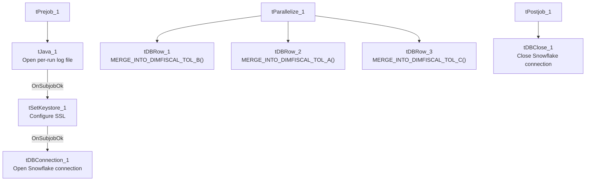

# Talend Job: DimFiscal_TOL_Load

## Overview

A merge-only orchestrator for the "TOL" site's fiscal/patient-billing dimension: it runs three Snowflake stored-procedure merges (`DIMFISCAL_TOL_A`, `_B`, `_C`) in parallel to fold previously-staged TOL fiscal data into its final tables. Functionally identical to `DimFiscal_CO_Load` and `DimFiscal_DC_Load` (same three active merge sub-tables, same wiring order `A, B, C`), differing only in the site-specific procedure names.

## Detail table

| Field | Value |
|---|---|
| Job name | DimFiscal_TOL_Load |
| Version | 0.1 |
| Project | EDW2SF |
| Author | jmach@harriscollect.com |
| Created | 2024-04-30T14:46:16.836-0700 |
| Last Modified | 2025-11-04T11:08:04.890-0800 |

## Step-by-step data flow

**Setup subjob:** `tPrejob_1` → `tJava_1` opens a per-run log file → on subjob success, `tSetKeystore_1` configures SSL trust/keystore → on subjob success, `tDBConnection_1` opens the Snowflake connection.

**Main subjob:** `tParallelize_1` runs three branches at the same time:
1. `tDBRow_1` runs `CALL STAGING.MERGE_INTO_DIMFISCAL_TOL_B();`
2. `tDBRow_2` runs `CALL STAGING.MERGE_INTO_DIMFISCAL_TOL_A();`
3. `tDBRow_3` runs `CALL STAGING.MERGE_INTO_DIMFISCAL_TOL_C();`

No result-code checking is wired on any of the three merges.

**Teardown subjob:** `tPostjob_1` → `tDBClose_1` (Snowflake).

## Settings tables

### SSL setup: `tSetKeystore_1`

| Setting | Value | What it means |
|---|---|---|
| SSL_TRUSTSERVER_TRUSTSTORE | `"C:/clientTrustStore.trustStore"` (hardcoded) | Same hardcoded truststore path used across all six `DimFiscal_<SITE>_Load` siblings. |
| SSL_KEYSTORE | `context.keystorePath` | Context-driven. |

### Merges: `tDBRow_1` / `tDBRow_2` / `tDBRow_3`

| Setting | Value | What it means |
|---|---|---|
| Query (`tDBRow_1`) | `CALL STAGING.MERGE_INTO_DIMFISCAL_TOL_B();` | Merges the "B" fiscal sub-table for TOL. |
| Query (`tDBRow_2`) | `CALL STAGING.MERGE_INTO_DIMFISCAL_TOL_A();` | Merges the "A" fiscal sub-table for TOL. |
| Query (`tDBRow_3`) | `CALL STAGING.MERGE_INTO_DIMFISCAL_TOL_C();` | Merges the "C" fiscal sub-table for TOL. |
| Result handling | None captured | No `tJavaRow`/`tWarn`/`tDie` downstream of any of the three. |

## Dependencies & configuration

- **Triggers/depends on other jobs:** none — no `tRunJob` links found, and no orchestrator in this project's captured metadata calls `DimFiscal_TOL_Load`.
- **Context variables used:** `keystorePath`, `logDir`.
- **1 hardcoded path finding:** `tSetKeystore_1.SSL_TRUSTSERVER_TRUSTSTORE = "C:/clientTrustStore.trustStore"`.

## Glossary

| Component type | Plain-English meaning |
|---|---|
| `tJava` | Runs custom Java code once — here, to redirect console output to a per-run log file. |
| `tSetKeystore` | Configures the SSL trust/keystore used for secure connections made later in the job. |
| `tSnowflakeConnection` / `tSnowflakeClose` / `tSnowflakeRow` | Open/close a Snowflake connection, or run an arbitrary SQL statement/procedure call against it. |
| `tParallelize` | Runs its downstream branches at the same time rather than one after another. |

## Issues observed

- **No result-code checking on any of the three merge calls** — same gap as every other sibling in this family.
- **Family comparison — DimFiscal_TOL_Load has 3 merge sub-tables (A, B, C)**, matching CO and DC exactly (and identical wiring order); CHI has only 2, HH has 5, and PRE nominally has 3 but one is disabled. This job is the most recently created of the six siblings (2024-04-30, vs. 2022 for the other five), but its structure is otherwise a direct copy of the CO/DC template.
- Same hardcoded truststore path issue documented across the whole `DimFiscal_<SITE>_Load` family applies here.
