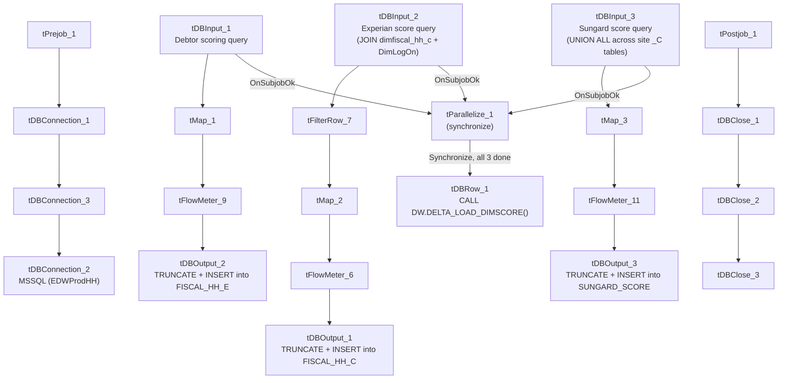

# Talend Job: DimScore_Load

## Overview

Loads three separate scoring/collections-analytics feeds from the "EDWProdHH" MSSQL database into Snowflake, all run in parallel: a general debtor scoring feed (Attune/Propensity/Decile/Dialer-group scores) into `FISCAL_HH_E`, an Experian credit score feed (joined from the HH site's fiscal "C" table) into `FISCAL_HH_C`, and a Sungard dollar-rate score feed (unioned across multiple sites' fiscal "C" tables) into `SUNGARD_SCORE`. After all three loads finish, it calls a Snowflake delta-load procedure (`DELTA_LOAD_DIMSCORE`) to merge the results into the final `DIMSCORE` dimension.

## Detail table

| Field | Value |
|---|---|
| Job name | DimScore_Load |
| Version | 0.1 |
| Project | EDW2SF |
| Author | jmach@harriscollect.com |
| Created | 2022-01-31T08:46:42.016-0800 |
| Last Modified | 2022-05-24T09:48:32.746-0700 |

## Step-by-step data flow

**Setup subjob:** `tPrejob_1` → `tDBConnection_1` (Snowflake) → `tDBConnection_3` (second Snowflake connection) → `tDBConnection_2` (MSSQL, "EDWProdHH" context variables).

**Main subjob** — three independent read/transform/load chains, each triggering `tParallelize_1` on its own subjob success; once all three have reported in, `tParallelize_1` synchronizes and fires the final merge:

1. **Debtor scoring feed:** `tDBInput_1` runs a query joining logon/debtor/score fields (Attune Score, Propensity Score, Decile Trial Group, Dialer Group) → `tMap_1` passes through, renaming `DEBTOR` to `DEBTORNUMBER` → `tFlowMeter_9` counts rows → `tDBOutput_2` truncates and inserts into Snowflake `FISCAL_HH_E`.
2. **Experian score feed:** `tDBInput_2` runs `SELECT debtornumber, CAST(df.dimlogon...), L.Logon, COALESCE(TRY_CAST(df.ctrl_f499 AS numeric(10,0)), 0) AS experian_score FROM dimfiscal_hh_c df INNER JOIN DimLogOn L ON df.DimLogon = L.DimL...` (truncated) → `tFilterRow_7` applies a filter (condition truncated, appears to compare two columns) → `tMap_2` passes through → `tFlowMeter_6` counts rows → `tDBOutput_1` truncates and inserts into Snowflake `FISCAL_HH_C`.
3. **Sungard score feed:** `tDBInput_3` runs a `UNION ALL` query pulling `DOLLAR_RT` (renamed `SUNGARD_SCORE`) from `DimFiscal_CO_C`, `DimFiscal_CHI_C`, and presumably other sites' `_C` fiscal tables (query truncated after two `UNION ALL` segments), filtered to non-blank `DOLLAR_RT` values → `tMap_3` passes through → `tFlowMeter_11` counts rows → `tDBOutput_3` truncates and inserts into Snowflake `SUNGARD_SCORE`.
4. Once all three source reads report `OnSubjobOk` to `tParallelize_1`, it synchronizes and fires `tDBRow_1`, which runs `CALL DW.DELTA_LOAD_DIMSCORE();` to merge the three feeds into the final `DIMSCORE` dimension.

**Teardown subjob:** `tPostjob_1` → `tDBClose_1` (Snowflake) → `tDBClose_2` (MSSQL) → `tDBClose_3` (second Snowflake).

## Settings tables

### Feed 1: `tDBInput_1` / `tDBOutput_2`

| Setting | Value | What it means |
|---|---|---|
| Query (visible) | `SELECT E.[LOGON], CAST(L.DimLogon...), [DEBTOR], TRY_CAST([Attune Score]...), TRY_CAST([Propen Score]...), TRY_CAST([Decile Tri...` (truncated) | Debtor-level scoring/analytics feed. |
| Target table | `FISCAL_HH_E` | |
| Output action / Table action | `INSERT` / `TRUNCATE` | Full replace every run. |

### Feed 2: `tDBInput_2` / `tDBOutput_1`

| Setting | Value | What it means |
|---|---|---|
| Query (visible) | `SELECT debtornumber, CAST(df.dimlogon AS numeric(10,0)) AS DimLogon, L.Logon, COALESCE(TRY_CAST(df.ctrl_f499 AS numeric(10,0)), 0) AS experian_score FROM dimfiscal_hh_c df INNER JOIN DimLogOn L ON df.DimLogon = L.DimL...` (truncated) | Derives an Experian credit score from a raw fiscal control field (`ctrl_f499`), defaulting to 0 when not castable. |
| Target table | `FISCAL_HH_C` | |
| Output action / Table action | `INSERT` / `TRUNCATE` | Full replace every run. |

### Feed 3: `tDBInput_3` / `tDBOutput_3`

| Setting | Value | What it means |
|---|---|---|
| Query (visible) | `SELECT L.LOGON, CO.DimLogon, CO.DebtorNumber, DOLLAR_RT FROM DimFiscal_CO_C CO INNER JOIN DimLogOn L ON L.DimLogOn = CO.DimLogon WHERE RTRIM(COALESCE(DOLLAR_RT,'')) <> '' UNION ALL SELECT L.LOGON, CHI.DimLogon, CHI.DebtorNumber, DOLLA...` (truncated after 2 of presumably more `UNION ALL` segments) | Combines a "dollar rate" score across multiple sites' fiscal "C" tables (CO and CHI visible; additional sites likely present but truncated) into one `SUNGARD_SCORE` feed. |
| Target table | `SUNGARD_SCORE` | |
| Output action / Table action | `INSERT` / `TRUNCATE` | Full replace every run. |

### Final merge: `tDBRow_1`

| Setting | Value | What it means |
|---|---|---|
| Query | `CALL DW.DELTA_LOAD_DIMSCORE();` | Merges/consolidates the three freshly-truncated-and-reloaded feed tables into the `DIMSCORE` dimension. Only fires after all three feeds report success via `tParallelize_1`'s synchronize behavior. |

## Dependencies & configuration

- **Triggers/depends on other jobs:** none — no `tRunJob` links found.
- **Context variables used:** `EDWProdHH_Database`, `EDWProdHH_Login`, `EDWProdHH_Port`, `EDWProdHH_Schema`, `EDWProdHH_Server`.
- **Related jobs:** reads from `dimfiscal_hh_c` and (via `UNION ALL`) `DimFiscal_CO_C`/`DimFiscal_CHI_C` — the same "_C" fiscal sub-tables merged by `DimFiscal_HH_Load`, `DimFiscal_CO_Load`, and `DimFiscal_CHI_Load` respectively, making this job a downstream consumer of those merges (though no formal `tRunJob` dependency exists — this job simply queries the resulting tables directly, so it must run after those merges complete for current data).
- No hardcoded developer-workstation paths found in this job.

## Glossary

| Component type | Plain-English meaning |
|---|---|
| `tMSSqlInput` / `tMSSqlConnection` / `tMSSqlClose` | Query a Microsoft SQL Server source / open and close that connection. |
| `tFilterRow` | Passes through only rows matching a configured condition, dropping the rest. |
| `tMap` | Maps/transforms columns from one schema to another. |
| `tFlowMeter` | Counts rows passing a point in the flow for logging/monitoring. |
| `tSnowflakeOutput` / `tSnowflakeConnection` / `tSnowflakeClose` / `tSnowflakeRow` | Write rows to Snowflake / open and close the Snowflake connection / run arbitrary SQL against it. |
| `tParallelize` | Runs its downstream branches at the same time; here used with `SYNCHRONIZE` to wait for all three feeds before firing the final merge. |

## Issues observed

- **This job has an undeclared, implicit dependency on `DimFiscal_HH_Load`, `DimFiscal_CO_Load`, and `DimFiscal_CHI_Load` having already run and merged current data** into `dimfiscal_hh_c`/`DimFiscal_CO_C`/`DimFiscal_CHI_C` — there is no `tRunJob` link enforcing that ordering. If `DimScore_Load` runs before those merges complete for a given cycle, its Experian and Sungard score feeds would reflect stale fiscal data with no error or warning raised. Verify the actual scheduling order with the team; this dependency is invisible from `DimScore_Load`'s own metadata alone.
- **The Sungard feed's `UNION ALL` query is truncated after two site segments (CO, CHI)** in this metadata — unable to determine from the visible text how many sites are actually included (all six site codes, or only some). If a site is missing from the union, its debtors would simply be absent from `SUNGARD_SCORE` with no error raised. Verify the full query directly in Talend Studio.
- **`tFilterRow_7`'s condition is truncated** (`input_row.columnName1.equals(input_row.columnNam...`) — unable to determine what rows are being excluded from the Experian score feed before it reaches `tMap_2`/`FISCAL_HH_C`.
- No result-code checking is wired on the final `DELTA_LOAD_DIMSCORE()` merge call — a failure there would surface only as a generic Talend execution error, consistent with the pattern flagged project-wide in `05_operational_runbook.md`.
