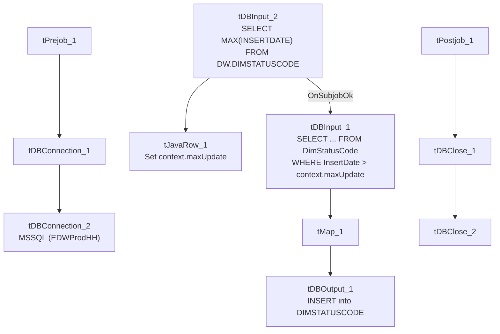

# Talend Job: DimStatus_Load

## Overview

An incremental loader for the account-status code dimension: it computes the current maximum `InsertDate` already loaded into Snowflake `DIMSTATUSCODE`, then pulls only newer rows from the "EDWProdHH" MSSQL `DimStatusCode` table and inserts them. A simple, low-volume reference-data job with no merge step — new rows are appended directly to the final table.

## Detail table

| Field | Value |
|---|---|
| Job name | DimStatus_Load |
| Version | 0.1 |
| Project | EDW2SF |
| Author | jmach@harriscollect.com |
| Created | 2022-04-06T08:42:52.640-0700 |
| Last Modified | 2025-09-24T11:00:15.394-0700 |

## Step-by-step data flow

**Setup subjob:** `tPrejob_1` → `tDBConnection_1` (Snowflake) → `tDBConnection_2` (MSSQL, "EDWProdHH" context variables).

**Main subjob:**

1. `tDBInput_2` runs `SELECT CAST(MAX(INSERTDATE) AS VARCHAR(10)) AS MAX_DATE FROM DW.DIMSTATUSCODE;` against Snowflake.
2. `tJavaRow_1` captures that value into `context.maxUpdate`.
3. On success, `tDBInput_1` runs `SELECT [DimStatusKey],[StatusCode],[Description],[InsertDate] FROM [dbo].[DimStatusCode] WHERE InsertDate > ` + `context.maxUpdate` against MSSQL — an explicitly incremental filter, unlike some sibling jobs in this project where the filter's presence is unconfirmed.
4. `tMap_1` passes the row through to the target schema.
5. `tDBOutput_1` inserts the rows into Snowflake `DIMSTATUSCODE` (`INSERT`, `tableAction=NONE` — no truncate, consistent with an append-only incremental design).

**Teardown subjob:** `tPostjob_1` → `tDBClose_1` (Snowflake) → `tDBClose_2` (MSSQL).

## Settings tables

### Source: `tDBInput_1` (`tMSSqlInput`)

| Setting | Value | What it means |
|---|---|---|
| Table | `DimStatusCode` | Source status-code lookup table. |
| Query | `SELECT [DimStatusKey],[StatusCode],[Description],[InsertDate] FROM [dbo].[DimStatusCode] WHERE InsertDate > ` + `context.maxUpdate` | **Confirmed incremental filter** — unlike `i3_CallDetail_40_Load`/`DimDebtor_Load`, this job's `WHERE` clause explicitly references the computed max value, so the incremental design is verifiably applied. |

### Target: `tDBOutput_1` (`tSnowflakeOutput`)

| Setting | Value | What it means |
|---|---|---|
| Table | `DIMSTATUSCODE` | Destination table. |
| Output action / Table action | `INSERT` / `NONE` | Appends only new rows — no truncate, consistent with the incremental filter above. |

## Dependencies & configuration

- **Triggers/depends on other jobs:** none — no `tRunJob` links found.
- **Context variables used:** `EDWProdHH_Database`, `EDWProdHH_Login`, `EDWProdHH_Port`, `EDWProdHH_Schema`, `EDWProdHH_Server`, `maxUpdate` (computed internally).
- No hardcoded developer-workstation paths found in this job.

## Glossary

| Component type | Plain-English meaning |
|---|---|
| `tMSSqlInput` / `tMSSqlConnection` / `tMSSqlClose` | Query a Microsoft SQL Server source / open and close that connection. |
| `tSnowflakeInput` / `tSnowflakeOutput` / `tSnowflakeConnection` / `tSnowflakeClose` | Query, write to, connect to, or close a Snowflake connection. |
| `tMap` | Maps/transforms columns from one schema to another. |
| `tJavaRow` | Runs custom Java code once per input row — here used to unpack a single query result into a context variable. |

## Issues observed

- **`InsertDate` is typed `id_BigDecimal` in the schema, not a date/timestamp type**, and the incremental comparison (`InsertDate > context.maxUpdate`) is a numeric/string comparison built from a `CAST(MAX(INSERTDATE) AS VARCHAR(10))` on the Snowflake side concatenated directly into the MSSQL query text. This works as a simple increasing-integer watermark, but it's worth confirming `InsertDate` values are genuinely monotonically increasing (e.g. a sequence or epoch-like value) rather than a true calendar date, since the column name could otherwise be misleading to someone unfamiliar with the source schema.
- Beyond that, this job has no other notable issues beyond the project-wide patterns already documented in `05_operational_runbook.md` — it correctly implements the incremental-load pattern that several sibling jobs in this project (`DimDebtor_Load`, `i3_CallDetail_40_Load`) leave unconfirmed.
