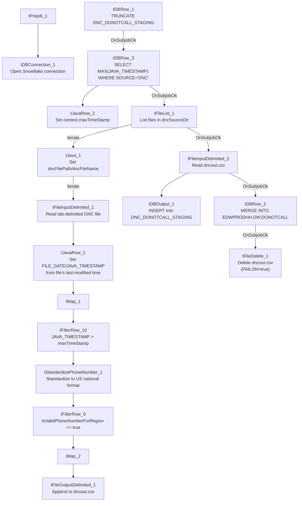

# Talend Job: DoNotCall_Load

## Overview

Parses raw Do-Not-Call (DNC) list files (tab-delimited, containing a record date, phone number, and free-text content per line) from a source directory, standardizes/validates each phone number to US national format, filters out already-processed records using a max-timestamp watermark, writes the qualifying rows to an intermediate pipe-delimited file, then loads that file into Snowflake staging and merges it into the final `EDWPRODHH.DW.DONOTCALL` table with a "last write wins by timestamp" merge rule. This is the "parsed/standardized" sibling of `DoNotCall_Load_Full`, which instead loads DNC file content verbatim without phone-number parsing (see that job's doc for the comparison).

## Detail table

| Field | Value |
|---|---|
| Job name | DoNotCall_Load |
| Version | 0.1 |
| Project | EDW2SF |
| Author | jmach@harriscollect.com |
| Created | 2024-12-04T08:26:03.441-0800 |
| Last Modified | 2024-12-16T13:18:02.432-0800 |

## Step-by-step data flow

**Setup subjob:** `tPrejob_1` → `tDBConnection_1` (Snowflake).

**Watermark + staging-clear subjob:**
1. `tDBRow_1` runs `TRUNCATE TABLE DNC_DONOTCALL_STAGING;` on Snowflake.
2. On success, `tDBRow_3` runs `SELECT COALESCE(MAX(JAVA_TIMESTAMP),0) AS MAX_TIMESTAMP FROM DNC_DONOTCALL_STAGING WHERE SOURCE='DNC';` — note this queries the table that was just truncated, so it would always return 0 in the same run (see Issues observed) — → `tJavaRow_2` captures the result into `context.maxTimeStamp`.
3. On `tDBRow_3`'s subjob success, `tFileList_1` lists files in `context.dncSourceDir` (an `EXCLUDEFILEMASK` of `*.txt` is configured but `IFEXCLUDE=false`, so every file in the directory is actually picked up).
4. For each file: `tJava_1` sets `context.dncFilePath`/`context.dncFileName` → `tFileInputDelimited_1` reads the file (tab-delimited, no header, `DIE_ON_ERROR=false`, using repository schema `"...metadata"` for both main and reject) → `tJavaRow_1` reads the file's OS last-modified timestamp into `FILE_DATE`/`JAVA_TIMESTAMP` → `tMap_1` maps to a `PHONENUMBER`/`CONTENT`/`SOURCE` schema → `tFilterRow_10` keeps only rows where `JAVA_TIMESTAMP > context.maxTimeStamp` → `tStandardizePhoneNumber_1` standardizes the phone number to US national format → `tFilterRow_9` keeps only rows where `IsValidPhoneNumberForRegion == true` → `tMap_2` maps to the final file-output schema → `tFileOutputDelimited_1` appends the row to `context.dncOutputDir + "dncout.csv"` (pipe-delimited, no header).
5. Once `tFileList_1`'s subjob completes, `tFileInputDelimited_2` reads the accumulated `dncout.csv` back in → feeds `tDBOutput_1` (inserts into Snowflake `DNC_DONOTCALL_STAGING`).
6. On that subjob's success, `tDBRow_2` runs a `MERGE INTO EDWPRODHH.DW.DONOTCALL` statement (see Settings) → on success, `tFileDelete_1` deletes `dncout.csv` (`FAILON=true` — a failed delete fails the job).

**Teardown:** no `tPostjob` component captured in this job's metadata (see Issues observed).

## Settings tables

### Source parsing: `tFileInputDelimited_1` / `tStandardizePhoneNumber_1`

| Setting | Value | What it means |
|---|---|---|
| FIELDSEPARATOR / HEADER | `\t` / 0 (no header) | Tab-delimited raw DNC files. |
| DIE_ON_ERROR | `false` | Malformed rows don't fail the job; no reject flow is wired (rejected rows silently dropped, same pattern flagged elsewhere in this project). |
| PHONE_NUMBER_FORMAT / COUNTRY_CODE_CUSTOME | `NATIONAL` / `"US"` | All numbers standardized to US national format regardless of source formatting. |
| Filter after standardization | `IsValidPhoneNumberForRegion == true` | Numbers that don't validate as US numbers are dropped from the output file entirely — no record of how many or which ones. |

### Merge: `tDBRow_2`

| Setting | Value | What it means |
|---|---|---|
| Query | `MERGE INTO EDWPRODHH.DW.DONOTCALL AS tgt USING (SELECT ... FROM EDWPRODHH.STAGING.DNC_DONOTCALL_STAGING QUALIFY ROW_NUMBER() OVER (PARTITION BY PHONENUMBER ORDER BY RECORD_DATE DESC)=1) AS src ON (tgt.PHONENUMBER=src.PHONENUMBER) WHEN MATCHED AND (src.JAVA_TIMESTAMP > tgt.JAVA_TIMESTAMP) THEN UPDATE ... WHEN NOT MATCHED THEN INSERT ...` | Deduplicates the staged batch to one row per phone number (latest `RECORD_DATE`), then upserts into the final table only when the new record's `JAVA_TIMESTAMP` is newer than what's already there — a "last write wins" merge, guarding against out-of-order file processing. |

### Cleanup: `tFileDelete_1`

| Setting | Value | What it means |
|---|---|---|
| FILENAME | `context.dncOutputDir+"dncout.csv"` | Deletes the intermediate file after a successful merge. |
| FAILON | `true` | If the delete fails (e.g. file locked or already gone), **this job fails** — stricter than its `DoNotCall_Load_Full` sibling, which sets `FAILON=false` for the equivalent step. |

## Dependencies & configuration

- **Triggers/depends on other jobs:** none — no `tRunJob` links found.
- **Context variables used:** `dncFileName`, `dncFilePath`, `dncOutputDir`, `dncSourceDir`, `maxTimeStamp` (computed internally).
- **4 hardcoded developer-workstation paths**: `tFileInputDelimited_1.TEMP_DIR`, `tFileInputDelimited_2.TEMP_DIR`, `tFileDelete_1.DIRECTORY`, `tFileDelete_1.PATH` (all `C:/Talend-Studio-20211109_1610-V8.0.1/workspace/...`) — same portability risk documented project-wide in `05_operational_runbook.md`.

## Glossary

| Component type | Plain-English meaning |
|---|---|
| `tFileList` | Lists files in a directory for the job to iterate over one at a time. |
| `tFileInputDelimited` / `tFileOutputDelimited` | Read/write a delimited (CSV-style) text file according to a schema. |
| `tJavaRow` / `tJava` | Run custom Java code once per row / once overall. |
| `tMap` | Maps/transforms columns from one schema to another. |
| `tFilterRow` | Passes through only rows matching a configured condition. |
| `tStandardizePhoneNumber` | Normalizes a phone number to a standard format and flags whether it's a valid number for a given region. |
| `tSnowflakeOutput` / `tSnowflakeConnection` / `tSnowflakeRow` | Write rows to Snowflake / open the connection / run arbitrary SQL against it. |
| `tFileDelete` | Deletes a file from disk. |

## Issues observed

- **The max-timestamp watermark query (`tDBRow_3`) runs against `DNC_DONOTCALL_STAGING` immediately after that same table was just truncated (`tDBRow_1`).** Since `DNC_DONOTCALL_STAGING` is a staging table that's cleared every run, `SELECT MAX(JAVA_TIMESTAMP) ... WHERE SOURCE='DNC'` would always return 0 (via `COALESCE`) within the same execution, making `context.maxTimeStamp` effectively meaningless as an incremental filter unless the intent was actually to check the *final* `EDWPRODHH.DW.DONOTCALL` table instead. **This looks like a logic bug**: the watermark should likely be computed from the final table (as `DimStatus_Load` and others correctly do against their target dimension) rather than from a table this same job just emptied. Unable to confirm the intended behavior from metadata alone; verify with the team — if uncorrected, `tFilterRow_10`'s `JAVA_TIMESTAMP > context.maxTimeStamp` filter would pass through every record in every source file every run, reprocessing files repeatedly.
- **No reject flow is wired from `tFileInputDelimited_1`.** `DIE_ON_ERROR=false`, so malformed rows don't fail the job, but there is also no connection carrying rejected rows anywhere — they are silently dropped with no record of how many or which ones failed to parse.
- **Invalid phone numbers are silently dropped** (`tFilterRow_9`) with no logging of how many records were excluded per file — if a source file's format changes and most/all numbers fail region validation, the job would still report success while loading few or zero DNC records.
- **`tFileDelete_1` has `FAILON=true`**, meaning if `dncout.csv` cannot be deleted after a successful merge (e.g. file lock, permissions), the whole job fails even though the DNC data was already correctly merged into the warehouse — a purely cosmetic cleanup failure would be indistinguishable from a data-load failure in the job's exit status.
- **No `tPostjob` component is present in this job's metadata** — unlike most other jobs in this project, there's no visible teardown subjob closing the Snowflake connection explicitly. Unable to determine whether this is an extraction gap or the job genuinely relies on implicit connection cleanup at job end.
