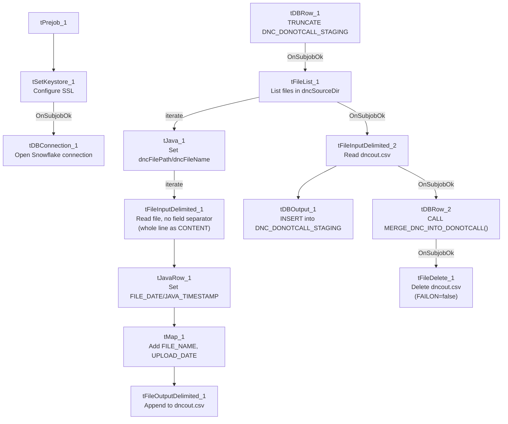

# Talend Job: DoNotCall_Load_Full

## Overview

Loads Do-Not-Call (DNC) list files verbatim — capturing each line's raw `CONTENT`, file name, and upload date, with **no phone-number parsing or standardization** — into Snowflake staging, then calls a stored procedure to merge the batch into the final DNC table. This is the "full/raw" sibling of `DoNotCall_Load`, which instead parses out a `PHONE_NUMBER` column and standardizes/validates it before loading (see that job's doc for the comparison). The version bump (0.2 vs. `DoNotCall_Load`'s 0.1) and later creation date (2025-01-08 vs. 2024-12-04) suggest this is a newer variant built shortly after the original.

## Detail table

| Field | Value |
|---|---|
| Job name | DoNotCall_Load_Full |
| Version | 0.2 |
| Project | EDW2SF |
| Author | jmach@harriscollect.com |
| Created | 2025-01-08T12:12:43.688-0800 |
| Last Modified | 2025-11-12T07:14:01.539-0800 |

## Step-by-step data flow

**Setup subjob:** `tPrejob_1` → `tSetKeystore_1` configures SSL trust/keystore → on subjob success, `tDBConnection_1` opens the Snowflake connection.

**Staging-clear + file-processing subjob:**
1. `tDBRow_1` runs `TRUNCATE TABLE DNC_DONOTCALL_STAGING;`.
2. On success, `tFileList_1` lists files in `context.dncSourceDir` (same `EXCLUDEFILEMASK`/`IFEXCLUDE=false` non-exclusion pattern as `DoNotCall_Load`).
3. For each file: `tJava_1` sets `context.dncFilePath`/`context.dncFileName` → `tFileInputDelimited_1` reads the file with **no field separator configured** (`FIELDSEPARATOR=""`), effectively treating each line as a single `CONTENT` value with no column splitting (`DIE_ON_ERROR=false`) → `tJavaRow_1` reads the file's OS last-modified timestamp into `FILE_DATE`/`JAVA_TIMESTAMP` → `tMap_1` maps to a schema of `FILE_DATE`, `JAVA_TIMESTAMP`, `CONTENT`, `SOURCE`, `FILE_NAME`, `UPLOAD_DATE` → `tFileOutputDelimited_1` appends the row to `context.dncOutputDir + "dncout.csv"` (pipe-delimited, no header) — **no phone-number extraction, standardization, or timestamp-based filtering happens in this job**, unlike `DoNotCall_Load`.
4. Once `tFileList_1`'s subjob completes, `tFileInputDelimited_2` reads `dncout.csv` back in → feeds `tDBOutput_1` (inserts into Snowflake `DNC_DONOTCALL_STAGING`).
5. On that subjob's success, `tDBRow_2` runs `CALL MERGE_DNC_INTO_DONOTCALL();` (a stored procedure call, unlike `DoNotCall_Load`'s inline `MERGE INTO` statement) → on success, `tFileDelete_1` deletes `dncout.csv` (`FAILON=false` — a failed delete does **not** fail the job here, unlike `DoNotCall_Load`).

**Teardown:** no `tPostjob` component captured in this job's metadata (same gap as `DoNotCall_Load`).

## Settings tables

### Source parsing: `tFileInputDelimited_1`

| Setting | Value | What it means |
|---|---|---|
| FIELDSEPARATOR | `""` (empty) | No column splitting — each line is captured whole as `CONTENT`. This is the key structural difference from `DoNotCall_Load`, which splits out a dedicated `PHONE_NUMBER` column. |
| DIE_ON_ERROR | `false` | Malformed rows don't fail the job; no reject flow wired (same gap as `DoNotCall_Load`). |

### Merge: `tDBRow_2`

| Setting | Value | What it means |
|---|---|---|
| Query | `CALL MERGE_DNC_INTO_DONOTCALL();` | A stored procedure, not an inline `MERGE` statement — its actual merge logic (dedup rule, matching key) is not visible in this job's own metadata, unlike `DoNotCall_Load`'s fully inline `MERGE INTO` SQL. |

### Cleanup: `tFileDelete_1`

| Setting | Value | What it means |
|---|---|---|
| FAILON | `false` | A failed delete does **not** fail this job — the opposite setting from `DoNotCall_Load`'s equivalent step (`FAILON=true`). |

## Dependencies & configuration

- **Triggers/depends on other jobs:** none — no `tRunJob` links found.
- **Context variables used:** `dncFileName`, `dncFilePath`, `dncOutputDir`, `dncSourceDir`, `keystorePath`.
- **5 hardcoded developer-workstation paths**: `tFileInputDelimited_1.TEMP_DIR`, `tFileInputDelimited_2.TEMP_DIR`, `tFileDelete_1.DIRECTORY`, `tFileDelete_1.PATH` (all `C:/Talend-Studio-20211109_1610-V8.0.1/workspace/...`), plus `tSetKeystore_1.SSL_TRUSTSERVER_TRUSTSTORE` (`"C:/clientTrustStore.trustStore"`) — the SSL truststore path is not present in `DoNotCall_Load`'s findings, since that job has no `tSetKeystore` component at all.

## Glossary

| Component type | Plain-English meaning |
|---|---|
| `tFileList` | Lists files in a directory for the job to iterate over one at a time. |
| `tFileInputDelimited` / `tFileOutputDelimited` | Read/write a delimited (CSV-style) text file according to a schema. |
| `tJavaRow` / `tJava` | Run custom Java code once per row / once overall. |
| `tMap` | Maps/transforms columns from one schema to another. |
| `tSetKeystore` | Configures the SSL trust/keystore used for secure connections. |
| `tSnowflakeOutput` / `tSnowflakeConnection` / `tSnowflakeRow` | Write rows to Snowflake / open the connection / run arbitrary SQL against it. |
| `tFileDelete` | Deletes a file from disk. |

## Issues observed

- **This job performs no phone-number extraction, standardization, or region validation at all** — every line of every source file is loaded as raw `CONTENT` with no `PHONE_NUMBER` column, unlike its `DoNotCall_Load` sibling. Whether `DoNotCall_Load_Full` is meant to be a raw-archive/audit-trail companion to the parsed `DoNotCall_Load` job, or a replacement for it, is unable to determine from metadata — the two jobs both write to the same `DNC_DONOTCALL_STAGING` table and presumably the same final `DONOTCALL`/DNC target, which raises the question of whether running both in the same cycle could double-process the same source files. Verify with the team whether these two jobs are meant to run against different source directories, on different schedules, or are mutually exclusive.
- **No incremental/timestamp filtering is applied in this job** (no `tFilterRow` equivalent to `DoNotCall_Load`'s `JAVA_TIMESTAMP > context.maxTimeStamp` check) — every file in `context.dncSourceDir` is reprocessed on every run unless something external (e.g. file archival) removes already-processed files first. No `tFileArchive`/`tFileDelete` step removes the *source* files after processing in this job (only the intermediate `dncout.csv` is deleted) — unable to determine from metadata how re-processing of the same source file across runs is prevented, if at all.
- **`tFileDelete_1.FAILON=false` here vs. `true` in `DoNotCall_Load`** — an inconsistency between the two sibling jobs in how seriously a cleanup failure is treated. Neither is inherently wrong, but the difference suggests the two jobs weren't built with a shared, deliberate error-handling standard.
- **The merge logic (`CALL MERGE_DNC_INTO_DONOTCALL()`) is opaque** — unlike `DoNotCall_Load`'s fully inline `MERGE INTO` SQL (visible in this metadata), this job calls a stored procedure whose actual matching/dedup logic isn't captured here. Verify directly against the Snowflake procedure definition if reconciling record counts between the two DNC jobs.
- Same reject-flow gap as `DoNotCall_Load`: `DIE_ON_ERROR=false` on `tFileInputDelimited_1` with no wired reject output — malformed lines are silently dropped.
