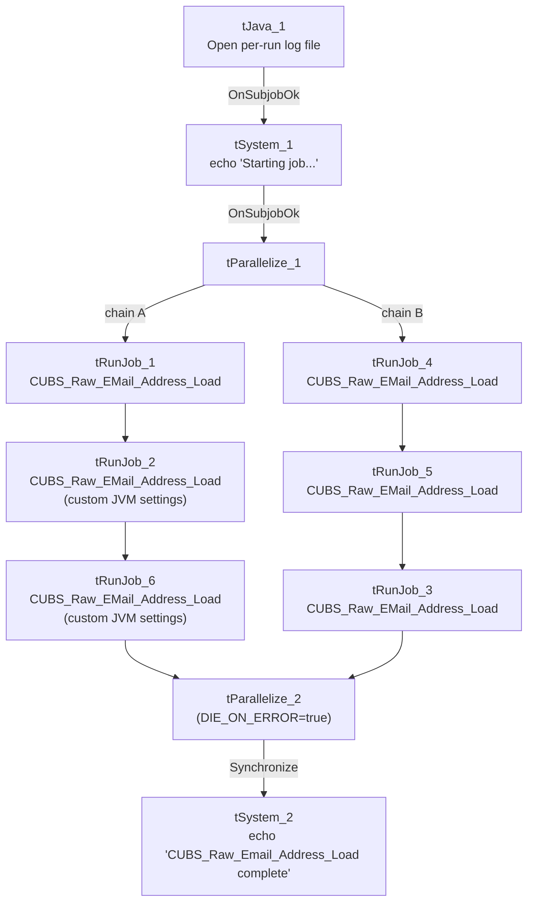

# Talend Job: EMail_Address_Load

## Overview

A pure orchestrator with no data logic of its own: it calls the shared `CUBS_Raw_EMail_Address_Load` job **six separate times** in a mix of parallel and sequential chains, apparently once per client logon/site. It does not read or write any business data directly — every actual email-address load happens inside the repeatedly-invoked child job.

## Detail table

| Field | Value |
|---|---|
| Job name | EMail_Address_Load |
| Version | 0.1 |
| Project | EDW2SF |
| Author | jmach@harriscollect.com |
| Created | 2023-02-06T15:12:15.148-0800 |
| Last Modified | 2025-11-04T10:52:55.147-0800 |

## Step-by-step data flow

1. `tJava_1` opens a per-run log file, then on subjob success `tSystem_1` runs a shell command (`echo 'Starting job EMail_Address_Load'`) purely for log visibility.
2. On success, `tParallelize_1` starts two independent chains:
   - **Chain A:** `tRunJob_1` (**CUBS_Raw_EMail_Address_Load**, `USE_INDEPENDENT_PROCESS=true`) → on success, `tRunJob_2` (same target, but `USE_CHILD_JVM_SETTING=false`/`USE_CUSTOM_JVM_SETTING=true` — a different JVM sizing configuration than `tRunJob_1`) → on success, `tRunJob_6` (same target, same custom-JVM configuration as `tRunJob_2`).
   - **Chain B:** `tRunJob_4` (**CUBS_Raw_EMail_Address_Load**) → on success, `tRunJob_5` (same target) → on success, `tRunJob_3` (same target).
3. Both chains ultimately feed into `tParallelize_2` (`DIE_ON_ERROR=true`, unlike `tParallelize_1`'s `DIE_ON_ERROR=false`): `tRunJob_6` and `tRunJob_3` both connect into it.
4. Once both chains report in, `tParallelize_2` synchronizes and fires `tSystem_2`, which runs `echo 'CUBS_Raw_Email_Address_Load complete'` — a shell command purely for log visibility, marking overall completion.

## Settings tables

### Orchestration: `tRunJob_1`–`tRunJob_6`

| Setting | Value | What it means |
|---|---|---|
| PROCESS (all 6) | `CUBS_Raw_EMail_Address_Load` | The same shared job is called six times in this job, with no visible per-call context override in this metadata — see Issues observed. |
| USE_INDEPENDENT_PROCESS (all 6) | `true` | Each call runs as a separate process rather than sharing this job's JVM (contrast with `DimFiscal_CO_Load`'s in-process pattern). |
| DIE_ON_CHILD_ERROR (all 6) | `true` | If any of the six calls fails, that chain (and ultimately this job) fails. |
| JVM setting (`tRunJob_2`, `tRunJob_6`) | `USE_CHILD_JVM_SETTING=false`, `USE_CUSTOM_JVM_SETTING=true` | These two calls use a custom JVM memory/sizing configuration, unlike the other four which use the default child-JVM setting — see Issues observed. |

### Shell commands: `tSystem_1` / `tSystem_2`

| Setting | Value | What it means |
|---|---|---|
| COMMAND | `"echo 'Starting job EMail_Address_Load'"` / `"echo 'CUBS_Raw_Email_Address_Load complete'"` | Purely cosmetic log markers — no actual system effect beyond writing to console/log output. |
| DIRECTORY (both) | `"C:/Talend-Studio-20211109_1610-V8.0.1/workspace"` (hardcoded) | Working directory for the shell command — see Issues observed. |

## Dependencies & configuration

- **Triggers/depends on other jobs:** calls **`CUBS_Raw_EMail_Address_Load`** six times via `tRunJob_1` through `tRunJob_6` (see `06_dependency_matrix.md`, which records this same 6x call pattern). No formal `tRunJob` link exists from any other job into `EMail_Address_Load` itself in this project's captured orchestration.
- **Context variables used:** `logDir`.
- **2 hardcoded developer-workstation paths** (`tSystem_1.DIRECTORY`, `tSystem_2.DIRECTORY`, both `C:/Talend-Studio-20211109_1610-V8.0.1/workspace`).

## Glossary

| Component type | Plain-English meaning |
|---|---|
| `tJava` | Runs custom Java code once — here, to redirect console output to a per-run log file. |
| `tSystem` | Runs an OS-level shell command — here used only to print a marker message. |
| `tParallelize` | Runs its downstream branches at the same time; the second instance here also waits (`SYNCHRONIZE`) for both branches before continuing. |
| `tRunJob` | Runs another Talend job as a sub-process (or inline, if configured not to use an independent process). |

## Issues observed

- **The same job (`CUBS_Raw_EMail_Address_Load`) is called six times with no per-call context distinction visible in this metadata.** `06_dependency_matrix.md` notes this exact pattern project-wide (`EMail_Address_Load` → `CUBS_Raw_EMail_Address_Load`, 6 times) and flags that confirming what differs per call "requires opening each `tRunJob` component's context settings individually." Each `tRunJob` here uses `CONTEXT_NAME=Default` with no visible per-call context override captured in this extraction — it's likely each call is meant to process a different client logon/site (similar to how `Semaphore_Check`'s `tForeach` loops over a list this extraction also couldn't capture), but **this cannot be confirmed from the JSON alone**. Verify directly in Talend Studio which logon or parameter differs across the six calls; if none does, the six calls may be fully redundant.
- **Two of the six calls (`tRunJob_2`, `tRunJob_6`) use a custom JVM setting** while the other four use the default. Unable to determine from metadata why only these two calls need different JVM sizing — possibly because they process a larger site's email-address volume — worth confirming with the team.
- **`tParallelize_1` has `DIE_ON_ERROR=false` while `tParallelize_2` has `DIE_ON_ERROR=true`** — inconsistent error-handling posture between the two `tParallelize` components in the same job. A failure in one of the two parallel chains before reaching `tParallelize_2` might not stop the job the same way a failure after that point would; verify the practical effect in Talend Studio if partial-chain failures are a concern.
- **The two `tSystem` shell commands add no functional value beyond log markers**, but each still requires the hardcoded workspace directory to exist as configured — a minor but real portability dependency for what is otherwise a purely cosmetic step.
