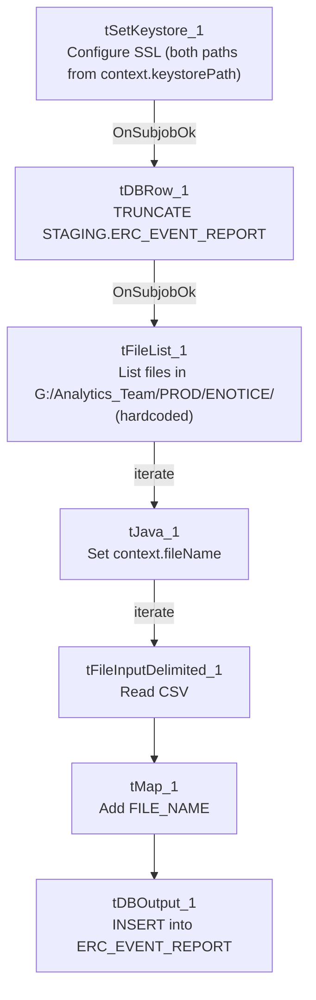

# Talend Job: ERC_Event_Report_Load

## Overview

Loads e-notice/e-communication event-report CSV files (letter code, letter ID, customer, email address, event type, comment, event date, account numbers) from a fixed network share into a Snowflake `ERC_EVENT_REPORT` staging table, truncating the table first. This is the newest job in this batch by creation date (January 2026), and its source directory is a hardcoded network path rather than a context variable — see Issues observed.

## Detail table

| Field | Value |
|---|---|
| Job name | ERC_Event_Report_Load |
| Version | 0.1 |
| Project | EDW2SF |
| Author | jmach@harriscollect.com |
| Created | 2026-01-30T11:28:21.062-0800 |
| Last Modified | 2026-02-04T09:45:08.090-0800 |

## Step-by-step data flow

1. `tSetKeystore_1` configures SSL trust/keystore, both truststore and keystore paths set to `context.keystorePath` (unlike most other jobs in this project, which hardcode the truststore path — see Issues observed).
2. On subjob success, `tDBRow_1` runs `TRUNCATE TABLE STAGING.ERC_EVENT_REPORT;`.
3. On success, `tFileList_1` lists files in a **hardcoded** directory `"G:/Analytics_Team/PROD/ENOTICE/"`, ordered by modified date ascending (an `EXCLUDEFILEMASK` of `*.txt` is configured but `IFEXCLUDE=false`, so it has no effect).
4. For each file: `tJava_1` sets `context.fileName` → `tFileInputDelimited_1` reads the CSV (comma-delimited, header row present, `DIE_ON_ERROR=false`) using repository schema `"...metadata"` for both main and reject flows.
5. `tMap_1` maps the ~11 source columns through to the target schema, adding a `FILE_NAME` column.
6. `tDBOutput_1` inserts the rows into Snowflake `ERC_EVENT_REPORT` (`INSERT`, `tableAction=NONE` — relies on the earlier `TRUNCATE` for a clean load).

No `tPrejob`/`tPostjob` or explicit Snowflake connection-open/close components are present in this job's metadata — see Issues observed.

## Settings tables

### Source list: `tFileList_1`

| Setting | Value | What it means |
|---|---|---|
| DIRECTORY | `"G:/Analytics_Team/PROD/ENOTICE/"` (hardcoded) | A fixed network-share path, not a `context.*` variable — unlike the `context.sourceDir`/`StandardFolders_0.1` pattern used by most other jobs in this project. See Issues observed. |
| ORDER_BY_MODIFIEDDATE | `true` (ascending) | Files are processed oldest-first. |

### Source: `tFileInputDelimited_1`

| Setting | Value | What it means |
|---|---|---|
| FIELDSEPARATOR / HEADER | `,` / 1 header row | Standard CSV with header. |
| Columns | `LetterCode, Letter_ID, Customer, EmailAddress, Event, Comment, EventDate, Account_Number, Account_Number_2_w_Logon, VariableField5_FN, Extra_Info_rCID` | An e-notice event-report extract — event type, comment, and account identifiers for a letter/communication tracking system. |
| DIE_ON_ERROR | `false` | Malformed rows don't fail the job; no reject flow wired (rejects silently dropped). |

### Target: `tDBOutput_1`

| Setting | Value | What it means |
|---|---|---|
| Table | `ERC_EVENT_REPORT` | Destination staging table. |
| Output action / Table action | `INSERT` / `NONE` | Relies on the earlier explicit `TRUNCATE TABLE STAGING.ERC_EVENT_REPORT;` step rather than the component's own table-action setting. |

## Dependencies & configuration

- **Triggers/depends on other jobs:** none — no `tRunJob` links found.
- **Context variables used:** `fileName`, `keystorePath`.
- **1 hardcoded path flagged by the extraction:** `tFileInputDelimited_1.TEMP_DIR = "C:/Talend-Studio-20211109_1610-V8.0.1/workspace"`. **Additionally observed directly in this job's own metadata but not flagged by the automated extraction:** `tFileList_1.DIRECTORY = "G:/Analytics_Team/PROD/ENOTICE/"` — a hardcoded network-share source path (see Issues observed).

## Glossary

| Component type | Plain-English meaning |
|---|---|
| `tSetKeystore` | Configures the SSL trust/keystore used for secure connections made later in the job. |
| `tFileList` | Lists files in a directory for the job to iterate over one at a time. |
| `tFileInputDelimited` | Reads a delimited (CSV-style) text file according to a schema. |
| `tMap` | Maps/transforms columns from one schema to another. |
| `tSnowflakeOutput` / `tSnowflakeRow` | Write rows to Snowflake / run an arbitrary SQL statement against it. |

## Issues observed

- **The source directory is hardcoded as `"G:/Analytics_Team/PROD/ENOTICE/"`**, a Windows network-share path, rather than using `context.sourceDir` or another project-standard context variable as almost every other file-based job in this project does (see `StandardFolders_0.1`, used by 176 jobs per `06_dependency_matrix.md`). This was not flagged in the automated `hardcoded_path_findings` list (which only caught the `TEMP_DIR` workstation path), but it is directly visible in `tFileList_1`'s own configuration in this job's JSON. If this job is ever moved to a different environment or that network drive letter/mapping changes, this job would fail with no context-driven fallback, and it would not be caught by any project-wide "hardcoded path" remediation effort that only searches for the `C:/Talend-Studio-...` pattern.
- **No `tPrejob`/`tPostjob` or explicit Snowflake connection-open/close components appear in this job's metadata** — the same structural gap seen in `DimFiscal_HH_B_TrueUp`. `tDBRow_1` and `tDBOutput_1` (both Snowflake components) must be relying on an implicit/default connection not captured as a separate component here. Unable to determine from metadata whether this is intentional (e.g., a quickly-built utility job) or an extraction gap.
- **No reject flow wired from `tFileInputDelimited_1`** — malformed CSV rows are silently dropped (`DIE_ON_ERROR=false`), consistent with the project-wide pattern flagged in other jobs' docs, but worth noting since this job processes external partner/vendor-style files that may have inconsistent formatting.
- **No result/row-count logging** (no `tWarn`/`tDie`/`tSendMail`) — a load failure here would only surface as a generic Talend execution error.
