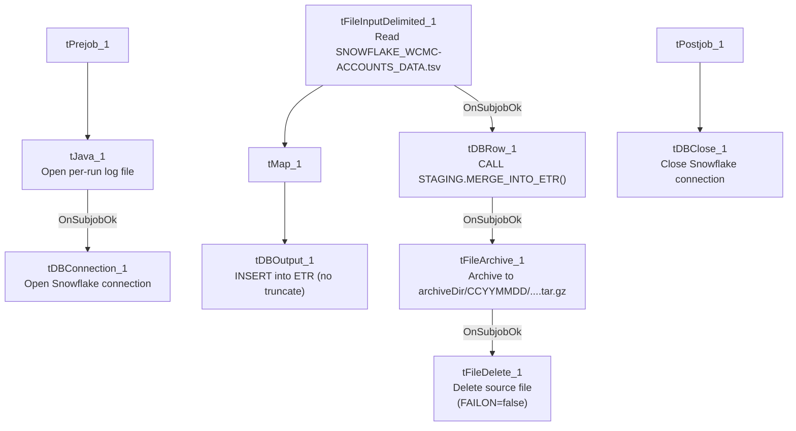

# Talend Job: ETR_Load

## Overview

Loads an "ETR" (estimated/expected transaction rate — exact meaning not defined in metadata) line-item file exported from a source labeled `SNOWFLAKE_WCMC-ACCOUNTS_DATA.tsv` into a Snowflake `ETR` table, then merges the loaded rows into a downstream table via a stored procedure, and finally archives and deletes the source file. Follows the same truncate-load-merge-archive shape used throughout this project (e.g. `ADP_Payroll_Load`), but with no `TRUNCATE` step before the insert — see Issues observed.

## Detail table

| Field | Value |
|---|---|
| Job name | ETR_Load |
| Version | 0.1 |
| Project | EDW2SF |
| Author | jmach@harriscollect.com |
| Created | 2025-03-06T09:22:42.527-0800 |
| Last Modified | 2025-09-24T11:06:50.143-0700 |

## Step-by-step data flow

**Setup subjob:** `tPrejob_1` → `tJava_1` opens a per-run log file → on success, `tDBConnection_1` opens the Snowflake connection.

**Main subjob:**

1. `tFileInputDelimited_1` reads `context.sourceDir + "SNOWFLAKE_WCMC-ACCOUNTS_DATA.tsv"` (tab-delimited, header row present, `DIE_ON_ERROR=false`) using repository schema `"...etr"` for both main and reject.
2. `tMap_1` maps the ~16 source columns (logon, debtor number, ETR ID, original/adjustment/payment/balance amounts, cancellation fields, assignment/service dates, location/department/provider fields) through to the same-shaped target schema.
3. `tDBOutput_1` inserts the rows into Snowflake `ETR` (`INSERT`, `tableAction=NONE` — **no truncate before load**, see Issues observed).
4. On `tFileInputDelimited_1`'s subjob success (in parallel with the load flow above), `tDBRow_1` runs `CALL STAGING.MERGE_INTO_ETR();`.
5. On that subjob's success, `tFileArchive_1` archives the source file to `context.archiveDir + <CCYYMMDD> + "/SNOWFLAKE_WCMC-ACCOUNTS_DATA.tsv.tar.gz"` (`.tgz` format, `OVERWRITE=true`).
6. On success, `tFileDelete_1` deletes `context.sourceDir + "SNOWFLAKE_WCMC-ACCOUNTS_DATA.tsv"` (`FAILON=false` — a failed delete does not fail the job).

**Teardown subjob:** `tPostjob_1` → `tDBClose_1` (Snowflake).

## Settings tables

### Source: `tFileInputDelimited_1`

| Setting | Value | What it means |
|---|---|---|
| FILENAME | `context.sourceDir+"SNOWFLAKE_WCMC-ACCOUNTS_DATA.tsv"` | A fixed filename, not derived from a `tFileList` iteration — this job processes exactly one named file per run. |
| FIELDSEPARATOR / HEADER | `\t` / 1 header row | Tab-separated with header. |
| DIE_ON_ERROR | `false` | Malformed rows don't fail the job; no reject flow wired (rejects silently dropped). |

### Target: `tDBOutput_1`

| Setting | Value | What it means |
|---|---|---|
| Table | `ETR` | Destination table. |
| Output action / Table action | `INSERT` / `NONE` | **No truncate before insert** — see Issues observed. |

### Merge: `tDBRow_1`

| Setting | Value | What it means |
|---|---|---|
| Query | `CALL STAGING.MERGE_INTO_ETR();` | Merges the freshly-inserted `ETR` rows into a downstream table (not shown in this metadata). |

### Archive: `tFileArchive_1`

| Setting | Value | What it means |
|---|---|---|
| TARGET | `context.archiveDir+TalendDate.getDate("CCYYMMDD")+"/SNOWFLAKE_WCMC-ACCOUNTS_DATA.tsv.tar.gz"` | Archives into a date-stamped subfolder, `.tgz` format. |
| SOURCE_FILE | `"C:/Talend-Studio-20211109_1610-V8.0.1/workspace/source.csv"` (hardcoded) | A hardcoded, seemingly unrelated filename (`source.csv`, not the actual `.tsv` source) — see Issues observed. |

## Dependencies & configuration

- **Triggers/depends on other jobs:** none — no `tRunJob` links found.
- **Context variables used:** `archiveDir`, `logDir`, `sourceDir`.
- **4 hardcoded developer-workstation paths:** `tFileInputDelimited_1.TEMP_DIR`, `tFileDelete_1.DIRECTORY`, `tFileDelete_1.PATH`, `tFileArchive_1.SOURCE_FILE` (all `C:/Talend-Studio-20211109_1610-V8.0.1/workspace/...`).

## Glossary

| Component type | Plain-English meaning |
|---|---|
| `tFileInputDelimited` | Reads a delimited (CSV/TSV-style) text file according to a schema. |
| `tMap` | Maps/transforms columns from one schema to another. |
| `tSnowflakeOutput` / `tSnowflakeConnection` / `tSnowflakeClose` / `tSnowflakeRow` | Write rows to Snowflake / open and close the connection / run arbitrary SQL against it. |
| `tFileArchive` / `tFileDelete` | Zip a processed file to an archive location, then delete the original from the source directory. |

## Issues observed

- **`tDBOutput_1` has no `TRUNCATE` before the insert (`tableAction=NONE`)**, and the source file is read by a fixed filename rather than an incrementing/timestamped list — if this job is re-run (e.g. after a partial failure) without the source file having changed, the same rows would be inserted into `ETR` a second time, since there is no incremental filter or upsert key visible in this metadata. This differs from most other file-load jobs in this project (e.g. `ADP_Payroll_Load`), which explicitly `TRUNCATE` before inserting. Verify whether `ETR` is a true staging table that's expected to be cleared by the `MERGE_INTO_ETR()` procedure itself, or whether this is a gap.
- **`tFileArchive_1.SOURCE_FILE` is hardcoded to `"C:/Talend-Studio-20211109_1610-V8.0.1/workspace/source.csv"`** — a filename (`source.csv`) that doesn't match the actual source file this job processes (`SNOWFLAKE_WCMC-ACCOUNTS_DATA.tsv`). This looks like a leftover default value from the component's template that was never updated to reference the real source file; combined with the archive step's `SOURCE` parameter correctly using `context.sourceDir`, the practical archiving behavior may still work correctly (the `SOURCE`/`TARGET` pair appear to drive the actual archive operation), but the unused/stale `SOURCE_FILE` value is worth cleaning up to avoid confusion.
- **No reject flow wired from `tFileInputDelimited_1`** — malformed rows are silently dropped (`DIE_ON_ERROR=false`), consistent with the project-wide pattern.
- **No result-code checking on the `MERGE_INTO_ETR()` call** — a failure there would surface only as a generic Talend execution error, unlike `ADP_Payroll_Load`'s explicit `tDie`-on-merge-failure pattern.
- **The business meaning of "ETR" is not defined anywhere in this job's metadata** — the column names (`ETR`, `ETR_ADJ_AMT`, `ETR_PMT_AMT`, `ETR_BALANCE`, `ETR_CANCEL_DT`, `ETR_ASSIGN_DT`) suggest some kind of billing/transaction-rate or extended-terms record tied to a debtor account, but the acronym itself is unexplained. Verify with the team.
