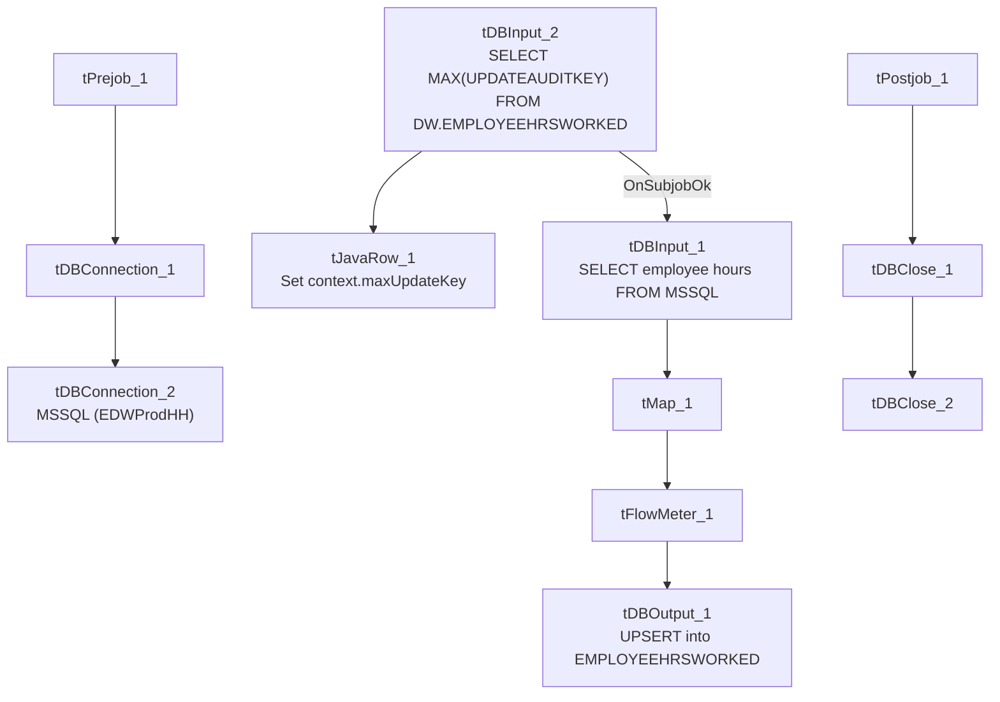

# Talend Job: EmployeeHrsWorked_Load

## Overview

An incremental loader for employee time/payroll hours: it computes the current maximum `UpdateAuditKey` already in Snowflake `EMPLOYEEHRSWORKED`, then pulls rows from the "EDWProdHH" MSSQL source (regular time, sick/PTO/unpaid time, dollars, employee name/description) and upserts them. Structurally near-identical to `EmployeeRates_Load` in this same batch — same connection pattern, same max-key watermark approach, same `UPSERT` target action — differing only in the specific columns and table names.

## Detail table

| Field | Value |
|---|---|
| Job name | EmployeeHrsWorked_Load |
| Version | 0.1 |
| Project | EDW2SF |
| Author | jmach@harriscollect.com |
| Created | 2022-03-23T15:03:57.290-0700 |
| Last Modified | 2025-09-24T11:01:04.121-0700 |

## Step-by-step data flow

**Setup subjob:** `tPrejob_1` → `tDBConnection_1` (Snowflake) → `tDBConnection_2` (MSSQL, "EDWProdHH" context variables).

**Main subjob:**

1. `tDBInput_2` runs `SELECT CAST(COALESCE(MAX(UPDATEAUDITKEY),0) AS VARCHAR(10)) AS MAX_UPDATE_KEY FROM DW.EMPLOYEEHRSWORKED;` against Snowflake.
2. `tJavaRow_1` captures the value into `context.maxUpdateKey`.
3. On success, `tDBInput_1` runs a `SELECT` against MSSQL pulling `EmployeeHrsWorkedKey, EmployeeHrsWorkedID, PayrollID, TimeDate, RegTime, SPTO, UPTO, FirstName, LastName, Description, Dollars, UpdateAuditKey` (query text truncated in this metadata — no visible `WHERE` clause referencing `context.maxUpdateKey`, see Issues observed).
4. `tMap_1` passes the row through.
5. `tFlowMeter_1` counts rows.
6. `tDBOutput_1` upserts the rows into Snowflake `EMPLOYEEHRSWORKED` (`outputAction=UPSERT`, `tableAction=NONE`).

**Teardown subjob:** `tPostjob_1` → `tDBClose_1` (Snowflake) → `tDBClose_2` (MSSQL).

## Settings tables

### Source: `tDBInput_1`

| Setting | Value | What it means |
|---|---|---|
| Query (visible) | `SELECT CAST(EmployeeHrsWorkedKey AS NUMERIC(10,0)) AS EmployeeHrsWorkedKey, EmployeeHrsWorkedID, CAST(PayrollID AS NUMERIC(10,0)) AS PayrollID, TimeDate, RegTime, SPTO, UPTO, FirstName, LastName, Descript...` (truncated) | Per-employee, per-date time entry: regular time, sick PTO, unpaid PTO, and dollar value. |

### Target: `tDBOutput_1`

| Setting | Value | What it means |
|---|---|---|
| Table | `EMPLOYEEHRSWORKED` | Destination table. |
| Output action | `UPSERT` | Updates existing rows / inserts new ones by key — safe against duplication even if the source query's filter can't be confirmed. |
| Table action | `NONE` | No truncate — consistent with an incremental/upsert design. |

## Dependencies & configuration

- **Triggers/depends on other jobs:** none — no `tRunJob` links found.
- **Context variables used:** `EDWProdHH_Database`, `EDWProdHH_Login`, `EDWProdHH_Port`, `EDWProdHH_Schema`, `EDWProdHH_Server`, `maxUpdateKey` (computed internally).
- No hardcoded developer-workstation paths found in this job.

## Glossary

| Component type | Plain-English meaning |
|---|---|
| `tMSSqlInput` / `tMSSqlConnection` / `tMSSqlClose` | Query a Microsoft SQL Server source / open and close that connection. |
| `tSnowflakeInput` / `tSnowflakeOutput` / `tSnowflakeConnection` / `tSnowflakeClose` | Query, write to, connect to, or close a Snowflake connection. |
| `tMap` | Maps/transforms columns from one schema to another. |
| `tFlowMeter` | Counts rows passing a point in the flow for logging/monitoring. |
| `tJavaRow` | Runs custom Java code once per input row — here used to unpack a single query result into a context variable. |

## Issues observed

- **Whether the source query actually filters on `context.maxUpdateKey` cannot be confirmed** — the `tDBInput_1.QUERY` text is truncated in this metadata before any `WHERE` clause would appear, the same gap seen in `i3_CallDetail_40_Load` and `DimDebtor_Load`. Because `tDBOutput_1` uses `UPSERT` rather than a plain `INSERT`, a full (unfiltered) re-read would not create duplicate rows in Snowflake even if the filter is missing — but it would mean every run re-reads and re-transmits the entire source table, which is a performance/cost concern rather than a correctness one. Verify the actual query text in Talend Studio.
- Beyond that, no other findings beyond the project-wide patterns already documented in `05_operational_runbook.md` — this is a straightforward, low-risk incremental dimension/fact-style load.
