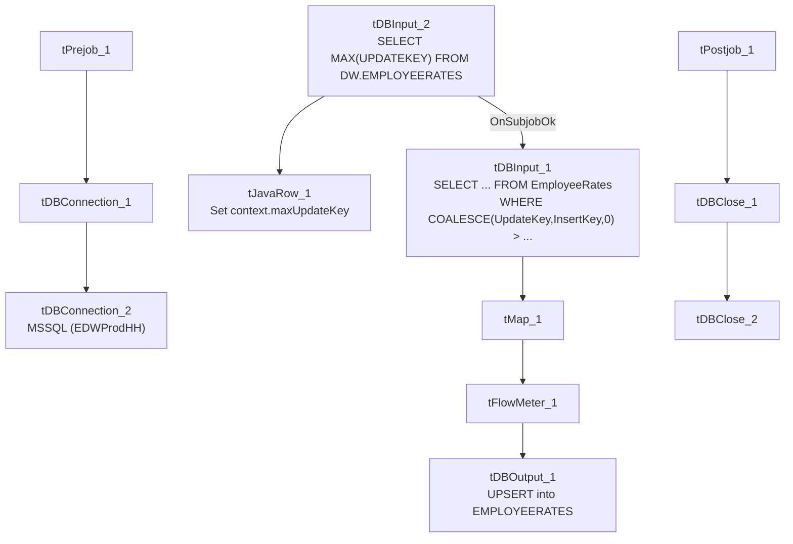

# Talend Job: EmployeeRates_Load

## Overview

An incremental loader for employee hourly-pay-rate records: it computes the current maximum `UpdateKey` already in Snowflake `EMPLOYEERATES`, then pulls only newer rows from the "EDWProdHH" MSSQL `EmployeeRates` table and upserts them. Structurally near-identical to `EmployeeHrsWorked_Load` in this same batch, but — unlike that sibling — this job's incremental `WHERE` clause is confirmed present in the captured metadata (see Settings table).

## Detail table

| Field | Value |
|---|---|
| Job name | EmployeeRates_Load |
| Version | 0.1 |
| Project | EDW2SF |
| Author | jmach@harriscollect.com |
| Created | 2022-03-24T09:24:34.387-0700 |
| Last Modified | 2025-09-24T10:59:37.877-0700 |

## Step-by-step data flow

**Setup subjob:** `tPrejob_1` → `tDBConnection_1` (Snowflake) → `tDBConnection_2` (MSSQL, "EDWProdHH" context variables).

**Main subjob:**

1. `tDBInput_2` runs `SELECT CAST(COALESCE(MAX(UPDATEKEY),0) AS VARCHAR(10)) AS MAX_UPDATE_KEY FROM DW.EMPLOYEERATES;` against Snowflake.
2. `tJavaRow_1` captures the value into `context.maxUpdateKey`.
3. On success, `tDBInput_1` runs `SELECT CAST(PayrollId AS NUMERIC(10,0)) AS PayrollId, Field1, Field2, CAST(HourRate AS NUMERIC(16,2)) AS HourRate, CAST(COALESCE(UpdateKey,InsertKey,0) AS NUMERIC(10,0)) AS UpdateKey FROM EmployeeRates WHERE COALESCE(UpdateKey,InsertKey,0) > ` + (query truncated, but the `WHERE` clause referencing an incremental key is visible).
4. `tMap_1` passes the row through.
5. `tFlowMeter_1` counts rows.
6. `tDBOutput_1` upserts the rows into Snowflake `EMPLOYEERATES` (`outputAction=UPSERT`, `tableAction=NONE`).

**Teardown subjob:** `tPostjob_1` → `tDBClose_1` (Snowflake) → `tDBClose_2` (MSSQL).

## Settings tables

### Source: `tDBInput_1`

| Setting | Value | What it means |
|---|---|---|
| Query | `SELECT CAST(PayrollId AS NUMERIC(10,0)) AS PayrollId, Field1, Field2, CAST(HourRate AS NUMERIC(16,2)) AS HourRate, CAST(COALESCE(UpdateKey,InsertKey,0) AS NUMERIC(10,0)) AS UpdateKey FROM EmployeeRates WHERE COALESCE(UpdateKey,InsertKey,0) > ...` (truncated after the comparison operator, but the incremental filter itself is confirmed present) | Falls back to `InsertKey` when `UpdateKey` is null, so both newly-inserted and later-updated rate rows are captured by the same watermark. |
| `Field1` / `Field2` | Generic column names, no business label in this metadata | Unable to determine what these represent from the source schema alone — likely client/logon or rate-category identifiers given their position next to `PayrollId`; verify against the MSSQL source schema directly. |

### Target: `tDBOutput_1`

| Setting | Value | What it means |
|---|---|---|
| Table | `EMPLOYEERATES` | Destination table. |
| Output action | `UPSERT` | Updates existing rows / inserts new ones by key. |
| Table action | `NONE` | No truncate — consistent with the incremental design. |

## Dependencies & configuration

- **Triggers/depends on other jobs:** none — no `tRunJob` links found.
- **Context variables used:** `EDWProdHH_Database`, `EDWProdHH_Login`, `EDWProdHH_Port`, `EDWProdHH_Schema`, `EDWProdHH_Server`, `maxUpdateKey` (computed internally).
- No hardcoded developer-workstation paths found in this job.

## Glossary

| Component type | Plain-English meaning |
|---|---|
| `tMSSqlInput` / `tMSSqlConnection` / `tMSSqlClose` | Query a Microsoft SQL Server source / open and close that connection. |
| `tSnowflakeInput` / `tSnowflakeOutput` / `tSnowflakeConnection` / `tSnowflakeClose` | Query, write to, connect to, or close a Snowflake connection. |
| `tMap` | Maps/transforms columns from one schema to another. |
| `tFlowMeter` | Counts rows passing a point in the flow for logging/monitoring. |
| `tJavaRow` | Runs custom Java code once per input row — here used to unpack a single query result into a context variable. |

## Issues observed

- **`Field1` and `Field2` are unlabeled generic column names** in both the source and target schema — unlike every other job in this batch, this table's business meaning for two of its five columns cannot be determined from the metadata at all. Verify against the MSSQL `EmployeeRates` table's actual column names/comments if this data needs to be interpreted.
- **This job's incremental filter is confirmed present** (`WHERE COALESCE(UpdateKey,InsertKey,0) > ...`), unlike its `EmployeeHrsWorked_Load` sibling where the equivalent `WHERE` clause is truncated out of the captured metadata — worth using this job's confirmed pattern as a reference point if verifying `EmployeeHrsWorked_Load`'s actual query in Talend Studio.
- Beyond the unlabeled columns, no other findings beyond the project-wide patterns already documented in `05_operational_runbook.md`.
