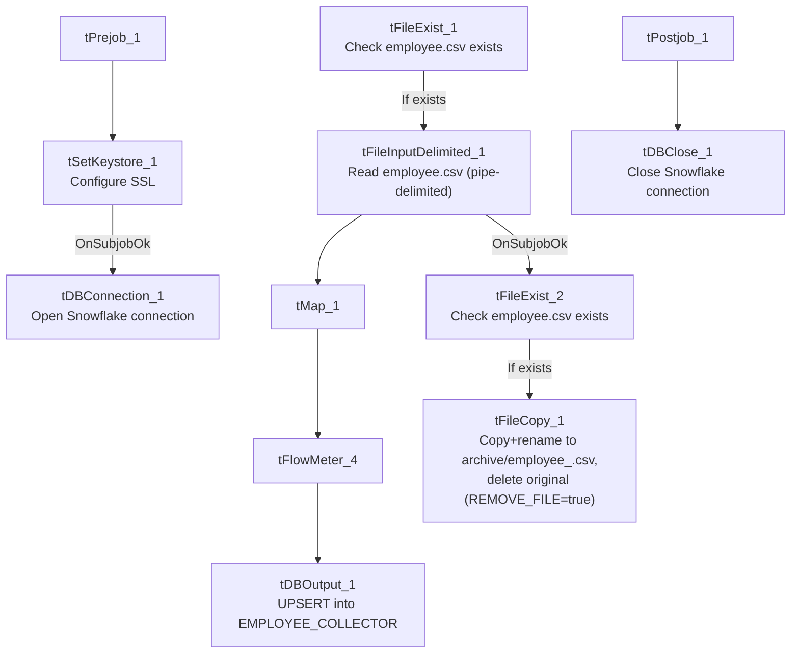

# Talend Job: Employee_Collector_Load

## Overview

Loads a collector/employee roster file (`employee.csv`: name, initials, desk, department, team, CUBS logon, payroll ID, start/end dates, supervisor/manager, alias, username, title, agent type, subgroup, director) into Snowflake `EMPLOYEE_COLLECTOR`, upserting by key. Before loading, it checks whether the source file exists at all; after loading, it separately checks existence again and — if present — copies (archives) the file to a dated backup name in an `archive/` subfolder.

## Detail table

| Field | Value |
|---|---|
| Job name | Employee_Collector_Load |
| Version | 0.1 |
| Project | EDW2SF |
| Author | jmach@harriscollect.com |
| Created | 2022-02-08T15:26:23.330-0700 |
| Last Modified | 2025-11-12T07:21:17.902-0800 |

## Step-by-step data flow

**Setup subjob:** `tPrejob_1` → `tSetKeystore_1` configures SSL trust/keystore (hardcoded truststore path, `context.keystorePath` for keystore) → on subjob success, `tDBConnection_1` opens the Snowflake connection.

**Main subjob:**

1. `tFileExist_1` checks whether `context.sourceDir + "employee.csv"` exists.
2. **If it exists** (`RUN_IF`), `tFileInputDelimited_1` reads the file (pipe-delimited `|`, header row present, `US-ASCII` encoding, `DIE_ON_ERROR=false`) using repository schema `"...empcol"` for both main and reject.
3. `tMap_1` maps the ~19 source columns through to the target schema.
4. `tFlowMeter_4` counts rows.
5. `tDBOutput_1` upserts the rows into Snowflake `EMPLOYEE_COLLECTOR` (`outputAction=UPSERT`, `tableAction=NONE`).
6. Separately, on `tFileInputDelimited_1`'s subjob success, `tFileExist_2` checks again whether `context.sourceDir + "employee.csv"` exists.
7. **If it exists** (`RUN_IF`), `tFileCopy_1` copies/renames the file to `context.sourceDir + "archive/" + "employee_" + <CCYY-MM-DD> + ".csv"` (`REMOVE_FILE=true` — deletes the original after copying, `REPLACE_FILE=true`, `CREATE_DIRECTORY=true`, `FAILON=false`).

**Teardown subjob:** `tPostjob_1` → `tDBClose_1` (Snowflake).

## Settings tables

### Source: `tFileInputDelimited_1`

| Setting | Value | What it means |
|---|---|---|
| FILENAME | `context.sourceDir+"employee.csv"` | Fixed filename, no `tFileList` iteration. |
| FIELDSEPARATOR / HEADER | `\|` / 1 header row | Pipe-delimited with header. |
| DIE_ON_ERROR | `false` | Malformed rows don't fail the job; no reject flow wired (rejects silently dropped). |

### Target: `tDBOutput_1`

| Setting | Value | What it means |
|---|---|---|
| Table | `EMPLOYEE_COLLECTOR` | Destination roster table. |
| Output action | `UPSERT` | Updates existing collector records / inserts new ones by key. |
| Table action | `NONE` | No truncate — consistent with an upsert design. |

### Archive: `tFileCopy_1`

| Setting | Value | What it means |
|---|---|---|
| DESTINATION / DESTINATION_RENAME | `context.sourceDir+"archive/"` / `"employee_"+<CCYY-MM-DD>+".csv"` | Archives to a dated filename in an `archive/` subfolder under the same source directory. |
| REMOVE_FILE | `true` | The original `employee.csv` is deleted after the copy — effectively a "move and rename" rather than a plain copy. |
| FAILON | `false` | A failed copy/archive does not fail the job. |

## Dependencies & configuration

- **Triggers/depends on other jobs:** none — no `tRunJob` links found.
- **Context variables used:** `keystorePath`, `sourceDir`.
- **3 hardcoded developer-workstation/config paths:** `tFileInputDelimited_1.TEMP_DIR` (`C:/Talend-Studio-20211109_1610-V8.0.1/workspace`), `tFileCopy_1.SOURCE_DERECTORY` (same path — see Issues observed), `tSetKeystore_1.SSL_TRUSTSERVER_TRUSTSTORE` (`"C:/clientTrustStore.trustStore"`).

## Glossary

| Component type | Plain-English meaning |
|---|---|
| `tSetKeystore` | Configures the SSL trust/keystore used for secure connections made later in the job. |
| `tFileExist` | Checks whether a specific file exists on disk, without reading its contents. |
| `tFileInputDelimited` | Reads a delimited (CSV/pipe-style) text file according to a schema. |
| `tMap` | Maps/transforms columns from one schema to another. |
| `tFlowMeter` | Counts rows passing a point in the flow for logging/monitoring. |
| `tSnowflakeOutput` / `tSnowflakeConnection` / `tSnowflakeClose` | Write rows to Snowflake / open and close the connection. |
| `tFileCopy` | Copies (and optionally renames, and optionally deletes the original from) a file. |

## Issues observed

- **No "file does not exist" branch is wired from either `tFileExist_1` or `tFileExist_2`.** Both `tFileExist` components only have a `RUN_IF` ("exists") branch connected — if `employee.csv` is missing when the job runs, the main load subjob and the archive subjob simply don't execute, with no `tWarn`/`tSendMail`/`tDie` to flag that nothing happened. This means a missing source file on a given run would produce a silently "successful" job with zero rows loaded and no record archived — unlike `Semaphore_Check`'s explicit missing-file alerting pattern elsewhere in this project. Worth confirming whether a missing `employee.csv` should actually raise an alert.
- **`tFileCopy_1.SOURCE_DERECTORY` is hardcoded to the workspace path** (`C:/Talend-Studio-20211109_1610-V8.0.1/workspace`), but `tFileCopy_1.ENABLE_COPY_DIRECTORY=false`, meaning the actual source of the copy is driven by the `FILENAME` parameter (`context.sourceDir + "employee.csv"`) instead. The `SOURCE_DERECTORY` value therefore appears to be an unused vestige of the component's default configuration rather than a live portability risk — but it's still worth cleaning up, since a future change to `ENABLE_COPY_DIRECTORY` would silently activate this stale hardcoded path.
- **No reject flow wired from `tFileInputDelimited_1`** — malformed rows are silently dropped (`DIE_ON_ERROR=false`), consistent with the project-wide pattern.
- **No result/row-count logging** (no `tWarn`/`tDie`/`tSendMail`) — a load failure or an unexpectedly empty file would only surface as a generic Talend execution error or a silent no-op, per the missing-file issue above.
