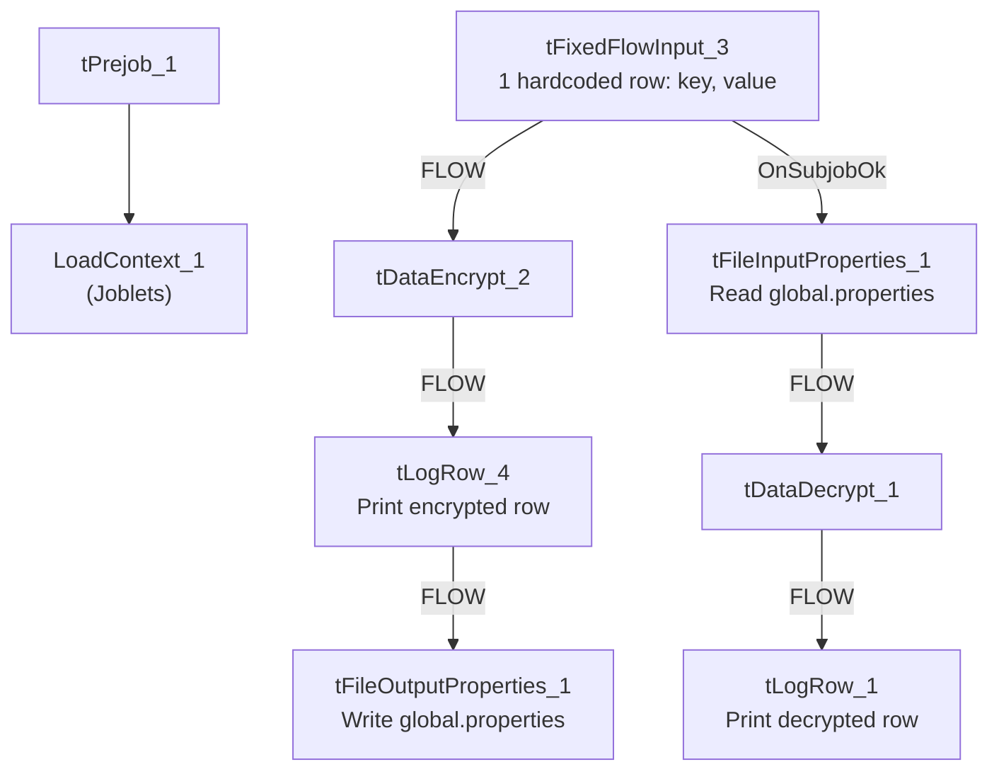

# Talend Job: EncryptValue_ContextVariable

## Overview

This is a developer utility/test job, not part of the production CUBS data pipeline: it demonstrates the encrypt/decrypt round-trip for a single hardcoded key/value pair using Talend's `tDataEncrypt`/`tDataDecrypt` components, writing and reading the result to/from a local Java `.properties` file. It moves no business data — it exists to verify that a chosen encryption password/algorithm produces a value that can be written to a properties file and correctly decrypted back, presumably as a template or test harness for other jobs (e.g. `Encrypt_CHI_Fiscal_Tax_Code`, `Encrypt_CO_Fiscal_A_F18_A`) that encrypt real fiscal/tax fields.

## Detail table

| Field | Value |
|---|---|
| Job name | EncryptValue_ContextVariable |
| Version | 0.1 |
| Project | EDW2SF |
| Author | jmach@harriscollect.com |
| Created | 2019-06-13T02:47:34.093+0100 |
| Last Modified | 2025-08-28T08:57:11.449-0700 |

## Step-by-step data flow

**Setup:** `tPrejob_1` → `LoadContext_1` (a `Joblets`-family component that loads context, triggered `OnComponentOk` from the prejob).

**Main subjob (two independent chains):**

1. **Encrypt chain:** `tFixedFlowInput_3` emits a single hardcoded row with two columns (`key`, `value`) → `tDataEncrypt_2` encrypts the row using a redacted password/secret type, reading its crypto file path from `context.crytographicFilePath` → `tLogRow_4` prints the encrypted row to the log → `tFileOutputProperties_1` writes it as a Java properties file (section `"section"`) to the hardcoded path `C:/Users/vmehra.TALEND/Documents/Project/MBO/MBO-DataPrivacy/test/global.properties`.
2. **Decrypt chain (runs after the encrypt chain completes, `OnSubjobOk`):** `tFileInputProperties_1` reads the same properties file back in → `tDataDecrypt_1` decrypts it (same redacted password/crypto file path) → `tLogRow_1` prints the decrypted row to the log, to visually confirm the round-trip worked.

## Settings tables

### Encrypt path: `tDataEncrypt_2` / `tFileOutputProperties_1`

| Setting | Value | What it means |
|---|---|---|
| PASSWORD_M1 | `***REDACTED***` | Encryption password — preserved as redacted, not guessable from metadata. |
| SECRET_TYPE | `***REDACTED***` | Also redacted. |
| CRYPTO_FILE_PATH | `context.crytographicFilePath` | Points to the cryptographic key file used for the encryption algorithm. |
| Output file | `"C:/Users/vmehra.TALEND/Documents/Project/MBO/MBO-DataPrivacy/test/global.properties"` | A hardcoded, individual developer's Windows user-profile path — see Issues observed. |

### Decrypt path: `tFileInputProperties_1` / `tDataDecrypt_1`

| Setting | Value | What it means |
|---|---|---|
| Input file | Same hardcoded path as above | Reads back the file just written. |
| PASSWORD_M1 / SECRET_TYPE | `***REDACTED***` | Same redacted values, needed to successfully decrypt. |

## Dependencies & configuration

- **Triggers/depends on other jobs:** none — no `tRunJob` links found.
- **Context variables used:** `crytographicFilePath` — matches the variable name/comment in the `ContextManagement_GlobalVariables_0.1` context group (`crytographicFilePath?`), whose default sample values in `_shared_context.json` are themselves individual-developer paths (e.g. `C:/Users/vmehra.TALEND/...`, `C:/Temp/password`).
- No entries in `hardcoded_path_findings` for this job specifically, but the `tFileOutputProperties_1.FILENAME` value is itself a hardcoded, non-context-driven Windows path under a named developer's user profile — functionally the same portability risk documented project-wide in `05_operational_runbook.md`, just not flagged in that field.

## Glossary

| Component type | Plain-English meaning |
|---|---|
| `LoadContext` (Joblets) | A reusable sub-flow ("joblet") that loads context variables at the start of a job. |
| `tFixedFlowInput` | Emits a small number of hardcoded rows defined directly in the component, used here purely as test data. |
| `tDataEncrypt` / `tDataDecrypt` | Encrypts/decrypts row data using a password and crypto-file-based algorithm. |
| `tFileOutputProperties` / `tFileInputProperties` | Write/read a Java-style `.properties` file, organized into named sections. |
| `tLogRow` | Prints the rows passing through it to the job's console/log, for debugging or verification. |

## Issues observed

- **This job's output path is a named individual developer's local Windows user profile** (`C:/Users/vmehra.TALEND/Documents/...`), not a shared/context-driven location — if this job is ever run outside that developer's original workstation, both the encrypt write and the decrypt read will fail because the directory won't exist. This is the same class of risk as the project's widely documented `C:/Talend-Studio-...` hardcoded paths (see `05_operational_runbook.md`), but tied to a specific person rather than the shared install path.
- **This job appears to be a test/demo harness, not a production data-moving job** — it operates on a single hardcoded row and writes into a path named `.../test/global.properties`. It's unclear from metadata whether it's still actively used, retained as a reference example, or effectively dead — verify with the team before assuming it needs the same operational monitoring as the project's real load jobs.
- **The actual encryption password, secret type, and crypto file contents are `***REDACTED***`** in this metadata, consistent with the strict grounding rule against reconstructing sensitive values — verify these directly in Talend Studio/the crypto key store if needed.
