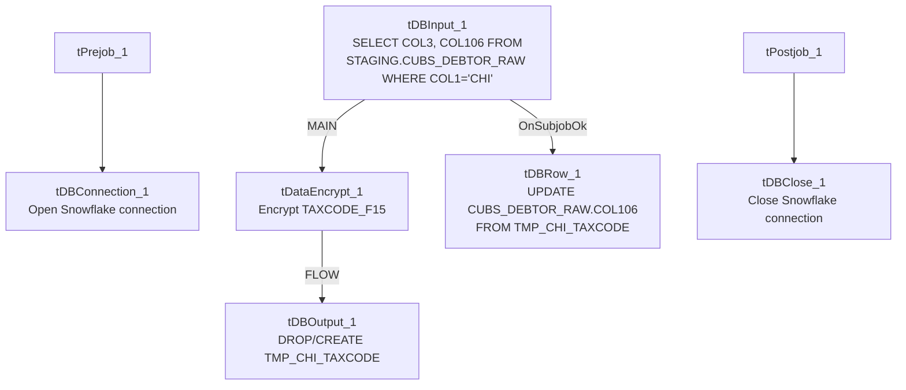

# Talend Job: Encrypt_CHI_Fiscal_Tax_Code

## Overview

This job encrypts the fiscal tax code field for CHI-site debtors directly inside the Snowflake staging table `STAGING.CUBS_DEBTOR_RAW`, in place. It reads the debtor index and tax code (`COL3`/`COL106`) for rows where `COL1='CHI'` and the tax code is non-blank, encrypts the tax code, stages the encrypted values in a throwaway table, then runs an `UPDATE` to write the encrypted value back over the original plaintext column in `CUBS_DEBTOR_RAW`. This is a PII/tax-data protection step scoped specifically to the CHI site.

## Detail table

| Field | Value |
|---|---|
| Job name | Encrypt_CHI_Fiscal_Tax_Code |
| Version | 0.1 |
| Project | EDW2SF |
| Author | jmach@harriscollect.com |
| Created | 2022-09-14T09:37:49.895-0700 |
| Last Modified | 2025-09-24T11:01:05.192-0700 |

## Step-by-step data flow

**Setup subjob:** `tPrejob_1` → `tDBConnection_1` opens the Snowflake connection.

**Main subjob:**

1. `tDBInput_1` runs `SELECT COL3, COL106 FROM STAGING.CUBS_DEBTOR_RAW WHERE COL1='CHI' AND TRIM(COL106) <> ''` — pulling only CHI-site rows (`COL1='CHI'`) that actually have a tax code value, aliased in the output schema as `DEBTOR_IDX`/`TAXCODE_F15`.
2. `tDataEncrypt_1` encrypts `TAXCODE_F15` (AES, redacted secret key/password/type), reading its crypto file path from `context.cryptoPath`.
3. `tDBOutput_1` writes the encrypted rows into `TMP_CHI_TAXCODE`, dropping and recreating the table each run (`DROP_IF_EXISTS_AND_CREATE`).
4. Once `tDBInput_1`'s subjob completes successfully (`OnSubjobOk`), `tDBRow_1` runs `UPDATE STAGING.CUBS_DEBTOR_RAW dbt SET COL106 = chi.TAXCODE_F15 FROM TMP_CHI_TAXCODE chi WHERE dbt.COL3 = chi.DEBTOR_IDX;` — overwriting the plaintext tax code in the staging table with the encrypted value, joined back on the debtor index.

**Teardown subjob:** `tPostjob_1` → `tDBClose_1` closes the Snowflake connection.

## Settings tables

### Source: `tDBInput_1` (`tSnowflakeInput`)

| Setting | Value | What it means |
|---|---|---|
| Query | `SELECT COL3, COL106 FROM STAGING.CUBS_DEBTOR_RAW WHERE COL1='CHI' AND TRIM(COL106) <> ''` | Reads only CHI-site rows with a non-blank tax code; `COL3`/`COL106` are generic staging-table column names aliased to `DEBTOR_IDX`/`TAXCODE_F15` in the output schema. |

### Encrypt: `tDataEncrypt_1`

| Setting | Value | What it means |
|---|---|---|
| SECRET_TYPE / SECRET_KEY / PASSWORD_M1 | `***REDACTED***` | Encryption credentials, preserved as redacted. |
| CRYPTO_METHOD | `AES` | Symmetric encryption algorithm. |
| CRYPTO_FILE_PATH | `context.cryptoPath` | Key/crypto file location. |
| ALGO_VERSION | `2` | Talend's internal encryption algorithm version. |

### Stage: `tDBOutput_1` (`tSnowflakeOutput`)

| Setting | Value | What it means |
|---|---|---|
| Table | `TMP_CHI_TAXCODE` | A throwaway table holding the encrypted values before they're merged back. |
| Table action | `DROP_IF_EXISTS_AND_CREATE` | Table is fully rebuilt every run, so there's no risk of stale rows from a prior run. |
| Output action | `INSERT` | Simple append into the freshly recreated table. |

### Merge-back: `tDBRow_1` (`tSnowflakeRow`)

| Setting | Value | What it means |
|---|---|---|
| Query | `UPDATE STAGING.CUBS_DEBTOR_RAW dbt SET COL106 = chi.TAXCODE_F15 FROM TMP_CHI_TAXCODE chi WHERE dbt.COL3 = chi.DEBTOR_IDX;;` | Overwrites the plaintext tax code column in place with the encrypted value, matched by debtor index. Note the trailing double semicolon (`;;`) — harmless in Snowflake SQL but a minor copy-paste artifact. |

## Dependencies & configuration

- **Triggers/depends on other jobs:** none — no `tRunJob` links found.
- **Context variables used:** `cryptoPath` (crypto key file location for `tDataEncrypt_1`).
- No hardcoded developer-workstation paths found in this job's own components.
- This job operates directly on `STAGING.CUBS_DEBTOR_RAW`, the same generic staging table referenced by the CO-site sibling `Encrypt_CO_Fiscal_A_F18_A` targets a different table (`DIMFISCAL_CO_A`) — the two encryption jobs are not simply the same template with a site code swapped; they operate on different tables and column structures entirely (see that job's own doc).

## Glossary

| Component type | Plain-English meaning |
|---|---|
| `tSnowflakeConnection` / `tSnowflakeClose` | Open/close the Snowflake connection shared by other components in the job. |
| `tSnowflakeInput` | Runs a query against Snowflake and returns its result rows. |
| `tDataEncrypt` | Encrypts row/column data using a password and crypto-file-based algorithm. |
| `tSnowflakeOutput` | Writes rows to a Snowflake table, optionally dropping/recreating it first. |
| `tSnowflakeRow` | Runs an arbitrary SQL statement (here, an `UPDATE ... FROM ...` merge-back) against Snowflake. |

## Issues observed

- **`COL3` and `COL106` are generic, un-named staging columns** (`STAGING.CUBS_DEBTOR_RAW` appears to be a wide, genericized raw-load table where business meaning is only assigned by position/alias). This job's own aliasing (`DEBTOR_IDX`, `TAXCODE_F15`) is the only place that meaning is documented — if the underlying `CUBS_DEBTOR_RAW` column layout ever changes, `COL3`/`COL106` could silently start referring to different data with no compile-time warning.
- **No error handling or row-count logging** — no `tWarn`, `tDie`, or `tSendMail`. If the `UPDATE` in `tDBRow_1` fails or matches zero rows (e.g., because the join on `DEBTOR_IDX` doesn't line up), the job would still report success with no indication that no tax codes were actually encrypted.
- Beyond the above, nothing else stands out in this job's own metadata beyond the project-wide patterns already documented in `05_operational_runbook.md`.
