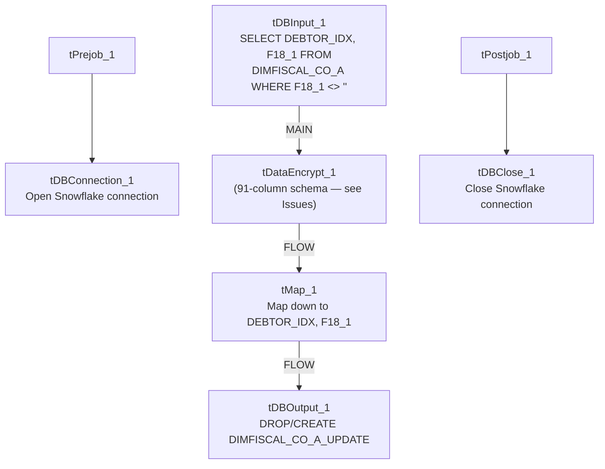

# Talend Job: Encrypt_CO_Fiscal_A_F18_A

## Overview

This job encrypts one fiscal field (`F18_1`) for CO-site debtors that have a non-blank value in that field, reading from `DIMFISCAL_CO_A` and writing the encrypted result into a new table `DIMFISCAL_CO_A_UPDATE`. Unlike its CHI counterpart (`Encrypt_CHI_Fiscal_Tax_Code`), which updates the source table in place, this job only produces a separate output table — it does not appear to write the encrypted value back into `DIMFISCAL_CO_A` itself within this job.

## Detail table

| Field | Value |
|---|---|
| Job name | Encrypt_CO_Fiscal_A_F18_A |
| Version | 0.1 |
| Project | EDW2SF |
| Author | jmach@harriscollect.com |
| Created | 2023-03-16T09:22:48.373-0700 |
| Last Modified | 2025-09-24T10:59:41.494-0700 |

## Step-by-step data flow

**Setup subjob:** `tPrejob_1` → `tDBConnection_1` opens the Snowflake connection.

**Main subjob:**

1. `tDBInput_1` runs `SELECT DEBTOR_IDX, F18_1 FROM DIMFISCAL_CO_A WHERE TRIM(COALESCE(F18_1,'')) <> '';` — pulling only CO debtors with a non-blank `F18_1` value.
2. `tDataEncrypt_1` encrypts the row. **Its own declared schema has 91 columns** (a full `DIMFISCAL_CO_A`-shaped debtor/fiscal record — name, address, phone, judgment, bankruptcy, tax-window fields, etc.), even though only two columns (`DEBTOR_IDX`, `F18_1`) actually flow into it from `tDBInput_1` — see Issues observed, this is very likely a copy-pasted component schema left over from another job.
3. `tMap_1` receives the row and maps it down to just `DEBTOR_IDX`/`F18_1` (`DIE_ON_ERROR=true`).
4. `tDBOutput_1` writes the two-column result into `DIMFISCAL_CO_A_UPDATE`, dropping and recreating the table each run (`DROP_IF_EXISTS_AND_CREATE`).

**Teardown subjob:** `tPostjob_1` → `tDBClose_1` closes the Snowflake connection.

## Settings tables

### Source: `tDBInput_1` (`tSnowflakeInput`)

| Setting | Value | What it means |
|---|---|---|
| Query | `SELECT DEBTOR_IDX, F18_1 FROM DIMFISCAL_CO_A WHERE TRIM(COALESCE(F18_1,'')) <> '';` | Only CO debtors with a populated `F18_1` value (an otherwise undocumented fiscal field — the field name gives no indication of its business meaning; unable to determine from metadata). |

### Encrypt: `tDataEncrypt_1`

| Setting | Value | What it means |
|---|---|---|
| SECRET_TYPE / SECRET_KEY / PASSWORD_M1 | `***REDACTED***` | Encryption credentials, preserved as redacted. |
| CRYPTO_METHOD | `AES` | Symmetric encryption algorithm. |
| CRYPTO_FILE_PATH | `context.cryptoPath` | Key/crypto file location — same context variable name as `Encrypt_CHI_Fiscal_Tax_Code`. |
| ALGO_VERSION | `2` | Talend's internal encryption algorithm version. |
| Declared schema | 91 columns (full fiscal/debtor record shape) | Does not match the 2-column flow actually feeding this component — see Issues observed. |

### Target: `tDBOutput_1` (`tSnowflakeOutput`)

| Setting | Value | What it means |
|---|---|---|
| Table | `DIMFISCAL_CO_A_UPDATE` | A separate table, not the original `DIMFISCAL_CO_A` — this job does not appear to merge the encrypted value back into the source table. |
| Table action | `DROP_IF_EXISTS_AND_CREATE` | Rebuilt fresh every run. |
| Output action | `INSERT` | Simple append into the freshly recreated table. |

## Dependencies & configuration

- **Triggers/depends on other jobs:** none — no `tRunJob` links found.
- **Context variables used:** `cryptoPath` (same variable name/purpose as in `Encrypt_CHI_Fiscal_Tax_Code`, though there is no evidence in either job's metadata that they share a literal value — each job references its own `context.cryptoPath`).
- No hardcoded developer-workstation paths found in this job's own components.
- **No downstream step in this job writes the encrypted `F18_1` value back into `DIMFISCAL_CO_A`** — unlike the CHI tax-code job's `UPDATE ... FROM` merge-back step, this job stops at producing `DIMFISCAL_CO_A_UPDATE`. Whether a separate job (not in this batch) consumes that table to complete the update is unable to determine from metadata; verify with the team.

## Glossary

| Component type | Plain-English meaning |
|---|---|
| `tSnowflakeConnection` / `tSnowflakeClose` | Open/close the Snowflake connection shared by other components in the job. |
| `tSnowflakeInput` | Runs a query against Snowflake and returns its result rows. |
| `tDataEncrypt` | Encrypts row/column data using a password and crypto-file-based algorithm. |
| `tMap` | Maps/transforms columns from one schema to another — here used to narrow a wide schema down to the two columns actually needed. |
| `tSnowflakeOutput` | Writes rows to a Snowflake table, optionally dropping/recreating it first. |

## Issues observed

- **`tDataEncrypt_1`'s own declared schema (91 columns, matching a full debtor/fiscal record — names, addresses, phone numbers, bankruptcy/judgment fields, tax-window dates, etc.) does not match the 2-column flow (`DEBTOR_IDX`, `F18_1`) that actually feeds it from `tDBInput_1`.** This is the same class of issue as `ADP_Payroll_Load`'s mismatched reject schema — a strong signal that this component's schema was copied from another job (likely one that encrypts/handles the full `DIMFISCAL_CO_A`-style record) and not cleaned up when this narrower 2-column job was built from it. It does not appear to break the job (the following `tMap_1` correctly narrows to 2 columns and the pipeline is functional per the connections), but it makes the job's internal metadata misleading if inspected in Talend Studio.
- **The encrypted result is written only to `DIMFISCAL_CO_A_UPDATE`, not merged back into `DIMFISCAL_CO_A` itself**, unlike the parallel CHI tax-code job which does perform that merge-back in the same job. If a separate merge step is expected to run afterward, it isn't visible in this job's own metadata or in `06_dependency_matrix.md`'s `tRunJob` list — verify with the team whether this is a two-step process (with the second step undocumented/out of scope here) or an intentionally different, read-only-output design.
- **No error handling or row-count logging** — no `tWarn`, `tDie`, or `tSendMail`; a failed or zero-row run would only surface as a generic Talend execution error.
