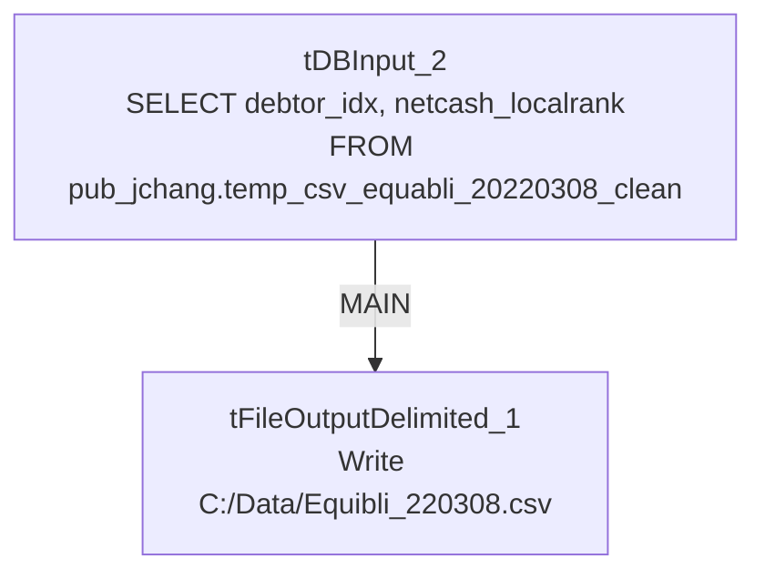

# Talend Job: Equibli_Extract

## Overview

A minimal, one-off extract job: it reads `debtor_idx` and `netcash_localrank` from a specifically-dated Snowflake table (`edwprodhh.pub_jchang.temp_csv_equabli_20220308_clean`) and writes the result straight to a hardcoded local CSV file. Every identifying detail — the source table name and the output filename — is baked in with the same date (`220308` / `20220308`), strongly suggesting this was built to run exactly once for a specific one-time data pull related to the "Equabli" (also spelled "Equibli" elsewhere in this project) scoring/prediction system, rather than as a recurring scheduled job.

## Detail table

| Field | Value |
|---|---|
| Job name | Equibli_Extract |
| Version | 0.1 |
| Project | EDW2SF |
| Author | jmach@harriscollect.com |
| Created | 2022-03-18T10:20:37.247-0700 |
| Last Modified | 2025-09-24T10:59:38.994-0700 |

## Step-by-step data flow

This job has no `tPrejob`/`tPostjob`, no explicit connection-open/close components, and no context variables at all — just a single two-component flow:

1. `tDBInput_2` runs `select debtor_idx, netcash_localrank from edwprodhh.pub_jchang.temp_csv_equabli_20220308_clean;` against Snowflake.
2. `tFileOutputDelimited_1` writes the result directly to `"C:/Data/Equibli_220308.csv"` (comma-delimited, no header row, ISO-8859-15 encoding).

## Settings tables

### Source: `tDBInput_2` (`tSnowflakeInput`)

| Setting | Value | What it means |
|---|---|---|
| Query | `select debtor_idx, netcash_localrank from edwprodhh.pub_jchang.temp_csv_equabli_20220308_clean;` | Reads from a table under the `pub_jchang` schema — flagged project-wide in `01_system_architecture.md` as looking like an individually-owned schema (initials-based name) rather than shared infrastructure. The table name itself (`temp_csv_equabli_20220308_clean`) reads as a one-time, manually prepared staging table for a specific date. |

### Target: `tFileOutputDelimited_1`

| Setting | Value | What it means |
|---|---|---|
| FILENAME | `"C:/Data/Equibli_220308.csv"` | Hardcoded absolute Windows path with no `context.` variable — not portable, and the filename itself is dated `220308` (March 8, 2022). |
| INCLUDEHEADER | `false` | No header row in the output CSV. |
| FIELDSEPARATOR | `,` | Standard CSV. |

## Dependencies & configuration

- **Triggers/depends on other jobs:** none — no `tRunJob` links found.
- **Context variables used:** none — this job uses no `context.*` variables anywhere, unusual for this project (most jobs use at least `StandardFolders_0.1`'s shared path variables).
- **Hardcoded path:** `C:/Data/Equibli_220308.csv` is a fixed local path, not flagged in this job's `hardcoded_path_findings` array (that field only tracks the specific `C:/Talend-Studio-...` pattern used elsewhere), but it is functionally the same portability risk — this job cannot run correctly on any machine without a `C:/Data/` directory.

## Glossary

| Component type | Plain-English meaning |
|---|---|
| `tSnowflakeInput` | Runs a query against Snowflake and returns its result rows. Notably, no `tSnowflakeConnection`/`tSnowflakeClose` components exist in this job — it must rely on Talend Studio's ability to open an implicit/default connection configured on the component itself, or an external connection context not captured here. |
| `tFileOutputDelimited` | Writes rows to a delimited (CSV-style) text file. |

## Issues observed

- **This entire job is hardcoded end-to-end for a single date (March 8, 2022)** — the source table name, the output filename, and the destination directory are all fixed literals with no `context.` variables. It cannot be re-run for a different date or environment without editing the job itself. This strongly suggests it was a one-time ad hoc extract that was saved into the repository rather than deleted — worth confirming with the team whether it's still needed or safe to retire.
- **No `tPrejob`/`tPostjob` or explicit Snowflake connection component** — every other job in this batch opens and closes its Snowflake connection explicitly via `tDBConnection`/`tDBClose`; this job has neither, meaning `tDBInput_2` must be using an implicit/default connection not visible in this metadata. Unable to determine from metadata which connection that resolves to; verify directly in Talend Studio.
- **No error handling of any kind** (no `tDie`/`tWarn`/`tSendMail`), consistent with this being a disposable, manually-run job rather than a monitored production pipeline component.
