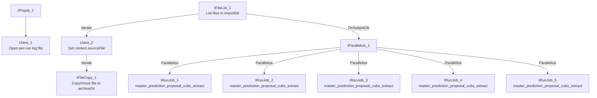

# Talend Job: Export_Hermes_APC_Master_Prediction

## Overview

This is a file-intake orchestrator job for the "Hermes"/Equabli prediction-scoring pipeline: it watches an import directory for files, archives each one it finds, then — regardless of whether any files were actually present — fires off 5 parallel copies of a shared sub-job, `master_prediction_proposal_cubs_extract`. Per `06_dependency_matrix.md`, this job and `Extract_Hermes_Master_Prediction` both call that same target 5 times each; the two calling jobs are themselves near-identical (see Issues observed) and almost certainly exist to run the same 5-way parallel extract at two different points/triggers in the overall prediction workflow.

## Detail table

| Field | Value |
|---|---|
| Job name | Export_Hermes_APC_Master_Prediction |
| Version | 0.1 |
| Project | EDW2SF |
| Author | jmach@harriscollect.com |
| Created | 2024-11-03T21:45:20.472-0800 |
| Last Modified | 2025-08-28T08:57:16.259-0700 |

## Step-by-step data flow

**Setup subjob:** `tPrejob_1` → `tJava_1` opens a per-run log file at `context.logDir + jobName + "_" + <timestamp> + ".log"` and redirects `System.out`/`System.err` to it.

**Main subjob:**

1. `tFileList_1` lists files in `context.importDir` (an `EXCLUDEFILEMASK` of `*.txt` is configured but `IFEXCLUDE=false`, so it has no effect — every file is picked up, matching the same non-functional-exclusion pattern seen in `ADP_Payroll_Load`).
2. For each file found (`ITERATE`), `tJava_2` captures the current file path into `context.sourceFile`, then `tFileCopy_1` copies/archives it to `context.archiveDir` (`REMOVE_FILE=true`, so the original is deleted after copying — effectively a move).
3. Once `tFileList_1`'s subjob completes (`OnSubjobOk` — i.e., regardless of how many files, if any, were found), `tParallelize_1` fires all 5 `tRunJob` components at once, each independently calling the same sub-job, `master_prediction_proposal_cubs_extract` (`DIE_ON_CHILD_ERROR=true`, `USE_INDEPENDENT_PROCESS=true`, `TRANSMIT_ORIGINAL_CONTEXT=true` on all 5).

## Settings tables

### File intake: `tFileList_1` / `tFileCopy_1`

| Setting | Value | What it means |
|---|---|---|
| DIRECTORY | `context.importDir` | Source directory being watched for incoming files. |
| EXCLUDEFILEMASK / IFEXCLUDE | `"*.txt"` / `false` | The `.txt` exclusion is configured but inactive, so all files are processed — same non-functional-filter pattern as elsewhere in this project. |
| `tFileCopy_1` SOURCE_DERECTORY | `"C:/Talend-Studio-20211109_1610-V8.0.1/workspace"` | Hardcoded developer-workstation path — see Issues observed. |
| `tFileCopy_1` DESTINATION / REMOVE_FILE | `context.archiveDir` / `true` | Files are moved (copied then the original deleted), not just copied. |

### Orchestration: `tRunJob_1`–`tRunJob_5`

| Setting | Value | What it means |
|---|---|---|
| PROCESS | `master_prediction_proposal_cubs_extract` (all 5) | All 5 call the exact same sub-job. |
| USE_INDEPENDENT_PROCESS | `true` (all 5) | Each runs in its own JVM process. |
| DIE_ON_CHILD_ERROR | `true` (all 5) | If any of the 5 sub-job calls fails, this orchestrator fails too. |
| TRANSMIT_ORIGINAL_CONTEXT | `true` (all 5) | Each call passes through this job's own context values unchanged. |

## Dependencies & configuration

- **This job calls `master_prediction_proposal_cubs_extract` 5 times in parallel.** Per `06_dependency_matrix.md`, distinguishing what differs between the 5 calls (most likely one call per site/partner) requires opening each `tRunJob` component's own context override settings individually — not visible in this job-level metadata.
- **Context variables used:** `archiveDir`, `importDir`, `logDir`, `sourceFile`.
- **1 hardcoded developer-workstation path**: `tFileCopy_1.SOURCE_DERECTORY` = `"C:/Talend-Studio-20211109_1610-V8.0.1/workspace"` — same project-wide risk pattern documented in `05_operational_runbook.md`.

## Glossary

| Component type | Plain-English meaning |
|---|---|
| `tFileList` | Lists files in a directory for the job to iterate over one at a time. |
| `tFileCopy` | Copies (and optionally deletes the original of, i.e. moves) a file to another location. |
| `tParallelize` | Runs its downstream branches at the same time instead of one after another. |
| `tRunJob` | Runs another Talend job as a sub-process, optionally waiting for it to finish. |

## Issues observed

- **This job is functionally near-identical to `Extract_Hermes_Master_Prediction`.** Both jobs have the exact same component set, the same parameter values (down to the identical hardcoded `tFileCopy_1` path and the same 5x parallel call to `master_prediction_proposal_cubs_extract`), and the only structural difference found is the `tParallelize_1` branch ordering (`tRunJob_2` fires first here vs. `tRunJob_1` first in the other job) — which has no practical effect since `tParallelize` starts all branches concurrently regardless of declared order. This job was created over a year after `Extract_Hermes_Master_Prediction` (2024-11-03 vs. 2023-05-17), suggesting it may be a copy made to be triggered from a different point in the workflow (an "Export" step vs. an "Extract" step) rather than a functional variant — unable to confirm the intended distinction from metadata; verify with the team whether both are still needed or one has superseded the other.
- **The `*.txt` exclusion filter on `tFileList_1` is configured but inactive** (`IFEXCLUDE=false`), so if the intent was ever to skip `.txt` files, that isn't actually happening — every file in `importDir` is picked up and archived.
- **The 5 parallel `tRunJob` calls fire unconditionally after `tFileList_1` completes, even if zero files were found or copied** — there's no visible per-file gating on the `tRunJob` calls, meaning `master_prediction_proposal_cubs_extract` runs 5 times every time this job runs regardless of whether new source files actually arrived.
- **No error/row-count logging specific to this job's business outcome** (no `tWarn`/`tDie`/`tSendMail` beyond the child-job failure propagation) — a partial failure among the 5 parallel calls would surface only as a generic Talend execution error naming which `tRunJob` failed, not a job-specific business message.
