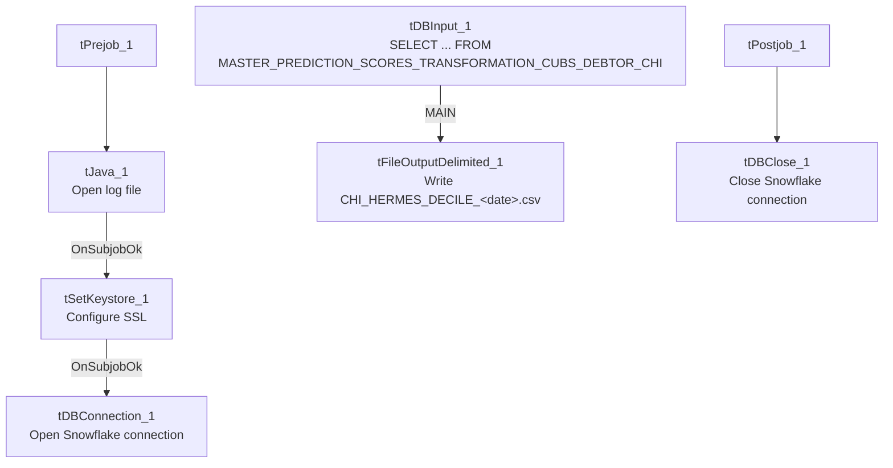

# Talend Job: Extract_CHI_Hermes_Decile

## Overview

Extracts the CHI-site "Hermes"/Equabli prediction decile assignment (logon, packet, debtor number, local/global score, treatment group, dialer group) from a Snowflake transformation table scoped to CHI, and writes it to a dated CSV file. This is one of a family of near-identical per-site decile extract jobs (`Extract_CO_Hermes_Decile`, `Extract_DC_Hermes_Decile`, `Extract_HH_Hermes_Decile`) — this one is internally consistent: its query, table name, and output filename all correctly reference `CHI`.

## Detail table

| Field | Value |
|---|---|
| Job name | Extract_CHI_Hermes_Decile |
| Version | 0.1 |
| Project | EDW2SF |
| Author | jmach@harriscollect.com |
| Created | 2023-08-13T21:08:44.369-0700 |
| Last Modified | 2025-11-05T09:09:24.534-0800 |

## Step-by-step data flow

**Setup subjob:** `tPrejob_1` → `tJava_1` opens a per-run log file → `tSetKeystore_1` configures SSL trust/keystore from `context.keystorePath` (passwords redacted) → `tDBConnection_1` opens the Snowflake connection.

**Main subjob:**

1. `tDBInput_1` runs `SELECT LOGON, PACKET, DEBTORNUMBER, PL_GROUP, "LOCAL", "GLOBAL", EQUABLI_TREATMENT_GROUP, DIALERGRP FROM MASTER_PREDICTION_SCORES_TRANSFORMATION_CUBS_DEBTOR_CHI;` — a fixed, unfiltered read of the entire CHI-scoped transformation table.
2. `tFileOutputDelimited_1` writes the result to `context.outputDir + "CHI_HERMES_DECILE_" + <CCYYMMDD> + ".csv"` (comma-delimited, header included).

**Teardown subjob:** `tPostjob_1` → `tDBClose_1` closes the Snowflake connection.

## Settings tables

### Source: `tDBInput_1` (`tSnowflakeInput`)

| Setting | Value | What it means |
|---|---|---|
| Query | `SELECT LOGON, PACKET, DEBTORNUMBER, PL_GROUP, "LOCAL", "GLOBAL", EQUABLI_TREATMENT_GROUP, DIALERGRP FROM MASTER_PREDICTION_SCORES_TRANSFORMATION_CUBS_DEBTOR_CHI;` | No `WHERE` clause — the source table itself is already scoped to CHI by name; the entire table is exported every run. |

### Target: `tFileOutputDelimited_1`

| Setting | Value | What it means |
|---|---|---|
| FILENAME | `context.outputDir+"CHI_HERMES_DECILE_"+TalendDate.getDate("CCYYMMDD")+".csv"` | Correctly labeled `CHI_` — consistent with both the job name and the source table. |
| INCLUDEHEADER | `true` | CSV includes a header row (differs from `Equibli_Extract`'s no-header convention). |

### SSL setup: `tSetKeystore_1`

| Setting | Value | What it means |
|---|---|---|
| SSL_TRUSTSERVER_TRUSTSTORE | `"C:/clientTrustStore.trustStore"` | Hardcoded local path, not `context`-driven — see Issues observed. |
| SSL_KEYSTORE | `context.keystorePath` | Client keystore path is context-driven, unlike the trust store above. |
| SSL_TRUSTSERVER_PASSWORD / SSL_KEYSTORE_PASSWORD / NEED_CLIENT_AUTH | `***REDACTED***` | Preserved as redacted. |

## Dependencies & configuration

- **Triggers/depends on other jobs:** none — no `tRunJob` links found.
- **Context variables used:** `keystorePath`, `logDir`, `outputDir`.
- **1 hardcoded path finding:** `tSetKeystore_1.SSL_TRUSTSERVER_TRUSTSTORE` = `"C:/clientTrustStore.trustStore"` — a fixed local path rather than a `context.` variable, present identically across the whole `*_Hermes_Decile` family.

## Glossary

| Component type | Plain-English meaning |
|---|---|
| `tSetKeystore` | Configures SSL/TLS trust and client keystore settings for secure connections made later in the job. |
| `tSnowflakeConnection` / `tSnowflakeClose` | Open/close the Snowflake connection shared by other components. |
| `tSnowflakeInput` | Runs a query against Snowflake and returns its result rows. |
| `tFileOutputDelimited` | Writes rows to a delimited (CSV-style) text file. |

## Issues observed

- **This job is one of a near-identical family** (`Extract_CHI_Hermes_Decile`, `Extract_CO_Hermes_Decile`, `Extract_DC_Hermes_Decile`, `Extract_HH_Hermes_Decile`) sharing the same component structure, SSL setup, and query shape, differing only in the site-code suffix on the source table and the output filename prefix. **Unlike the `Extract_No_Dialer_Test_*` family (see those jobs' docs), this one is internally consistent** — its job name, query table (`..._CHI`), and output filename (`CHI_HERMES_DECILE_...`) all agree.
- **The query has no `WHERE` clause and no incremental filter** — every run exports the entire `MASTER_PREDICTION_SCORES_TRANSFORMATION_CUBS_DEBTOR_CHI` table fresh. This is presumably intentional (a full daily snapshot), but there's no visible mechanism to detect if the underlying transformation table is empty or stale before export.
- **`SSL_TRUSTSERVER_TRUSTSTORE` is a hardcoded local path** (`C:/clientTrustStore.trustStore`) rather than driven by a `context` variable like the paired `SSL_KEYSTORE` setting is — inconsistent within the same component, and a portability risk consistent with `05_operational_runbook.md`'s hardcoded-path findings, though this specific path isn't the commonly-cited `C:/Talend-Studio-...` one.
- **No error/row-count logging or reject handling** — no `tWarn`/`tDie`/`tSendMail`; a failed extract would only surface as a generic Talend execution error.
