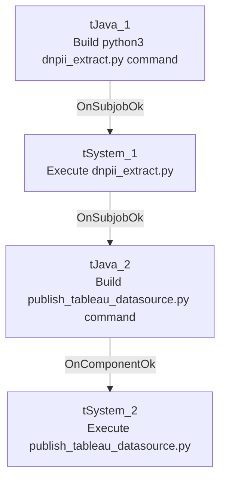

# Talend Job: Extract_DDNPII

## Overview

This job does not move data directly through Talend components at all — it shells out to two external Python scripts. The first (`dnpii_extract.py`) presumably builds a Tableau Hyper extract file at `/output/dnpii.hyper` (the "DDNPII" naming — unable to determine the exact business meaning of this acronym from metadata; likely a debtor/data "Do Not..." PII-related extract, verify with the team). The second (`publish_tableau_datasource.py`) publishes that Hyper file to a Tableau Server as a datasource named "DDNPII".

## Detail table

| Field | Value |
|---|---|
| Job name | Extract_DDNPII |
| Version | 0.1 |
| Project | EDW2SF |
| Author | jmach@harriscollect.com |
| Created | 2022-04-04T10:25:42.661-0700 |
| Last Modified | 2025-08-28T08:57:16.418-0700 |

## Step-by-step data flow

This job has no `tPrejob`/`tPostjob` and no database connection components — it's purely a shell-command wrapper:

1. `tJava_1` builds a command string into `context.pyCmd`: `"python3 " + context.pyScriptDir + "dnpii_extract.py --file /output/dnpii.hyper"`.
2. On success (`OnSubjobOk`), `tSystem_1` executes that command, with its working directory set to a hardcoded path, output/error streamed to the Talend console.
3. On success (`OnSubjobOk`), `tJava_2` builds a second command into `context.pyCmd`: `"python3 " + context.pyScriptDir + "publish_tableau_datasource.py --server " + context.tabServer + " --user " + context.tabUser + " --password " + context.tabPass + " --file /output/dnpii.hyper --name DDNPII --project " + context.tabPro...` (the code text is truncated in this metadata at `tabPro...`, almost certainly `context.tabProject`).
4. On component completion (`OnComponentOk`), `tSystem_2` executes the second command, same working directory and console output settings as `tSystem_1`.

## Settings tables

### `tSystem_1` / `tSystem_2`

| Setting | Value | What it means |
|---|---|---|
| DIRECTORY | `"C:/Talend-Studio-20211109_1610-V8.0.1/workspace"` (both) | Hardcoded developer-workstation working directory — the same pattern flagged project-wide in `05_operational_runbook.md`, present twice in this job. |
| COMMAND | `context.pyCmd` (built by the preceding `tJava` component) | The actual Python invocation, assembled dynamically rather than fixed. |
| OUTPUT / ERROROUTPUT | `OUTPUT_TO_CONSOLE` (both) | stdout/stderr from the Python scripts are streamed into the Talend job log, not captured separately. |

### `tJava_1` — dnpii_extract command

| Setting | Value | What it means |
|---|---|---|
| Command built | `"python3 " + context.pyScriptDir + "dnpii_extract.py --file /output/dnpii.hyper"` | Calls a Python script (not part of this Talend metadata) to build a Tableau Hyper file at a fixed container/server path `/output/dnpii.hyper`. |

### `tJava_2` — publish command

| Setting | Value | What it means |
|---|---|---|
| Command built (truncated) | `"python3 " + context.pyScriptDir + "publish_tableau_datasource.py --server " + context.tabServer + " --user " + context.tabUser + " --password " + context.tabPass + " --file /output/dnpii.hyper --name DDNPII --project " + context.tabPro...` | Publishes the Hyper file to Tableau Server under the name "DDNPII"; the project ID argument is cut off in this metadata but almost certainly continues with `context.tabProject` (matching the `TableauVariables_0.1` context group's `tabProject` variable seen in `_shared_context.json`). |

## Dependencies & configuration

- **Triggers/depends on other jobs:** none — no `tRunJob` links found.
- **Context variables used:** `pyCmd`, `pyScriptDir`, `tabPass`, `tabProject`, `tabServer`, `tabUser` — all consistent with the `TableauVariables_0.1` context group documented in `06_dependency_matrix.md`/`_shared_context.json`.
- **2 hardcoded developer-workstation paths**, both `tSystem_1.DIRECTORY` and `tSystem_2.DIRECTORY` = `"C:/Talend-Studio-20211109_1610-V8.0.1/workspace"` — the project-wide risk pattern from `05_operational_runbook.md`, occurring twice in this one job.

## Glossary

| Component type | Plain-English meaning |
|---|---|
| `tJava` | Runs custom Java code — here used only to build a shell command string into a context variable, not to process any row data. |
| `tSystem` | Executes an OS-level shell command from within the Talend job and streams its output to the log. |

## Issues observed

- **This job's actual business logic (what "DDNPII" data is extracted and how) lives entirely in an external Python script (`dnpii_extract.py`) that is outside the scope of this Talend metadata** — this doc can only describe the Talend-side orchestration (build command, run it, build the next command, run it), not what the script itself queries or computes. Unable to determine from metadata what "DDNPII" stands for or what data it contains; verify with the team or by reading the script directly.
- **The Tableau publish command text is truncated in the extracted metadata** (cuts off mid-argument at `context.tabPro...`) — while the continuation is almost certainly `context.tabProject`, this cannot be fully confirmed from the data provided.
- **Both `tSystem` components run with the same hardcoded Windows developer-workstation working directory** — if this job is ever run from a different machine or a non-Windows execution environment (e.g., a Linux-based Talend Runtime), both shell-outs would likely fail to resolve that directory, in addition to the `python3` command needing to be on the executing host's `PATH`.
- **The Tableau server password (`context.tabPass`) is passed as a plaintext command-line argument** to the Python script via `tSystem`. Depending on the host OS, command-line arguments can be visible to other processes/users on the same machine (e.g., via `ps` on Linux) — this is a potential credential-exposure risk worth flagging to the security team, even though the actual password value itself is appropriately redacted in this metadata.
