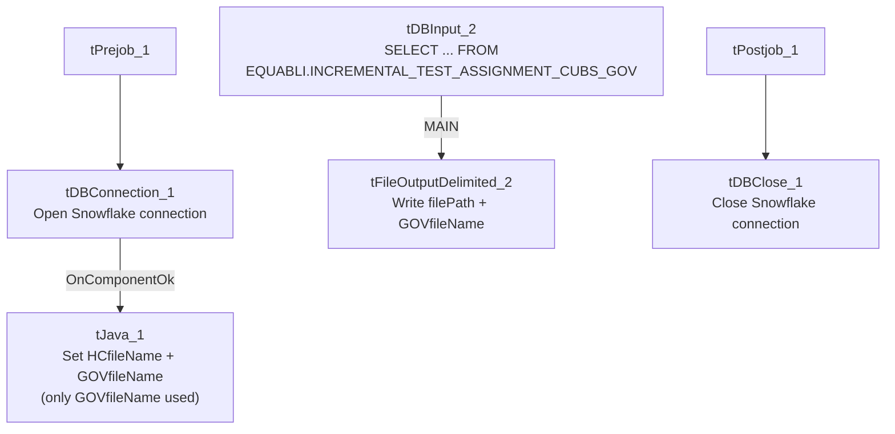

# Talend Job: Extract_Equabli_GOV

## Overview

Extracts the "GOV" (government-sector, presumably) Equabli test-assignment data — logon, packet, debtor number, group, local/global scores, treatment group, dialer group — from a Snowflake table under the `EQUABLI` schema, and writes it to a dated CSV file. It shares an identical filename-building step with `Extract_Equibli_Test` (see Issues observed) that computes both an "HC" and a "GOV" filename even though this job only ever uses the GOV one.

## Detail table

| Field | Value |
|---|---|
| Job name | Extract_Equabli_GOV |
| Version | 0.1 |
| Project | EDW2SF |
| Author | jmach@harriscollect.com |
| Created | 2022-07-27T10:57:47.386-0700 |
| Last Modified | 2025-09-24T11:00:08.028-0700 |

## Step-by-step data flow

**Setup subjob:** `tPrejob_1` → `tDBConnection_1` opens the Snowflake connection → on success, `tJava_1` computes both `context.HCfileName` (`"EQB_HH_" + <CCYYMMDD> + ".csv"`) and `context.GOVfileName` (`"EQB_GOV_" + <CCYYMMDD> + ".csv"`) — only the latter is used in this job.

**Main subjob:**

1. `tDBInput_2` runs `SELECT LOGON, PACKET, DEBTORNUMBER, PL_GROUP, "LOCAL", "GLOBAL", EQUABLI_TREATMENT_GROUP, DIALERGRP FROM EDWPRODHH.EQUABLI.INCREMENTAL_TEST_ASSIGNMENT_CUBS_GOV;`.
2. `tFileOutputDelimited_2` writes the result to `context.filePath + context.GOVfileName`.

**Teardown subjob:** `tPostjob_1` → `tDBClose_1` closes the Snowflake connection.

## Settings tables

### Filename setup: `tJava_1`

| Setting | Value | What it means |
|---|---|---|
| Code | `context.HCfileName="EQB_HH_" + TalendDate.getDate("CCYYMMDD")+".csv"; context.GOVfileName="EQB_GOV_" + TalendDate.getDate("CCYYMMDD") + ".csv";` | Computes both an "HC" (health-system) and "GOV" filename every run, but this job's flow only ever wires up `GOVfileName` — see Issues observed. |

### Source: `tDBInput_2` (`tSnowflakeInput`)

| Setting | Value | What it means |
|---|---|---|
| Query | `SELECT LOGON, PACKET, DEBTORNUMBER, PL_GROUP, "LOCAL", "GLOBAL", EQUABLI_TREATMENT_GROUP, DIALERGRP FROM EDWPRODHH.EQUABLI.INCREMENTAL_TEST_ASSIGNMENT_CUBS_GOV;` | Fully-qualified source table (`EDWPRODHH.EQUABLI...`), scoped to the "GOV" test-assignment group. |

### Target: `tFileOutputDelimited_2`

| Setting | Value | What it means |
|---|---|---|
| FILENAME | `context.filePath+context.GOVfileName` | Resolves to `<filePath>/EQB_GOV_<date>.csv`. |
| INCLUDEHEADER | `true` | CSV includes a header row. |

## Dependencies & configuration

- **Triggers/depends on other jobs:** none — no `tRunJob` links found.
- **Context variables used:** `GOVfileName`, `HCfileName` (computed but unused here), `filePath`.
- No hardcoded developer-workstation paths found in this job's own components.

## Glossary

| Component type | Plain-English meaning |
|---|---|
| `tSnowflakeConnection` / `tSnowflakeClose` | Open/close the Snowflake connection shared by other components. |
| `tJava` | Runs custom Java code — here used only to compute dated filenames into context variables. |
| `tSnowflakeInput` | Runs a query against Snowflake and returns its result rows. |
| `tFileOutputDelimited` | Writes rows to a delimited (CSV-style) text file. |

## Issues observed

- **`tJava_1` computes an unused `context.HCfileName` alongside the `GOVfileName` this job actually needs.** The exact same two-line code block appears verbatim in `Extract_Equibli_Test` (which, conversely, computes both names but only uses `HCfileName`). This strongly suggests both jobs were built from a shared template that originally handled both HC and GOV outputs, and each was subsequently narrowed to a single output without removing the now-dead filename computation — a harmless but recurring copy-paste artifact across this small job family.
- **No error/row-count logging or reject handling** — no `tWarn`/`tDie`/`tSendMail`; a failed extract would only surface as a generic Talend execution error.
- **No incremental filter or row-count check** — the query reads the entire `INCREMENTAL_TEST_ASSIGNMENT_CUBS_GOV` table every run despite "INCREMENTAL" appearing in the table's own name, suggesting the incremental logic (if any) lives upstream in how that table itself is populated, not in this extract job.
