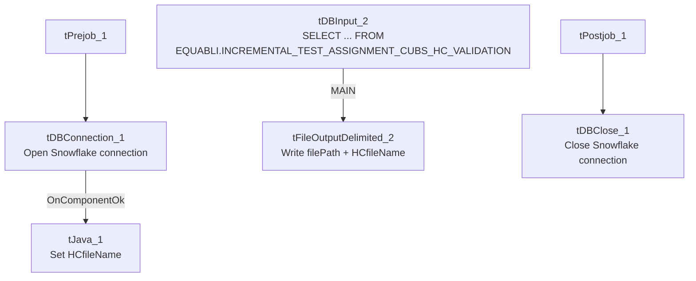

# Talend Job: Extract_Equabli_HC_Validation_Score

## Overview

Extracts the health-system ("HC") Equabli validation-score test assignment — logon, packet, debtor number, group, local/global scores, validation treatment group, and validation expiration date — from a Snowflake table under the `EQUABLI` schema, and writes it to a dated CSV file. Unlike `Extract_Equabli_GOV`/`Extract_Equibli_Test`, this job computes only the single filename it needs, with no unused sibling variable.

## Detail table

| Field | Value |
|---|---|
| Job name | Extract_Equabli_HC_Validation_Score |
| Version | 0.1 |
| Project | EDW2SF |
| Author | jmach@harriscollect.com |
| Created | 2022-12-09T08:36:14.177-0800 |
| Last Modified | 2025-09-24T10:59:34.269-0700 |

## Step-by-step data flow

**Setup subjob:** `tPrejob_1` → `tDBConnection_1` opens the Snowflake connection → on success, `tJava_1` computes `context.HCfileName = "HH_EQB_VALIDATIONSCORE_" + <CCYYMMDD> + ".csv"`.

**Main subjob:**

1. `tDBInput_2` runs `SELECT LOGON, PACKET, DEBTORNUMBER, PL_GROUP, "LOCAL", "GLOBAL", EQUABLI_VALIDATION_TREATMENT_GROUP, EQUABLI_VALIDATION_EXPIRATION_DATE FROM EQUABLI.INCREMENTAL_TEST_ASSIGNMENT_CUBS_HC_VALIDATION;`.
2. `tFileOutputDelimited_2` writes the result to `context.filePath + context.HCfileName`.

**Teardown subjob:** `tPostjob_1` → `tDBClose_1` closes the Snowflake connection.

## Settings tables

### Filename setup: `tJava_1`

| Setting | Value | What it means |
|---|---|---|
| Code | `context.HCfileName="HH_EQB_VALIDATIONSCORE_" + TalendDate.getDate("CCYYMMDD")+".csv";` | Computes only the single filename this job uses — note the `HH_` prefix embedded in the filename literal, which appears to tie this "HC" job to the "HH" site code (see `01_system_architecture.md` for site codes) even though the job name itself says "HC," not "HH." Unable to determine from metadata whether "HC" (health-system) and "HH" (a site code) are being used interchangeably here or refer to different things — verify with the team. |

### Source: `tDBInput_2` (`tSnowflakeInput`)

| Setting | Value | What it means |
|---|---|---|
| Query | `SELECT LOGON, PACKET, DEBTORNUMBER, PL_GROUP, "LOCAL", "GLOBAL", EQUABLI_VALIDATION_TREATMENT_GROUP, EQUABLI_VALIDATION_EXPIRATION_DATE FROM EQUABLI.INCREMENTAL_TEST_ASSIGNMENT_CUBS_HC_VALIDATION;` | Scoped to the "HC_VALIDATION" test-assignment table — a different table from the plain "HC" table used by `Extract_Equibli_Test`. |

### Target: `tFileOutputDelimited_2`

| Setting | Value | What it means |
|---|---|---|
| FILENAME | `context.filePath + context.HCfileName` | Resolves to `<filePath>/HH_EQB_VALIDATIONSCORE_<date>.csv`. |
| INCLUDEHEADER | `true` | CSV includes a header row. |

## Dependencies & configuration

- **Triggers/depends on other jobs:** none — no `tRunJob` links found.
- **Context variables used:** `HCfileName`, `filePath`.
- No hardcoded developer-workstation paths found in this job's own components.

## Glossary

| Component type | Plain-English meaning |
|---|---|
| `tSnowflakeConnection` / `tSnowflakeClose` | Open/close the Snowflake connection shared by other components. |
| `tJava` | Runs custom Java code — here used only to compute a dated filename into a context variable. |
| `tSnowflakeInput` | Runs a query against Snowflake and returns its result rows. |
| `tFileOutputDelimited` | Writes rows to a delimited (CSV-style) text file. |

## Issues observed

- **The output filename literal uses an `HH_` prefix while the job and context variable are both named "HC"** (`context.HCfileName = "HH_EQB_VALIDATIONSCORE_..."`) — this could be an intentional convention (site code `HH` = the health-system portfolio referred to elsewhere as "HC") or a naming inconsistency; unable to determine which from metadata. Worth confirming with the team, especially since `01_system_architecture.md` documents `HH` specifically as one of the project's site codes, distinct from any "HC" abbreviation.
- **No error/row-count logging or reject handling** — no `tWarn`/`tDie`/`tSendMail`; a failed extract would only surface as a generic Talend execution error.
- **No incremental filter visible in the query** despite "INCREMENTAL" in the source table's own name — as with `Extract_Equabli_GOV`, any incrementality is presumably handled upstream in how the source table itself is populated, not in this extract job.
