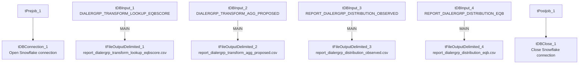

# Talend Job: Extract_Equabli_Reports

## Overview

Extracts four independent Equabli/dialer-group reporting tables from Snowflake and writes each to its own CSV file — an industry/segment yield lookup, a dialer-group score-threshold lookup, an observed dialer-group distribution report, and an EQB-score distribution report. Unlike the site-scoped `*_Hermes_Decile` jobs, this job is not scoped to any single site — it appears to be a general-purpose reporting extract for whoever consumes the Equabli dialer-grouping model's output tables.

## Detail table

| Field | Value |
|---|---|
| Job name | Extract_Equabli_Reports |
| Version | 0.1 |
| Project | EDW2SF |
| Author | jmach@harriscollect.com |
| Created | 2022-09-20T09:16:19.388-0700 |
| Last Modified | 2025-09-24T11:09:12.724-0700 |

## Step-by-step data flow

**Setup subjob:** `tPrejob_1` → `tDBConnection_1` opens the Snowflake connection.

**Main subjob** — four independent, parallel read/write pairs, all sharing the same connection:

1. `tDBInput_1` reads `EQUABLI.DIALERGRP_TRANSFORM_LOOKUP_EQBSCORE` (industry, PL_GROUP, team, netcash rank, packet/call/commission counts, segment yield percentiles, dialer group number) → `tFileOutputDelimited_1` writes `context.targetFolder + "report_dialergrp_transform_lookup_eqbscore.csv"`.
2. `tDBInput_2` reads `EQUABLI.DIALERGRP_TRANSFORM_AGG_PROPOSED` (PL_GROUP plus 4 pairs of min/max group thresholds) → `tFileOutputDelimited_2` writes `context.targetFolder + "report_dialergrp_transform_agg_proposed.csv"`.
3. `tDBInput_3` reads `EQUABLI.REPORT_DIALERGRP_DISTRIBUTION_OBSERVED` (team, PL_GROUP, dialer group, target/observed packet percentages and counts) → `tFileOutputDelimited_3` writes `context.targetFolder + "report_dialergrp_distribution_observed.csv"`.
4. `tDBInput_4` reads `EQUABLI.REPORT_DIALERGRP_DISTRIBUTION_EQB` (industry, team, PL_GROUP, EQB score, packet count) → `tFileOutputDelimited_4` writes `context.targetFolder + "report_dialergrp_distribution_eqb.csv"`.

**Teardown subjob:** `tPostjob_1` → `tDBClose_1` closes the Snowflake connection.

## Settings tables

### Sources and targets (all 4 pairs share the same shape)

| Setting | Value | What it means |
|---|---|---|
| Source tables | `EQUABLI.DIALERGRP_TRANSFORM_LOOKUP_EQBSCORE`, `EQUABLI.DIALERGRP_TRANSFORM_AGG_PROPOSED`, `EQUABLI.REPORT_DIALERGRP_DISTRIBUTION_OBSERVED`, `EQUABLI.REPORT_DIALERGRP_DISTRIBUTION_EQB` | Four distinct tables, no `WHERE` clauses on any — full-table exports every run. |
| Output directory | `context.targetFolder` (all 4) | Same shared output folder for all four report files, each with a fixed descriptive filename. |
| INCLUDEHEADER | `true` (all 4) | All four CSVs include a header row. |

## Dependencies & configuration

- **Triggers/depends on other jobs:** none — no `tRunJob` links found.
- **Context variables used:** `targetFolder` only.
- No hardcoded developer-workstation paths found in this job's own components.

## Glossary

| Component type | Plain-English meaning |
|---|---|
| `tSnowflakeConnection` / `tSnowflakeClose` | Open/close the single Snowflake connection shared across all four read/write pairs in this job. |
| `tSnowflakeInput` | Runs a query against Snowflake and returns its result rows. |
| `tFileOutputDelimited` | Writes rows to a delimited (CSV-style) text file. |

## Issues observed

- **All four extracts are full-table reads with no `WHERE` clause or incremental filter** — every run re-exports the entirety of all four Equabli reporting tables. If any of these tables grows large over time, this could become a slow, unnecessary full-scan job; unable to determine current table sizes from metadata.
- **No error/row-count logging or reject handling** — no `tWarn`/`tDie`/`tSendMail` anywhere in the job; a failure in any one of the four independent read/write pairs would only surface as a generic Talend execution error, and it's not obvious from the wiring alone whether one pair failing would abort the other three or let them complete (there are no explicit `OnSubjobOk`/`RUN_IF` links between the four pairs — each appears to run as its own independent parallel branch off the shared connection).
- Beyond the above, nothing else stands out in this job's own metadata beyond the project-wide patterns already documented in `05_operational_runbook.md`.
