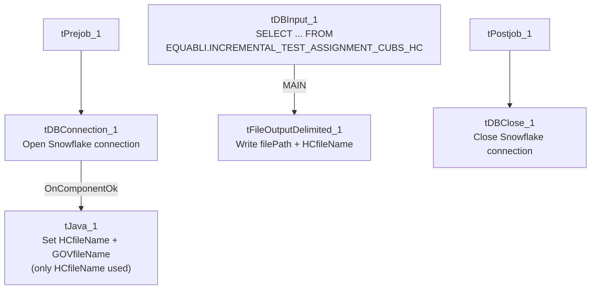

# Talend Job: Extract_Equibli_Test

## Overview

Extracts the "HC" (health-system) Equabli test-assignment data — logon, packet, debtor number, group, local/global scores, treatment group, dialer group — from a Snowflake table under the `EQUABLI` schema, and writes it to a dated CSV file. Note the job name spells the vendor "Equibli" while its query and context variables spell it "Equabli," consistent with an inconsistent spelling used throughout this job family (see Issues observed). This job shares the identical filename-computation code with `Extract_Equabli_GOV` but, in a mirror-image of that job, uses the "HC" filename and leaves the "GOV" one unused.

## Detail table

| Field | Value |
|---|---|
| Job name | Extract_Equibli_Test |
| Version | 0.1 |
| Project | EDW2SF |
| Author | jmach@harriscollect.com |
| Created | 2022-04-26T08:44:18.939-0700 |
| Last Modified | 2025-09-24T11:00:36.561-0700 |

## Step-by-step data flow

**Setup subjob:** `tPrejob_1` → `tDBConnection_1` opens the Snowflake connection → on success, `tJava_1` computes both `context.HCfileName` (`"EQB_HH_" + <CCYYMMDD> + ".csv"`) and `context.GOVfileName` (`"EQB_GOV_" + <CCYYMMDD> + ".csv"`) — only the former is used in this job.

**Main subjob:**

1. `tDBInput_1` runs `SELECT LOGON, PACKET, DEBTORNUMBER, PL_GROUP, "LOCAL", "GLOBAL", EQUABLI_TREATMENT_GROUP, DIALERGRP FROM EDWPRODHH.EQUABLI.INCREMENTAL_TEST_ASSIGNMENT_CUBS_HC;`.
2. `tFileOutputDelimited_1` writes the result to `context.filePath + context.HCfileName`.

**Teardown subjob:** `tPostjob_1` → `tDBClose_1` closes the Snowflake connection.

## Settings tables

### Filename setup: `tJava_1`

| Setting | Value | What it means |
|---|---|---|
| Code | `context.HCfileName="EQB_HH_" + TalendDate.getDate("CCYYMMDD")+".csv"; context.GOVfileName="EQB_GOV_" + TalendDate.getDate("CCYYMMDD") + ".csv";` | Identical code to `Extract_Equabli_GOV`'s `tJava_1` — computes both names, but this job only wires up `HCfileName`. |

### Source: `tDBInput_1` (`tSnowflakeInput`)

| Setting | Value | What it means |
|---|---|---|
| Query | `SELECT LOGON, PACKET, DEBTORNUMBER, PL_GROUP, "LOCAL", "GLOBAL", EQUABLI_TREATMENT_GROUP, DIALERGRP FROM EDWPRODHH.EQUABLI.INCREMENTAL_TEST_ASSIGNMENT_CUBS_HC;` | Fully-qualified source table scoped to the plain "HC" test-assignment group (not the "HC_VALIDATION" table used by `Extract_Equabli_HC_Validation_Score`). |

### Target: `tFileOutputDelimited_1`

| Setting | Value | What it means |
|---|---|---|
| FILENAME | `context.filePath+context.HCfileName` | Resolves to `<filePath>/EQB_HH_<date>.csv` — note the filename literal itself says `EQB_HH_`, not `EQB_HC_`, mirroring the same `HC`/`HH` naming ambiguity seen in `Extract_Equabli_HC_Validation_Score`. |
| INCLUDEHEADER | `true` | CSV includes a header row. |

## Dependencies & configuration

- **Triggers/depends on other jobs:** none — no `tRunJob` links found.
- **Context variables used:** `GOVfileName` (computed but unused here), `HCfileName`, `filePath`.
- No hardcoded developer-workstation paths found in this job's own components.

## Glossary

| Component type | Plain-English meaning |
|---|---|
| `tSnowflakeConnection` / `tSnowflakeClose` | Open/close the Snowflake connection shared by other components. |
| `tJava` | Runs custom Java code — here used only to compute dated filenames into context variables. |
| `tSnowflakeInput` | Runs a query against Snowflake and returns its result rows. |
| `tFileOutputDelimited` | Writes rows to a delimited (CSV-style) text file. |

## Issues observed

- **The job name spells the vendor "Equibli" while every other reference in this job (context variables, the source schema `EQUABLI`, the query) spells it "Equabli."** This inconsistent spelling recurs across the batch (compare `Equibli_Extract`, which also uses "Equibli" in its name against an "Equabli"-spelled source), suggesting the two spellings have been used interchangeably by whoever authored these jobs rather than referring to two different systems — worth confirming with the team which spelling is authoritative.
- **`tJava_1` computes an unused `context.GOVfileName`** — identical dead-code pattern to `Extract_Equabli_GOV`'s unused `HCfileName`, confirming both jobs were built from the same two-output template and each narrowed down without removing the leftover computation.
- **The output filename literal is `EQB_HH_...`, not `EQB_HC_...`**, despite the job/variable naming saying "HC" — same `HC`/`HH` naming ambiguity flagged in `Extract_Equabli_HC_Validation_Score`; unable to determine from metadata whether this is intentional (site code `HH`) or a typo carried through the template.
- **No error/row-count logging or reject handling** — no `tWarn`/`tDie`/`tSendMail`; a failed extract would only surface as a generic Talend execution error.
