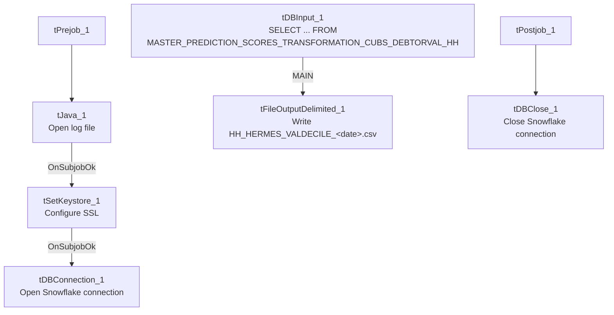

# Talend Job: Extract_HH_Hermes_ValDecile

## Overview

Extracts the HH-site "Hermes"/Equabli **validation** decile assignment — a distinct table from the regular decile assignment in `Extract_HH_Hermes_Decile` — including a validation treatment group and a validation expiration date, and writes it to a dated CSV file. Structurally this job is built from the exact same template as the `*_Hermes_Decile` family (same SSL setup, same connection pattern), but its source table and output columns are specific to score *validation* rather than the primary decile scores.

## Detail table

| Field | Value |
|---|---|
| Job name | Extract_HH_Hermes_ValDecile |
| Version | 0.1 |
| Project | EDW2SF |
| Author | jmach@harriscollect.com |
| Created | 2023-08-13T21:49:55.516-0700 |
| Last Modified | 2025-11-05T09:26:23.975-0800 |

## Step-by-step data flow

**Setup subjob:** `tPrejob_1` → `tJava_1` opens a per-run log file → `tSetKeystore_1` configures SSL trust/keystore from `context.keystorePath` (passwords redacted) → `tDBConnection_1` opens the Snowflake connection.

**Main subjob:**

1. `tDBInput_1` runs `SELECT LOGON, PACKET, DEBTORNUMBER, PL_GROUP, "LOCAL", "GLOBAL", EQUABLI_VALIDATION_TREATMENT_GROUP, TO_VARCHAR(EQUABLI_VALIDATION_EXPIRATION_DATE,'MM/DD/YYYY') FROM MASTER_PREDICTION_SCORES_TRANSFORMATION_CUBS_DEBTORVAL_HH;` — note the source table name has `DEBTORVAL` (debtor validation) in place of the plain decile job's `DEBTOR`, and the expiration date is explicitly cast to a `MM/DD/YYYY` string in-query.
2. `tFileOutputDelimited_1` writes the result to `context.outputDir + "HH_HERMES_VALDECILE_" + <CCYYMMDD> + ".csv"` (comma-delimited, header included).

**Teardown subjob:** `tPostjob_1` → `tDBClose_1` closes the Snowflake connection.

## Settings tables

### Source: `tDBInput_1` (`tSnowflakeInput`)

| Setting | Value | What it means |
|---|---|---|
| Query | `SELECT LOGON, PACKET, DEBTORNUMBER, PL_GROUP, "LOCAL", "GLOBAL", EQUABLI_VALIDATION_TREATMENT_GROUP, TO_VARCHAR(EQUABLI_VALIDATION_EXPIRATION_DATE,'MM/DD/YYYY') FROM MASTER_PREDICTION_SCORES_TRANSFORMATION_CUBS_DEBTORVAL_HH;` | Reads from the `DEBTORVAL` (validation) transformation table, distinct from `Extract_HH_Hermes_Decile`'s `DEBTOR` table. The expiration date is pre-formatted to a string in-query rather than left as a native date type. |

### Target: `tFileOutputDelimited_1`

| Setting | Value | What it means |
|---|---|---|
| FILENAME | `context.outputDir+"HH_HERMES_VALDECILE_"+TalendDate.getDate("CCYYMMDD")+".csv"` | Correctly labeled `HH_..._VALDECILE_` — consistent with the job name and the validation-specific source table. |
| INCLUDEHEADER | `true` | CSV includes a header row. |

### SSL setup: `tSetKeystore_1`

| Setting | Value | What it means |
|---|---|---|
| SSL_TRUSTSERVER_TRUSTSTORE | `"C:/clientTrustStore.trustStore"` | Hardcoded local path, not `context`-driven — same as the sibling decile jobs. |
| SSL_KEYSTORE | `context.keystorePath` | Client keystore path is context-driven. |
| SSL_TRUSTSERVER_PASSWORD / SSL_KEYSTORE_PASSWORD / NEED_CLIENT_AUTH | `***REDACTED***` | Preserved as redacted. |

## Dependencies & configuration

- **Triggers/depends on other jobs:** none — no `tRunJob` links found.
- **Context variables used:** `keystorePath`, `logDir`, `outputDir`.
- **1 hardcoded path finding:** `tSetKeystore_1.SSL_TRUSTSERVER_TRUSTSTORE` = `"C:/clientTrustStore.trustStore"` — identical to the plain decile jobs' setting.

## Glossary

| Component type | Plain-English meaning |
|---|---|
| `tSetKeystore` | Configures SSL/TLS trust and client keystore settings for secure connections made later in the job. |
| `tSnowflakeConnection` / `tSnowflakeClose` | Open/close the Snowflake connection shared by other components. |
| `tSnowflakeInput` | Runs a query against Snowflake and returns its result rows. |
| `tFileOutputDelimited` | Writes rows to a delimited (CSV-style) text file. |

## Issues observed

- **This job is not a duplicate of `Extract_HH_Hermes_Decile`** — despite sharing the same component pattern, connection setup, and site scope (HH), it reads a genuinely different source table (`DEBTORVAL` vs. `DEBTOR`) with different business columns (validation treatment group and expiration date instead of the standard treatment group and dialer group). No CO/CHI/DC counterpart of this "ValDecile" job appears in this batch — unable to determine from metadata whether validation deciles are only produced for the HH site or whether equivalent jobs for other sites exist outside this batch; verify with the team.
- **The output schema's `EQUABLI_VALIDATION_EXPIRATION_DATE` column is typed `id_String` in this job**, even though the underlying Snowflake column is presumably a native date type — the query explicitly converts it with `TO_VARCHAR(...,'MM/DD/YYYY')`. This is a deliberate formatting choice for the output file, not a bug, but worth noting since it differs from `Extract_HH_Hermes_Decile`'s untouched `id_Double`/`id_String` column types.
- **`SSL_TRUSTSERVER_TRUSTSTORE` is a hardcoded local path** rather than `context`-driven like the paired `SSL_KEYSTORE` — same minor portability inconsistency as the rest of the Hermes Decile family.
- **No error/row-count logging or reject handling** — no `tWarn`/`tDie`/`tSendMail`; a failed extract would only surface as a generic Talend execution error.
