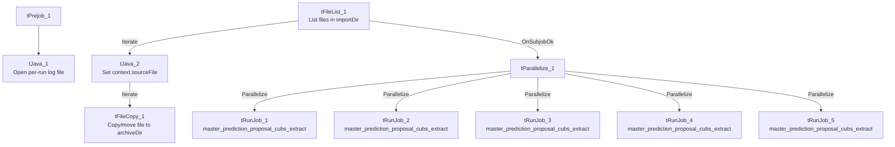

# Talend Job: Extract_Hermes_Master_Prediction

## Overview

This is the earlier sibling of `Export_Hermes_APC_Master_Prediction` (created 2023-05-17, over a year before that job's 2024-11-03 creation date): a file-intake orchestrator for the "Hermes"/Equabli prediction-scoring pipeline that watches an import directory, archives incoming files, then fires 5 parallel copies of the shared sub-job `master_prediction_proposal_cubs_extract`. The two jobs are functionally identical in every component and parameter observed in this metadata — see Issues observed for the one cosmetic difference found.

## Detail table

| Field | Value |
|---|---|
| Job name | Extract_Hermes_Master_Prediction |
| Version | 0.1 |
| Project | EDW2SF |
| Author | jmach@harriscollect.com |
| Created | 2023-05-17T13:26:24.494-0700 |
| Last Modified | 2024-06-05T11:56:00.200-0700 |

## Step-by-step data flow

**Setup subjob:** `tPrejob_1` → `tJava_1` opens a per-run log file at `context.logDir + jobName + "_" + <timestamp> + ".log"` and redirects `System.out`/`System.err` to it.

**Main subjob:**

1. `tFileList_1` lists files in `context.importDir` (the `*.txt` `EXCLUDEFILEMASK` is configured but `IFEXCLUDE=false`, so it has no effect).
2. For each file found (`ITERATE`), `tJava_2` captures the current file path into `context.sourceFile`, then `tFileCopy_1` copies/moves it to `context.archiveDir` (`REMOVE_FILE=true`).
3. Once `tFileList_1`'s subjob completes (`OnSubjobOk`), `tParallelize_1` fires all 5 `tRunJob` components at once, each calling `master_prediction_proposal_cubs_extract` (`DIE_ON_CHILD_ERROR=true`, `USE_INDEPENDENT_PROCESS=true`, `TRANSMIT_ORIGINAL_CONTEXT=true`).

## Settings tables

### File intake: `tFileList_1` / `tFileCopy_1`

| Setting | Value | What it means |
|---|---|---|
| DIRECTORY | `context.importDir` | Source directory being watched for incoming files. |
| EXCLUDEFILEMASK / IFEXCLUDE | `"*.txt"` / `false` | Configured but inactive — all files are processed. |
| `tFileCopy_1` SOURCE_DERECTORY | `"C:/Talend-Studio-20211109_1610-V8.0.1/workspace"` | Hardcoded developer-workstation path — see Issues observed. |
| `tFileCopy_1` DESTINATION / REMOVE_FILE | `context.archiveDir` / `true` | Files are moved, not just copied. |

### Orchestration: `tRunJob_1`–`tRunJob_5`

| Setting | Value | What it means |
|---|---|---|
| PROCESS | `master_prediction_proposal_cubs_extract` (all 5) | All 5 call the exact same sub-job. |
| USE_INDEPENDENT_PROCESS | `true` (all 5) | Each runs in its own JVM process. |
| DIE_ON_CHILD_ERROR | `true` (all 5) | Any of the 5 failing fails this orchestrator too. |
| TRANSMIT_ORIGINAL_CONTEXT | `true` (all 5) | Each call inherits this job's own context values. |

## Dependencies & configuration

- **This job calls `master_prediction_proposal_cubs_extract` 5 times in parallel** — per `06_dependency_matrix.md`, what differs between the 5 calls (most likely one per site/partner) is not visible without opening each `tRunJob`'s own context overrides.
- **Context variables used:** `archiveDir`, `importDir`, `logDir`, `sourceFile`.
- **1 hardcoded developer-workstation path**: `tFileCopy_1.SOURCE_DERECTORY` = `"C:/Talend-Studio-20211109_1610-V8.0.1/workspace"`.

## Glossary

| Component type | Plain-English meaning |
|---|---|
| `tFileList` | Lists files in a directory for the job to iterate over one at a time. |
| `tFileCopy` | Copies (and optionally deletes the original of, i.e. moves) a file to another location. |
| `tParallelize` | Runs its downstream branches at the same time instead of one after another. |
| `tRunJob` | Runs another Talend job as a sub-process, optionally waiting for it to finish. |

## Issues observed

- **This job is functionally identical to `Export_Hermes_APC_Master_Prediction`** — same components, same parameter values (including the identical hardcoded `tFileCopy_1` path), same 5x parallel call to `master_prediction_proposal_cubs_extract`. The only difference found is the internal firing order of the `tParallelize_1` branches (`tRunJob_1` first here vs. `tRunJob_2` first in the other job), which has no functional effect. As the older of the two (created 2023-05-17 vs. 2024-11-03), this may be the original job that `Export_Hermes_APC_Master_Prediction` was cloned from — unable to determine from metadata whether both are still actively scheduled or whether one has been superseded; verify with the team to avoid double-running the same 5-way extract.
- **The `*.txt` exclusion filter is configured but inactive** (`IFEXCLUDE=false`) — every file in `importDir` is processed regardless.
- **The 5 parallel `tRunJob` calls fire unconditionally after `tFileList_1` completes**, even with zero files found — there is no visible gating tying the sub-job calls to whether new source files actually arrived.
- **No error/row-count logging specific to this job's business outcome** beyond the child-job failure propagation (`DIE_ON_CHILD_ERROR`).
