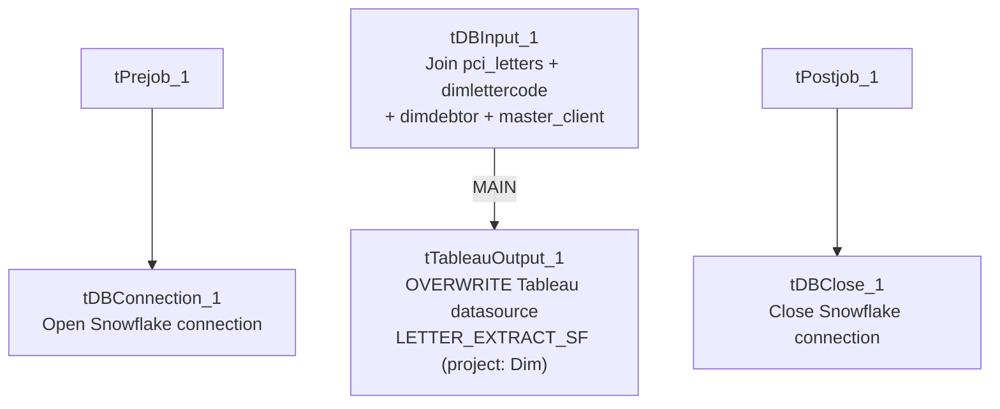

# Talend Job: Extract_Letter_Count

## Overview

Computes a per-print-date, per-client letter/email/text communication summary — joining PCI letter records, letter-code-to-collection-type mappings, debtor and client dimension tables — and publishes the result directly to a Tableau Server datasource named `LETTER_EXTRACT_SF` (no intermediate CSV file). It classifies each letter as "Letter," "Email," or "Text" based on the letter code prefix, and reclassifies late "Validation" letters (sent more than 10 days after the batch date) as "Validation on Contact."

## Detail table

| Field | Value |
|---|---|
| Job name | Extract_Letter_Count |
| Version | 0.1 |
| Project | EDW2SF |
| Author | jmach@harriscollect.com |
| Created | 2022-01-10T14:56:48.226-0800 |
| Last Modified | 2025-09-24T11:00:59.061-0700 |

## Step-by-step data flow

**Setup subjob:** `tPrejob_1` → `tDBConnection_1` opens the Snowflake connection.

**Main subjob:**

1. `tDBInput_1` runs a multi-join query: `edwprodhh.dw.pci_letters` (letter print date, raw letter code, mail disposition) left-joined to a distinct `edwprodhh.dw.dimlettercode` lookup (excluding the `HHPIFS` code and `CLOSED` collection type) to classify collection type, then left-joined to `edwprodhh.dw.dimdebtor` (for batch/assignment date and client), then left-joined to `edwprodhh.pub_jchang.master_client` (for industry, party, `PL_GROUP`). It computes `LETTERS_SENT` (1 if the mail disposition contains "included" or "mailed"), `COLLECTION_TYPE_CLEAN` (reclassifies late Validation letters), and `COMMUNICATION_TYPE` (Text/Email/Letter based on the letter code prefix).
2. `tTableauOutput_1` writes the result directly to a Tableau Server datasource — `serverUrl=http://mp-tab-v01`, project `Dim`, datasource name `LETTER_EXTRACT_SF`, output action `OVERWRITE`.

**Teardown subjob:** `tPostjob_1` → `tDBClose_1` closes the Snowflake connection.

## Settings tables

### Source: `tDBInput_1` (`tSnowflakeInput`)

| Setting | Value | What it means |
|---|---|---|
| Query (summarized) | Joins `pci_letters` → `dimlettercode` (excludes `HHPIFS`/`CLOSED`) → `dimdebtor` → `pub_jchang.master_client`; derives `LETTERS_SENT` flag, `COLLECTION_TYPE_CLEAN`, `COMMUNICATION_TYPE` | A denormalized, business-logic-bearing extract rather than a plain table dump — the classification logic (late-Validation reclassification, letter-code-prefix-based channel typing) lives entirely in this SQL, not in Talend components. |
| Source schema note | Joins against `pub_jchang.master_client` | Same individually-owned-looking schema (`pub_jchang`) flagged in `01_system_architecture.md` and used by `Equibli_Extract` — this job also depends on it. |

### Target: `tTableauOutput_1` (`TableauOutput`)

| Setting | Value | What it means |
|---|---|---|
| serverUrl | `http://mp-tab-v01` | Matches the `TableauVariables_0.1` context group's `tabServer` value seen in `_shared_context.json`, though here it's hardcoded directly on the component rather than via `context.tabServer`. |
| Auth / password | `***REDACTED***` | Preserved as redacted. |
| projectName / dataSourceName | `Dim` / `LETTER_EXTRACT_SF` | Publishes into the "Dim" Tableau project as a datasource named `LETTER_EXTRACT_SF` — matches the `tabFile`/`tabName` naming convention in `TableauVariables_0.1` (`LETTERS_EXTRACT_SF`), though pluralization differs slightly (`LETTER_` vs `LETTERS_`). |
| outputAction | `OVERWRITE` | Each run fully replaces the datasource's prior contents — no incremental append. |

## Dependencies & configuration

- **Triggers/depends on other jobs:** none — no `tRunJob` links found.
- **Context variables used:** none — all connection and Tableau publishing details in this job are hardcoded directly on the components rather than via `context.*` variables, unlike `Extract_DDNPII`'s equivalent Tableau-publish flow which is fully context-driven.
- No hardcoded developer-workstation paths found in this job's own components (the Tableau server URL is hardcoded but is not a filesystem path).

## Glossary

| Component type | Plain-English meaning |
|---|---|
| `tSnowflakeConnection` / `tSnowflakeClose` | Open/close the Snowflake connection used by the query. |
| `tSnowflakeInput` | Runs a query against Snowflake and returns its result rows. |
| `TableauOutput` | Publishes a Talend data flow directly to a Tableau Server datasource (via Tableau's Hyper API), without an intermediate file — a different mechanism from `Extract_Letter_Count_to_Hyper`'s local-file-then-separate-publish approach. |

## Issues observed

- **This job hardcodes its Tableau server URL and connection details directly on `tTableauOutput_1`, rather than via the project's existing `TableauVariables_0.1` context group** (which supplies `tabServer`, `tabUser`, `tabPass`, etc. and is used by 3 jobs per `06_dependency_matrix.md`). This means changing the Tableau server address in the future would require editing this job directly rather than updating a shared context value — an inconsistency worth flagging alongside the project's other context-vs-hardcoded patterns.
- **`outputAction=OVERWRITE` means every run fully replaces the `LETTER_EXTRACT_SF` datasource** — there is no incremental/append mode and no validation step confirming the new data looks reasonable before overwriting; a bad run (e.g., a broken join producing zero or garbage rows) would silently replace good data with bad in the Tableau-facing datasource, with no `tWarn`/`tDie` safety net in this job.
- **This job's business logic (the letter-code-prefix channel classification and the 10-day late-Validation reclassification) is significant and lives entirely inside the SQL query text**, not in any Talend component that would be visible in a canvas review — anyone auditing this job's logic needs to read the full query text, not just the component diagram.
- **This job and `Extract_Letter_Count_to_Hyper` cover overlapping ground (both summarize letter counts) but are not the same job** — they use different source-table joins, different derived columns, and different publishing mechanisms (direct Tableau publish here vs. a local Hyper file build there). See that job's own doc for its specific differences; unable to determine from metadata whether both are still actively used or one has superseded the other.
