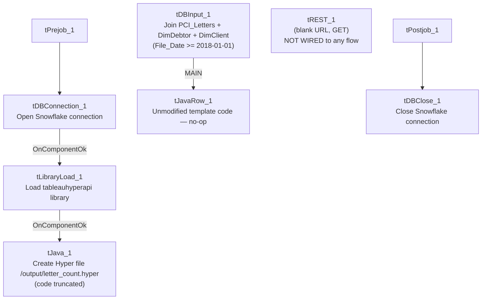

# Talend Job: Extract_Letter_Count_to_Hyper

## Overview

Computes a per-file-date, per-client letter-count summary (grouped by logon, `PL_GROUP`, account groups, and vendor) from PCI letter, debtor, and client tables, then builds a local Tableau Hyper extract file (`/output/letter_count.hyper`) using the Tableau Hyper API directly from custom Java code, rather than publishing straight to Tableau Server as `Extract_Letter_Count` does. It covers similar business ground to `Extract_Letter_Count` (letter counts) but is a structurally different job with a different query, different derived columns, and a different publishing mechanism — not a duplicate.

## Detail table

| Field | Value |
|---|---|
| Job name | Extract_Letter_Count_to_Hyper |
| Version | 0.1 |
| Project | EDW2SF |
| Author | jmach@harriscollect.com |
| Created | 2022-01-17T16:26:52.111-0800 |
| Last Modified | 2025-09-24T10:59:50.035-0700 |

## Step-by-step data flow

**Setup subjob:** `tPrejob_1` → `tDBConnection_1` opens the Snowflake connection → on success, `tLibraryLoad_1` loads the `tableauhyperapi` Java library (version `6.0.0-SNAPSHOT`) → on success, `tJava_1` builds a Tableau Hyper file (code truncated in this metadata, but visibly creates a `HyperProcess`/`Connection` and begins defining a `TableDefinition` named `"Letters"` at `/output/letter_count.hyper`).

**Main subjob:**

1. `tDBInput_1` runs a query joining `PCI_Letters`, `DimDebtor`, and `DimClient` (filtered to `File_Date BETWEEN '2018-01-01' AND CURRENT_DATE` — a hardcoded lower bound), computing a vendor classification (`PCI` / `RevSpring` / `Other` based on filename prefix) and a `"Letters Sent Flag"` (0 for letters whose code starts with `e` — an email code — or based on mail-disposition text), then aggregates with `COUNT(Customer_Key)` grouped by file date, logon, `PL_GROUP`, account groups, vendor, letter code, and the sent flag.
2. `tJavaRow_1` receives each row but its code is an unmodified Talend placeholder/template (`// code sample: ... output_row.id = input_row.id * 2;`) — meaning **no actual transformation happens here**; rows pass through unchanged. See Issues observed.

There is also an orphaned `tREST_1` component (a generic REST call with a blank URL) that appears in the component list but has **no connections to or from any other component** — it is not part of the executing flow at all.

**Teardown subjob:** `tPostjob_1` → `tDBClose_1` closes the Snowflake connection.

## Settings tables

### Source: `tDBInput_1` (`tSnowflakeInput`)

| Setting | Value | What it means |
|---|---|---|
| Query (summarized) | Joins `PCI_Letters` → `DimDebtor` → `DimClient`, filtered `File_Date BETWEEN '2018-01-01' AND CURRENT_DATE`; derives `Vendor` (PCI/RevSpring/Other by filename prefix) and `"Letters Sent Flag"`; aggregated with `COUNT(Customer_Key)` | The `2018-01-01` lower bound is a hardcoded literal in the SQL text, not a `context` variable — every run always starts from that fixed historical date, growing the scanned range indefinitely as `CURRENT_DATE` advances. |

### Hyper file build: `tLibraryLoad_1` / `tJava_1`

| Setting | Value | What it means |
|---|---|---|
| LIBRARY | `"mvn:org.talend.libraries/tableauhyperapi/6.0.0-SNAPSHOT/jar"` | Loads a **SNAPSHOT** (pre-release/unstable) version of the Tableau Hyper API library — see Issues observed. |
| Hyper file path | `/output/letter_count.hyper` (from the truncated `tJava_1` code) | A container/server-relative path, not `context`-driven. |

### Passthrough: `tJavaRow_1`

| Setting | Value | What it means |
|---|---|---|
| CODE | Unmodified Talend placeholder comment (`// code sample: ... output_row.id = input_row.id * 2;`) | This component does nothing — it's wired into the flow but never had its generated code replaced with real logic. Rows pass through as-is only because Talend's default `tJavaRow` behavior copies matching input/output columns unchanged when no code overrides them. |

## Dependencies & configuration

- **Triggers/depends on other jobs:** none — no `tRunJob` links found.
- **Context variables used:** none — this job uses no `context.*` variables anywhere; the Hyper file path, the SQL date bound, and the library version are all hardcoded literals.
- No entries in `hardcoded_path_findings` (the `/output/...` path isn't the commonly-flagged `C:/Talend-Studio-...` pattern), but `/output/letter_count.hyper` is still a fixed, non-context-driven path.

## Glossary

| Component type | Plain-English meaning |
|---|---|
| `tSnowflakeConnection` / `tSnowflakeClose` | Open/close the Snowflake connection used by the query. |
| `tLibraryLoad` | Loads an external Java library (here, Tableau's Hyper API) into the running job so custom Java code can use its classes. |
| `tJava` | Runs custom Java code — here used to build a Tableau `.hyper` file directly via the Hyper API, rather than through a dedicated Talend Tableau connector. |
| `tJavaRow` | Runs custom Java code once per input row — here left as the unedited template, so it acts as a no-op passthrough. |
| `tREST` | Makes an HTTP REST call. In this job, present but not connected to anything. |

## Issues observed

- **`tJavaRow_1`'s code was never replaced from Talend's default placeholder** (`// code sample: ... output_row.id = input_row.id * 2;`). It is wired into the main data flow between the aggregation query and (presumably, though the connection to `tJava_1`'s Hyper-writing logic is not captured as a normal component-to-component `FLOW` link in this metadata) the Hyper file build. Because it currently does nothing but pass rows through, this is very likely intended to eventually contain custom logic (e.g., writing each row into the open Hyper table) that was never finished — verify directly in Talend Studio whether this component is fully wired to the Hyper-writing code or effectively dead.
- **`tREST_1` exists in this job's component list but has zero connections to or from any other component** — it's a completely orphaned, unused component with a blank URL. It has no effect on the job's execution but is dead clutter that could confuse anyone reviewing the job.
- **`tLibraryLoad_1` loads a SNAPSHOT (pre-release) version of the Tableau Hyper API** (`tableauhyperapi/6.0.0-SNAPSHOT`) rather than a stable release — SNAPSHOT artifacts can change or disappear from a Maven repository without notice, which is a build-stability risk if this job is ever rebuilt/redeployed from scratch.
- **The query's `File_Date BETWEEN '2018-01-01' AND CURRENT_DATE` lower bound is a hardcoded literal**, not `context`-driven — as time passes, this job scans an ever-growing multi-year date range with no incremental/windowing logic, which could make it progressively slower.
- **This job and `Extract_Letter_Count` both summarize letter data but are not duplicates** — different source joins, different derived columns and grouping, and a fundamentally different Tableau-publishing mechanism (custom Hyper-file build here vs. `TableauOutput` component there). Unable to determine from metadata whether both are still actively scheduled or whether this one (given its apparent unfinished `tJavaRow_1` logic) is a superseded/abandoned attempt — verify with the team.
- **No error/row-count logging or reject handling** — no `tWarn`/`tDie`/`tSendMail`; a failed extract or an incomplete Hyper file write would only surface as a generic Talend execution error.
