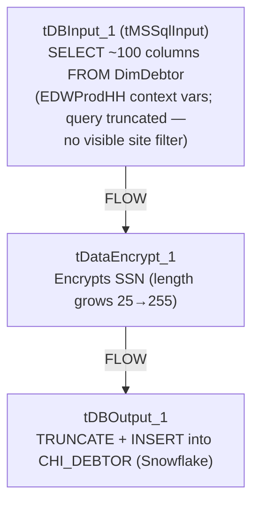

# Talend Job: Extract_MSSQL_COCHI_Debtor

## Overview

Extracts the full `DimDebtor` table (roughly 100 columns — name, address, phone, balance/collection amounts, judgment, bankruptcy, tax-window fields, letter history, etc.) from the MSSQL `EDWProdHH` database, encrypts one field along the way, and loads the result into a Snowflake table named `CHI_DEBTOR` (truncate-and-insert). Despite the job's name suggesting it covers both the CO **and** CHI sites ("COCHI"), the only destination table this job writes to is `CHI_DEBTOR` — see Issues observed for what this implies.

## Detail table

| Field | Value |
|---|---|
| Job name | Extract_MSSQL_COCHI_Debtor |
| Version | 0.1 |
| Project | EDW2SF |
| Author | jmach@harriscollect.com |
| Created | 2024-07-12T09:03:42.280-0700 |
| Last Modified | 2025-09-24T11:08:03.845-0700 |

## Step-by-step data flow

This job has **no `tPrejob`/`tPostjob` and no explicit connection-open/close components** for either side — unusual for this project (compare `i3_CallDetail_40_Load`, which explicitly opens/closes both its MSSQL and Snowflake connections). It is a single three-component flow:

1. `tDBInput_1` (`tMSSqlInput`) connects directly to MSSQL using `context.EDWProdHH_Server`/`Port`/`Schema`/`Database`/`Login` (password redacted, `USE_EXISTING_CONNECTION=false`) and reads the `DimDebtor` table via a query selecting ~100 named columns (`DebtorNumber`, `LOGON`, `DimLogon`, `DimClient`, `DEBTOR_IDX`, name/address/phone fields, balance and collection amount fields, `SSN`, judgment/bankruptcy fields, letter history, `InsertKey`/`UpdateKey`, etc.) — **the query text is truncated in this metadata** after `CAST([TOTAL-BAL] AS NUMERI...`, so any `WHERE` clause (e.g., a site filter) is not visible.
2. `tDataEncrypt_1` (FLOW) encrypts the row — the `SSN` column's declared length grows from 25 characters (source) to 255 characters (post-encrypt), a strong signal that `SSN` specifically is the field being encrypted, though the exact column(s) targeted by the encryption aren't separately itemized in this metadata.
3. `tDBOutput_1` (`tSnowflakeOutput`) writes the encrypted rows into `CHI_DEBTOR`, truncating the table first (`tableAction=TRUNCATE`) then inserting.

## Settings tables

### Source: `tDBInput_1` (`tMSSqlInput`)

| Setting | Value | What it means |
|---|---|---|
| HOST / PORT / SCHEMA / DBNAME / USER | `context.EDWProdHH_Server` / `Port` / `Schema` / `Database` / `Login` | Standard `EDWProdHH_*` context variables, matching the `EDWProdHH_0.1` context group documented in `_shared_context.json`/`06_dependency_matrix.md`. |
| DRIVER | `JTDS` | A specific JDBC driver choice for MSSQL. |
| TABLE | `"DimDebtor"` | Source table name (also set, redundantly, alongside a custom `QUERY`). |
| QUERY | ~100-column `SELECT` from `DimDebtor`, truncated after `CAST([TOTAL-BAL] AS NUMERI...` | The visible portion shows no `WHERE` clause — unable to confirm from metadata whether the query filters to CO/CHI logons specifically, or pulls the entire `DimDebtor` table regardless of site. See Issues observed. |
| PASS | `***REDACTED***` | Preserved as redacted. |

### Encrypt: `tDataEncrypt_1`

| Setting | Value | What it means |
|---|---|---|
| SECRET_TYPE / SECRET_KEY / PASSWORD_M1 | `***REDACTED***` | Encryption credentials, preserved as redacted. |
| CRYPTO_METHOD | `AES` | Symmetric encryption algorithm. |
| CRYPTO_FILE_PATH | `context.cryptoPath` | Same context variable name used by the `Encrypt_*` jobs in this batch. |
| Schema change | `SSN` grows from length 25 to 255 across this component | Indirect evidence that `SSN` is the encrypted field — its ciphertext representation needs far more room than the plaintext 9-digit SSN. No other column's declared length changes across this component. |

### Target: `tDBOutput_1` (`tSnowflakeOutput`)

| Setting | Value | What it means |
|---|---|---|
| Table | `CHI_DEBTOR` | The only destination table in this job — see Issues observed regarding the "COCHI" job name. |
| Table action | `TRUNCATE` | Table is emptied (not dropped/recreated) before the new rows are inserted — a brief empty-table window exists mid-run. |
| Output action | `INSERT` | Appends the newly loaded rows after the truncate. |

## Dependencies & configuration

- **Triggers/depends on other jobs:** none — no `tRunJob` links found.
- **Context variables used:** `EDWProdHH_Database`, `EDWProdHH_Login`, `EDWProdHH_Port`, `EDWProdHH_Schema`, `EDWProdHH_Server`, `cryptoPath`.
- No hardcoded developer-workstation paths found in this job's own components.

## Glossary

| Component type | Plain-English meaning |
|---|---|
| `tMSSqlInput` | Runs a query against a Microsoft SQL Server database and returns its result rows — here configured with its own inline connection settings rather than a shared, separately-opened connection component. |
| `tDataEncrypt` | Encrypts row/column data using a password and crypto-file-based algorithm. |
| `tSnowflakeOutput` | Writes rows to a Snowflake table, here after truncating it. |

## Issues observed

- **The job name "COCHI" implies coverage of both the CO and CHI sites, but the only destination table this job writes to is `CHI_DEBTOR` — there is no `CO_DEBTOR` or similarly-named CO output anywhere in this job's metadata.** Combined with the truncated `QUERY` text showing no visible site-filtering `WHERE` clause, there are two plausible explanations that cannot be distinguished from this metadata alone: (1) the query does filter to CO+CHI logons somewhere in its truncated portion, and both sites' debtors are being loaded into a single, oddly-named `CHI_DEBTOR` table (in which case the table name itself is misleading), or (2) the query pulls the entire `DimDebtor` table unfiltered, and the job name is aspirational/stale relative to what it currently does. **This should be verified directly in Talend Studio before assuming either site's debtor data is complete or correctly scoped.**
- **No `tPrejob`/`tPostjob` and no explicit `tMSSqlClose`/`tSnowflakeClose`** — every other job in this batch that touches a database explicitly opens and closes its connection(s); this job's `tMSSqlInput` and `tSnowflakeOutput` components appear to manage their own connections inline with no visible explicit close step, which is atypical for this project's usual pattern (compare `i3_CallDetail_40_Load`). Unable to determine from metadata whether this is intentional (each component closing its own connection implicitly) or an incomplete job design.
- **The source `QUERY` text is truncated in this metadata**, cutting off after `CAST([TOTAL-BAL] AS NUMERI...` — the full `SELECT` list, and critically any `WHERE` clause, cannot be confirmed from the data provided. This directly bears on the "COCHI" naming question above; verify the full query text in Talend Studio.
- **No reject-row handling wired** — `tDBOutput_1`'s schema includes the standard Snowflake-output reject/error columns (`columnName`, `errorMessage`, `sqlState`, etc.), but there is no visible connection routing rejected rows anywhere; a malformed row would either fail the whole load or be silently dropped, consistent with the unwired-reject-flow pattern seen in `ADP_Payroll_Load`.
- **No error/row-count logging** — no `tWarn`/`tDie`/`tSendMail`; a failed or incomplete load would only surface as a generic Talend execution error.
