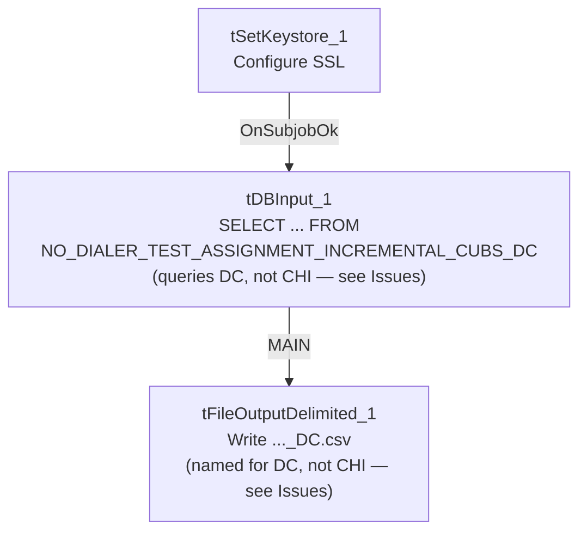

# Talend Job: Extract_No_Dialer_Test_CHI

## Overview

This job is named for the CHI site, but **its query and output filename both actually reference DC, not CHI** — it reads `NO_DIALER_TEST_ASSIGNMENT_INCREMENTAL_CUBS_DC` and writes a file named `..._DC.csv`. Based on this batch's sibling job `Extract_No_Dialer_Test_DC` (whose query and filename both reference CHI instead), the CHI- and DC-named jobs appear to have had their site-specific internals swapped, most likely during a copy-paste when one was cloned from the other. See Issues observed — this is a concrete, verifiable naming/data mismatch, not a stylistic quibble.

## Detail table

| Field | Value |
|---|---|
| Job name | Extract_No_Dialer_Test_CHI |
| Version | 0.1 |
| Project | EDW2SF |
| Author | jmach@harriscollect.com |
| Created | 2022-09-07T15:48:45.118-0700 |
| Last Modified | 2025-11-19T07:57:37.951-0800 |

## Step-by-step data flow

This job has no `tPrejob`/`tPostjob` and no explicit `tSnowflakeConnection`/`tSnowflakeClose` — just two steps gated by an SSL setup:

1. `tSetKeystore_1` configures SSL trust/keystore from `context.keystorePath` (passwords redacted).
2. On success (`OnSubjobOk`), `tDBInput_1` runs `SELECT LOGON, DEBTORNUMBER, TEST_NO_DIALER FROM NO_DIALER_TEST_ASSIGNMENT_INCREMENTAL_CUBS_DC;` — **querying the DC table, not a CHI one**.
3. `tFileOutputDelimited_1` writes the result to `context.outputDir + "NO_DIALER_TEST_ASSIGNMENT_INCREMENTAL_CUBS_" + <CCYYMMDD> + "_DC.csv"` — **also named for DC**.

## Settings tables

### Source: `tDBInput_1` (`tSnowflakeInput`)

| Setting | Value | What it means |
|---|---|---|
| Query | `SELECT LOGON, DEBTORNUMBER, TEST_NO_DIALER FROM NO_DIALER_TEST_ASSIGNMENT_INCREMENTAL_CUBS_DC;` | This job, named `Extract_No_Dialer_Test_CHI`, actually reads the **DC**-suffixed table. |

### Target: `tFileOutputDelimited_1`

| Setting | Value | What it means |
|---|---|---|
| FILENAME | `context.outputDir + "NO_DIALER_TEST_ASSIGNMENT_INCREMENTAL_CUBS_"+TalendDate.getDate("CCYYMMDD")+"_DC.csv"` | Also suffixed `_DC`, matching the query's actual (DC) scope, but not the job's own CHI-suggesting name. |

### SSL setup: `tSetKeystore_1`

| Setting | Value | What it means |
|---|---|---|
| SSL_TRUSTSERVER_TRUSTSTORE | `"C:/clientTrustStore.trustStore"` | Hardcoded local path, same as the `*_Hermes_Decile` family — see Issues observed. |
| SSL_KEYSTORE | `context.keystorePath` | Client keystore path is context-driven. |
| SSL_TRUSTSERVER_PASSWORD / SSL_KEYSTORE_PASSWORD / NEED_CLIENT_AUTH | `***REDACTED***` | Preserved as redacted. |

## Dependencies & configuration

- **Triggers/depends on other jobs:** none — no `tRunJob` links found.
- **Context variables used:** `keystorePath`, `outputDir`.
- **1 hardcoded path finding:** `tSetKeystore_1.SSL_TRUSTSERVER_TRUSTSTORE` = `"C:/clientTrustStore.trustStore"`.

## Glossary

| Component type | Plain-English meaning |
|---|---|
| `tSetKeystore` | Configures SSL/TLS trust and client keystore settings for the Snowflake connection used later in the job. |
| `tSnowflakeInput` | Runs a query against Snowflake and returns its result rows. |
| `tFileOutputDelimited` | Writes rows to a delimited (CSV-style) text file. |

## Issues observed

- **This is a confirmed site-code swap bug, not a naming quibble.** `Extract_No_Dialer_Test_CHI`'s query reads `NO_DIALER_TEST_ASSIGNMENT_INCREMENTAL_CUBS_DC` and its output file is named `..._DC.csv` — both internals point to DC. Its sibling job `Extract_No_Dialer_Test_DC` has the mirror-image problem: its query reads `..._CHI` and its output is named `..._CHI.csv`. The third sibling, `Extract_No_Dialer_Test_CO`, is internally consistent (queries and outputs `..._CO`). **The practical effect: whatever process runs "the CHI no-dialer-test extract" today is actually extracting and delivering DC's no-dialer-test assignment data, and vice versa for the job named "DC."** If any downstream consumer (a person, a file drop location, or another system) expects CHI-specific data from the job labeled `Extract_No_Dialer_Test_CHI`, they have been receiving DC's data instead — this should be escalated and confirmed with the team immediately, since it directly affects which site's debtors get excluded from dialer campaigns based on this test-assignment data.
- **`SSL_TRUSTSERVER_TRUSTSTORE` is a hardcoded local path**, consistent with the same setting across the `*_Hermes_Decile` family.
- **No `tPrejob`/`tPostjob`, no explicit Snowflake connection-open/close component, and no error/row-count logging** — same minimal-scaffolding pattern as `Equibli_Extract`; a failure would only surface as a generic Talend execution error.
